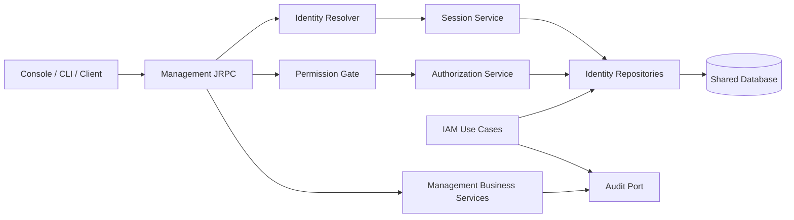

# VeloTrust IAM 身份与访问管理模块设计

- 文档版本：V1.0
- 状态：设计基线
- 参考：[VeloTrust 数据模型设计文档（最终版）](VeloTrust_数据模型设计文档_最终版.md)
- 适用范围：Management 用户身份、认证、会话、后台 RBAC 与审计

## 1. 目标与设计决策

IAM 为 Management 和后续客户端用户认证提供统一的内部用户身份、认证会话与管理权限服务。管理员和普通员工共用内部用户模型；认证回答“是谁”，管理 RBAC 回答“能否执行这项控制面操作”，ZTNA 策略独立回答“能否访问某项网络资源”。

本设计遵循以下决定：

1. **IAM 是 Management 的领域模块。** Management 保留服务入口和数据所有权，IAM 通过 Repository 与事务接口访问数据库；不让 JRPC、HTTP Handler 或其他业务模块直接拼接 IAM SQL。
2. **Management 使用当前 JRPC 传输。** 登录、会话和管理操作由 `POST /jrpc` 承载；HUB 的 gRPC 节点控制通道有独立的节点认证，不复用用户会话。
3. **认证采用服务端可撤销会话。** 客户端持有高熵不透明令牌；数据库只保存令牌摘要。每次受保护请求都要解析有效会话和有效用户，数据库或身份状态不可验证时拒绝请求。
4. **RBAC 采用资源操作权限。** 角色授予 `iam.user.read` 等稳定权限编码，JRPC 方法在代码中映射到所需权限。缺少方法映射、资源、权限或有效角色时一律拒绝。
5. **JRPC 方法映射首期以代码为准。** `t_iam_rpc_method` 暂不作为运行时动态授权来源；启动时核对所有已注册方法都具有明确的 `public`、`authenticated` 或 `permission` 声明。
6. **用户群组不自动继承后台角色。** 群组供组织目录和 ZTNA 策略主体使用；如未来要支持按群组赋予后台角色，须增加明确的数据关系和审计语义。
7. **身份认证与设备身份分开。** 用户登录凭证不能替代 `t_ztna_device_credential`；用户与设备在 ZTNA 授权时关联，但两者各自撤销、轮换和审计。
8. **Passkey 是首期用户登录方式之一。** Management Web 支持 WebAuthn 注册与登录；服务器仅保存 credential ID 和公钥，不接触认证器私钥。Passkey 不能替代 Agent/Gateway 节点认证。

## 2. 领域边界

### 2.1 IAM 负责

- 内部用户创建、资料和状态管理；本地密码与 WebAuthn Passkey 登录；TOTP/MFA；外部身份到内部用户的映射。
- 用户会话签发、续期、退出、撤销和过期验证。
- 管理角色、资源、权限、角色授权及当前用户可用权限查询。
- 管理接口鉴权策略注册、权限检查和身份/授权相关审计。
- 认证失败限速、账户状态检查和安全错误归一化。

### 2.2 IAM 不负责

- Gateway/Client Agent 节点注册凭证、WireGuard 公钥绑定和节点会话。这些属于设备准入与 HUB 控制通道。
- 受保护网络资源的最终访问策略、Peer AllowedIPs、ACL、路由与 DNS 下发。这些属于 ZTNA Policy、Tunnel 和 Network 模块。
- 前端菜单渲染本身。IAM 可提供菜单视图数据，但菜单显示不能成为后端授权依据。
- 对外部 IdP 身份声明的直接信任或自动授予管理员权限。外部身份只映射到内部用户，权限由 VeloTrust 的本地角色和策略决定。

## 3. 模块结构与依赖

```text
management/internal/identity/
├── domain/                 # 用户、角色、会话、权限值对象与状态规则
├── application/            # 登录、会话、用户、角色授权、权限检查用例
├── authn/
│   ├── password/           # 本地密码哈希与验证
│   ├── webauthn/            # Passkey 注册、断言验证和凭证撤销
│   ├── totp/               # TOTP、恢复码和认证挑战（启用 MFA 后）
│   └── external/            # OIDC/SAML/目录适配器（后续阶段）
├── authorization/          # 方法策略目录与 RBAC 决策
├── ports.go                # Repository、事务、限速和密钥服务接口
└── errors.go               # 稳定的领域错误码

management/internal/transport/jrpc/
├── server.go               # 传输及 JRPC 服务注册
├── auth.go                 # Bearer 凭证解析为 IAM Principal
└── authorization.go        # 按 JRPC 方法声明执行默认拒绝的权限门

management/internal/store/iam/
├── user_repository.go      # IAM Repository 的数据库实现
├── session_repository.go
├── rbac_repository.go
└── transaction.go
```

`identity/application` 依赖 IAM 自身定义的接口，不依赖具体 SQL/ORM。`store/iam` 实现这些接口；`transport/jrpc` 只负责提取请求凭证、调用身份解析和权限门，不承载密码、会话或 RBAC 业务规则。公共 JRPC 协议包保持通用，不直接导入 `management/internal/identity`。

首期模块依赖方向：



## 4. 数据模型映射与补充项

### 4.1 表所有权

| IAM 能力 | 数据模型 | 说明 |
|---|---|---|
| 内部账号 | `t_iam_user`、`t_iam_user_profile` | 管理员与员工共用用户主体 |
| 群组 | `t_iam_group`、`t_iam_user_group` | 由 `management/internal/group` 管理；IAM 读取身份关联，不把群组当管理角色 |
| 管理 RBAC | `t_iam_role`、`t_iam_user_role`、`t_iam_resource`、`t_iam_permission`、`t_iam_role_permission` | IAM 负责授权语义、约束和查询 |
| 控制台导航 | `t_iam_menu`、`t_iam_role_menu` | 仅用于菜单过滤；不用于接口授权 |
| 用户认证与会话 | `t_iam_user_session`、`t_iam_auth_challenge`、`t_iam_user_authenticator`、`t_iam_webauthn_credential` | Passkey 公钥凭证独立于 TOTP 密钥；会话和挑战由 IAM 管理 |
| 外部身份 | `t_iam_identity_provider`、`t_iam_external_identity`、可选组织/同步表 | 后续阶段启用 |
| 安全记录 | `t_iam_login_log`、`t_iam_audit_log` | 追加写，不提供普通更新/删除接口 |

`t_iam_rpc_method` 的数据模型说明允许静态代码映射。首期使用代码中的方法策略目录作为权威来源，降低数据库映射与代码部署版本不一致的风险；后台可由该目录生成只读接口清单。后续若改成数据库可配置映射，必须有版本、变更审计、启动校验和缓存失效机制，不能让未匹配方法因缺少记录而开放。

### 4.2 IAM 初始 schema 的专项补充

Passkey 的用户 handle、挑战绑定字段、凭证表和登录类型已经纳入数据模型及 PostgreSQL 初始 schema。初始 SQL 还包含下列 IAM 运行所需的补充项；正式版本必须将其纳入版本化迁移并保留约束：

- `t_iam_user.password_hash_version`（或等价算法/参数版本字段）。`password_salt` 保存每个用户独立的随机盐，`password_hash` 保存派生结果；哈希参数由版本映射，便于升级时在成功登录后重算。
- 共享认证限速记录 `t_iam_auth_throttle`：按用户名 HMAC 摘要和来源 IP 窗口记录失败次数及阻断到期时间，使多 Management 实例共享限速状态。只查 `t_iam_login_log` 不具备原子限速语义；按限速维度和窗口建立唯一约束。
- `t_iam_user_session.token_hash` 的唯一索引和摘要算法。`created_at` 表示会话绝对年龄起点，不能在令牌轮换时重置。
- 为角色、权限、资源、菜单和映射确定一致的“停用/软删”查询规则，并为会话、登录日志和审计日志配置保留期限。

本地密码采用 Argon2id，参数不得低于 OWASP Password Storage Cheat Sheet 列出的基线 `m=19 MiB, t=2, p=1`；部署时还需在目标硬件上压测并设置并发上限，防止并发哈希耗尽内存。参数选择和实现应参照 [OWASP 密码存储指南](https://cheatsheetseries.owasp.org/cheatsheets/Password_Storage_Cheat_Sheet.html) 与 [RFC 9106](https://www.rfc-editor.org/rfc/rfc9106)。

## 5. 认证与会话流程

### 5.1 密码登录

1. 客户端调用公开的 `IAM_Login`，提交规范化用户名、密码及可选 MFA 响应。请求通过 TLS；JRPC 请求体、错误日志和追踪数据不得包含密码或 OTP。
2. IAM 对用户名与来源 IP 执行共享限速。不存在的用户名也执行相近成本的密码验证，避免通过响应差异枚举用户。
3. 查询用户后统一检查 `user_status=active`、密码版本及账号 MFA 要求。密码错误、用户不存在、账户停用对外返回同类登录失败信息；内部日志使用稳定原因码。
4. 对启用 TOTP 的账号，校验 RFC 6238 验证码并原子消费匹配的时间步；TOTP 未通过前不得签发会话。Passkey 登录要求 WebAuthn 用户验证。当前没有部署级强制 MFA 策略。
5. 在一个事务中创建会话、记录成功登录事件并清除/更新限速状态。只向客户端返回一次原始不透明令牌和过期时间。
6. MFA 首次绑定必须经过验证后才变为 active。bootstrap 和管理员创建的临时密码账号均要求首次改密；强制改密期间只允许改密或退出。部署策略启用管理员强制 MFA 后，bootstrap 与登录流程还需完成 MFA 注册。

登录响应不区分用户名不存在、密码错误、停用账号或锁定账号。密码变更、用户停用、角色撤销、MFA 重置等操作需撤销现存会话或要求重新认证。登录限速、通用错误和 MFA 原则参考 [OWASP Authentication Cheat Sheet](https://cheatsheetseries.owasp.org/cheatsheets/Authentication_Cheat_Sheet.html)。

### 5.2 Passkey 注册与登录

Management 控制台通过浏览器 WebAuthn API 执行 Passkey 仪式。生产环境要求 HTTPS；每个部署显式配置稳定的 RP ID 和 origin allowlist，不从未受信任的 `Host` 或转发头动态推导。浏览器源必须精确匹配 allowlist，RP ID 必须满足 WebAuthn 对当前 origin 的域名范围规则。WebAuthn 的凭证按 RP ID 作用域隔离，具备验证方名称绑定；因此不能随意更换控制台域名后期待原凭证继续有效。[W3C WebAuthn Level 3](https://www.w3.org/TR/webauthn-3/) 定义了凭证创建、断言和 RP ID 作用域。

注册流程：

1. 已认证用户调用 `IAM_BeginPasskeyRegistration`；高权限账户的注册或替换要求近期完成 MFA/重新认证。
2. 服务端生成不可预测的挑战，保存挑战摘要、短有效期、一次性状态、预期 `rp_id` 和 origin；挑战内容仅通过注册选项返回。
3. 浏览器完成认证器注册并提交结果；服务端验证挑战、origin、RP ID hash、客户端数据类型和用户验证要求，校验通过后消费挑战。
4. 服务端为用户生成或复用一个随机、不透明且不超过 64 字节的 `webauthn_user_handle`，然后保存 credential ID、COSE 公钥、AAGUID、transports、签名计数器初值及备份状态。
5. 对同一用户允许注册多个 Passkey；凭证 ID 在同一 RP ID 下唯一。管理界面展示凭证名称、创建时间、最近使用时间和状态，支持用户撤销丢失的凭证。

登录流程支持两种入口：用户名优先时按账户列出已注册 credential ID；无用户名的 discoverable credential 流程通过 `userHandle` 查找用户。服务端生成新的短期挑战，验证返回的 credential ID、公钥签名、challenge、origin、RP ID hash、用户存在标志和用户验证标志；管理员策略要求 `userVerification=required` 并拒绝缺少 UV 标志的断言。验证成功后原子消费挑战、更新凭证最近使用/计数状态、创建服务端用户会话并写入 `login_type=passkey` 的登录事件。

挑战必须限时、限次、一次性消费并防重放；重复、过期或状态未知均拒绝。签名计数器用于克隆凭证风险检测，但不能对始终返回 0 的认证器或同步型 Passkey 一律拒绝；当已记录和新返回的计数器均非零但未递增时，按风险策略拒绝或要求二次验证，并记录安全事件。`backup_eligible` / `backup_state` 用于识别可同步凭证状态，不能据此宣称凭证是设备绑定密钥。

Passkey 是 VeloTrust 用户认证凭证，不是设备合规证明。用户完成 Passkey 登录后仍需通过角色权限和独立的 ZTNA 用户/设备/资源策略判断。Passkey 私钥由认证器或 Passkey 提供方保管；服务端只存验证所需的公钥材料。WebAuthn 的 phishing resistance 来自验证方名称绑定，具体等级和同步凭证的风险仍取决于认证器及部署策略。[NIST SP 800-63B-4](https://pages.nist.gov/800-63-4/sp800-63b.html?locale=en) 将 WebAuthn 作为具备验证方名称绑定的抗钓鱼示例。

**客户端边界：**浏览器控制台直接使用 WebAuthn。CLI/原生客户端不得读取或导出 Passkey 私钥，也不应自行仿造浏览器 WebAuthn 协议；需要用户登录时应启动系统浏览器完成授权，再通过短期、绑定客户端的授权码/PKCE 或受控设备授权流程换取 IAM 会话。这个 CLI 浏览器授权流程不属于当前 JRPC 传输框架，需另行实现。

### 5.3 令牌与服务端会话

- 令牌由 `crypto/rand` 生成，至少 256 bit 随机熵；使用 URL 安全编码传输。
- `t_iam_user_session.token_hash` 存储 `SHA-256(token)` 的编码值，不存原始令牌；数据库泄露后不能直接复用令牌。
- 请求使用 `Authorization: Bearer <token>`。生产环境必须使用 TLS；反向代理应删除外部传入的身份转发头，不能把可伪造的 `X-User` 类头当作身份来源。
- 初始会话策略建议配置 idle TTL 与绝对 TTL。请求解析时检查 `status=active`、`revoked_at IS NULL`、`expires_at > now`、`now-last_seen_at` 未超过 idle TTL、会话绝对年龄未超限，并重新检查用户状态。活跃会话按节流间隔更新 `last_seen_at`，避免每个 RPC 都进行额外写入。
- 会话续期只允许有效会话在到期前轮换令牌：事务内比较旧 `token_hash` 并替换为新摘要，旧令牌立即失效；新过期时间不能超过绝对 TTL。过期会话重新登录，不提供可无限延长的旧令牌。
- 退出或管理员撤销通过更新会话状态/时间戳即时生效。用户禁用、密码重置、MFA 重置或高风险角色变化按策略批量撤销该用户现有会话。
- 任何数据库超时、会话状态冲突、用户停用或令牌摘要查找异常均拒绝认证；不得降级为只验 JWT 签名或信任本地缓存。

Web 控制台、管理 CLI 和将来的用户客户端使用同一用户模型，但可具有不同会话策略和客户端标识。刷新令牌、可续期设备授权如未来需要独立生命周期，应新增凭证模型，不复用节点 WireGuard 私钥或 Agent 注册凭证。

### 5.4 JRPC 身份解析

Management JRPC 当前提供 `IdentityResolver` 和 `AccessPublic`/`AccessAuthenticated`。IAM 接入时遵循以下顺序：

1. 从 Authorization Bearer 头提取令牌并做格式和长度限制。
2. 缺少令牌时返回匿名身份，供显式公开的登录和版本方法使用；无效或被撤销的令牌返回认证失败。
3. 对令牌摘要查询会话及用户，构造只含内部用户 ID、用户类型、会话 ID、认证强度与 MFA 时间的 Principal。身份解析阶段不把角色列表作为长期可信快照。
4. JRPC 的 `AccessAuthenticated` 先拦截未登录请求；之后 Management 权限门根据完整方法名执行权限决策。

公开方法白名单只包含健康检查（HTTP 层）和必要的公开认证入口，如 `System_Version`、`IAM_Login`、`IAM_BeginPasskeyLogin`、`IAM_FinishPasskeyLogin`、`IAM_BeginExternalLogin`。其余方法默认要求认证。公开登录方法仍受限速、请求体限制和审计保护。

## 6. RBAC 设计

### 6.1 决策模型

每个 Management 方法在代码注册时声明一种策略：

| 声明 | 例子 | 运行行为 |
|---|---|---|
| `public` | `System_Version`、`IAM_Login` | 无会话可调用；公开方法最少化 |
| `authenticated` | `IAM_GetCurrentUser`、`IAM_Logout` | 必须有有效用户会话 |
| `permission:<code>` | `IAM_ListUsers` → `iam.user.read` | 有效用户且具备对应 RBAC 权限 |

权限门使用 `IAM_ServiceMethod` 完整方法名查找静态目录。未知方法、没有声明的方法、目录初始化失败、权限仓储不可用时均拒绝。`IAM_Login` 等公开方法不经过 permission 检查，但认证后仍需做用户、设备或业务校验。

RBAC 有效权限判定为：用户 active → 用户角色关系 active → 角色 active → 角色权限关系存在 → 权限 active → 资源 active → 方法声明所需权限编码完全匹配。首期为全局管理角色；不做隐藏的层级角色继承、通配符权限或“所有管理员自动允许”。

### 6.2 权限注册与敏感操作

- 权限以稳定编码表达，例如 `iam.user.read`、`iam.user.write`、`iam.role.grant`、`iam.audit_log.read`。
- API/JRPC 方法只映射权限；角色不直接绑定单个 RPC。创建、删除、授权、密钥轮换等是否拆分为敏感操作权限，由权限目录显式定义。
- 用户管理和角色管理采用独立权限。`iam.role.grant` 不由普通 `iam.role.write` 隐式包含。
- 执行用户或角色变更时，服务层仍检查防止最后一个有效管理员被禁用/降权、操作者不能给自己提升权限、不能授予自己没有的权限，并检查 `version_no` 防止并发覆盖。
- RBAC 更新、用户角色授予/撤销和审计事件在同一事务写入；变更后后续请求立即使用新状态。首期不缓存用户角色/权限快照。数据库不可用时所有受保护写操作和读取均 fail closed。
- 菜单查询可按 `t_iam_role_menu` 过滤导航，但隐藏菜单不等于拒绝，显示菜单也不代表授权。每个业务方法独立由服务端检查。

### 6.3 JRPC 方法目录示例

| 方法 | 策略 | 权限/额外要求 |
|---|---|---|
| `System_Version` | public | 不含敏感部署信息 |
| `IAM_Login` | public | 按账号摘要/IP 限速；通用失败响应 |
| `IAM_BeginPasskeyLogin` / `IAM_FinishPasskeyLogin` | public | 一次性 WebAuthn challenge；限速；origin/RP ID 严格校验 |
| `IAM_BeginPasskeyRegistration` / `IAM_FinishPasskeyRegistration` | authenticated | 仅当前用户；高权限账户需近期重新认证 |
| `IAM_RevokePasskey` | authenticated | 仅撤销自己的凭证；管理员代撤销需独立权限并审计 |
| `IAM_RefreshSession` | authenticated | 仅有效会话，原子轮换令牌 |
| `IAM_Logout` | authenticated | 只能撤销当前会话 |
| `IAM_ChangePassword` | authenticated | 校验当前密码；保留当前会话、撤销其他会话；解除首次改密状态 |
| `IAM_ResetUserPassword` | `iam.user.write` | 禁止管理员重置自身；撤销目标用户会话并要求首次改密 |
| `IAM_SetUserStatus` | `iam.user.write` | 不能禁用最后一个平台管理员；停用时撤销其所有会话 |
| `IAM_SetupTOTP` / `IAM_ConfirmTOTP` / `IAM_DisableTOTP` | authenticated | TOTP 设置和停用需要密码重新验证；密钥加密存储，验证码时间步不可重放 |
| `IAM_GetCurrentUser` | authenticated | 返回最小用户资料和当前权限列表 |
| `IAM_ListUsers` | permission | `iam.user.read` |
| `IAM_CreateUser` / `IAM_UpdateUser` | permission | `iam.user.write`；不返回密码字段 |
| `IAM_ListRoles` | permission | `iam.role.read` |
| `IAM_GrantRole` / `IAM_RevokeRole` | permission | `iam.role.grant`；写审计并保护最后一个平台管理员 |
| `IAM_GrantPermission` / `IAM_RevokePermission` | permission | `iam.role.write`；系统角色权限不可撤销 |
| `IAM_QueryAuditLogs` | permission | `iam.audit_log.read`；严格过滤可查询字段 |

表中方法名是建议命名；最终映射必须与实际服务注册名称一致，并由启动校验和权限目录测试保证没有遗漏。

## 7. 主要用例与事务

### 用户创建

1. 校验操作者具备 `iam.user.write`，校验登录名规范和唯一性。
2. 如果是本地用户，生成独立随机盐并运行带并发上限的 Argon2id；外部用户不接受本地密码。
3. 一个事务内创建用户、默认群组（如有）和审计记录；密码、盐、认证器密钥和令牌不写入审计详情。
4. 返回公开用户 DTO，不暴露哈希、盐、外部敏感声明或认证器数据。

### 用户停用

一个事务内检查不能禁用最后一个平台管理员、将用户改为 disabled、撤销其活动会话、记录审计并发出授权重评估事件。若事件通知不可用，数据库状态仍是权威状态；在线请求解析会话时因用户已禁用即时拒绝。

### 角色授权

一个事务内验证操作者 `iam.role.grant`、目标用户与角色状态、当前权限边界和乐观锁版本，写入/撤销关系并追加审计。重复请求采用唯一约束和幂等语义；数据库约束冲突转换为稳定业务错误。

### 认证挑战与 TOTP

WebAuthn challenge 有短 TTL、最多尝试次数并通过原子更新消费；RP ID 和 origin 来自部署端 allowlist。TOTP 秘钥使用 AES-GCM 加密保存，密钥由受保护环境秘密注入并记录版本。服务端使用数据库中的单调时间步原子拒绝验证码重放。恢复码、外部 KMS 密钥轮换和部署级强制 MFA 策略尚未实现；密钥不可用时 TOTP 登录失败关闭。

## 8. 错误处理、日志与审计

- 对外使用稳定错误类别：`unauthenticated`、`permission_denied`、`invalid_request`、`conflict`、`rate_limited`、`internal`。JRPC 映射沿用当前协议错误结构，不回显密码验证、SQL 或外部 IdP 内部细节。
- 登录失败的公开消息一致；内部 `t_iam_login_log` 记录 `reason_code`，未知账号允许 `user_id=NULL` 并保存经过规范化/脱敏的名称快照。
- 登录、登出、令牌轮换、MFA 变更、密码重置、用户/角色/权限更改、权限拒绝及管理员会话撤销都应有 request ID、操作者快照、来源 IP 和稳定操作码。
- 所有审计字段先按 allowlist 构造；不允许直接序列化 JRPC 请求体或 Go 用户实体到 `changes_json`。
- 登录日志和审计日志追加写。日志写入失败时，对安全敏感变更应让业务事务失败；对于一般鉴权拒绝，可写安全日志并通过独立指标告警，但不能因此放行。
- 不记录密码、OTP、Bearer token、完整 Authorization Header、TOTP 密钥、恢复码、私钥或数据库 DSN。

## 9. 多实例与故障语义

IAM 的权威状态在共享数据库；合并或分离部署使用同一用例实现和同一 Repository 语义。首期每次受保护请求查询数据库验证活动会话、用户及 RBAC，不依赖单实例内存作为撤销权威。若后续引入缓存，缓存必须有跨实例失效通知和有上限的 TTL；撤销/停用后在失效窗口内不得保留旧权限。

数据库不可用时：

- 登录、刷新、用户/角色更改失败，不签发新凭证。
- 已有受保护请求无法重新验证会话或权限时返回服务不可用/未授权，拒绝执行。
- 不使用过期的内存权限快照、节点本地文件或 JWT 自包含声明作为降级授权来源。

审计、会话撤销、角色更新与用户状态变更使用事务。跨服务后续动作（如 HUB 重发节点配置）使用事务性事件/Outbox，不能把消息发送成功作为数据库事务已提交的替代。

## 10. 初始化与配置

- 权限资源目录通过版本化代码种子或数据库迁移幂等初始化，权限编码稳定；每次启动验证当前二进制使用的权限编码均已存在且有效。
- 不创建默认 `admin/admin` 或固定密码。受限的一次性 bootstrap 操作只在不存在有效平台管理员时开放，并在首次成功创建后关闭。
- 敏感加密密钥来自环境秘密注入、操作系统秘密存储或 KMS；不得放入示例 JSON、数据库或普通日志。至少需要配置密码哈希并发限制、会话 idle/absolute TTL、限速窗口、MFA 策略和会话密钥版本。
- 数据库迁移应兼容 Management 与 HUB 分离/合并部署：先添加兼容字段与索引，再上线读写代码，最后清理旧结构；不允许启动时依赖 ORM 自动改表。

## 11. 分阶段实施与验收

### 阶段一：身份、登录与管理 RBAC

- 实现本地用户、Argon2id 密码、WebAuthn Passkey 注册/登录/撤销、登录限速、Bearer 会话解析、登录/退出/撤销、Repository 与事务接口。
- 实现角色/权限/资源目录、方法策略静态注册、启动完整性检查和 JRPC 权限门。
- 实现 bootstrap、当前用户/权限查询、用户和角色最小管理 RPC、审计。
- 验收：无令牌、令牌无效/过期/撤销、用户停用、权限映射缺失、停用角色/权限、数据库不可用均不能访问受保护方法；WebAuthn challenge 重放、RP ID/origin 不匹配、签名无效或管理员断言缺少 UV 均拒绝；Passkey 私钥不离开认证器；菜单不影响后端权限；会话/角色撤销立即生效；并发授权不绕过唯一约束；审计不含秘密。

### 阶段二：TOTP 与会话强化

- 已实现 TOTP 绑定/确认/停用、密码重新验证、登录验证、加密存储和时间步防重放。
- 待实现恢复码、认证失败锁定策略、敏感操作重新验证、外部 KMS 密钥轮换和管理员强制 MFA。
- 验收：恢复码单次消费；密钥轮换可恢复；MFA 变更按策略撤销旧会话；管理员强制 MFA 在多实例配置下不可绕过。

### 阶段三：外部身份接入

- 按 Provider 接口实现 OIDC/SAML/企业目录适配和 `external_identity` 映射。
- 验收：验证 issuer/audience/签名/时效/nonce/state/PKCE（按协议适用）；不因邮箱相同自动合并；外部身份不会自动获得管理员角色；提供方停用可撤销本地会话并执行账户状态同步。

## 12. 后续实现需要的主要接口

以下为领域接口方向，不是对外 JRPC 契约的最终 Go 签名：

```text
AuthenticationService.Login(credentials, source) -> SessionGrant
SessionService.Resolve(bearerToken) -> Principal
SessionService.Refresh(currentToken) -> SessionGrant
SessionService.Revoke(sessionID, actor) -> result
UserService.Create/Update/Disable/ResetPassword(...)
RoleService.Create/Update/Grant/Revoke(...)
AuthorizationService.Authorize(principal, permissionCode, requestContext) -> decision

UserRepository
SessionRepository
RoleRepository
PermissionRepository
LoginEventRepository
AuditRepository
AuthThrottleRepository
TransactionManager
```

所有 Repository 方法接收 `context.Context`；需要多个写入共同成功的用例通过 `TransactionManager` 明确事务边界。Repository 不返回 ORM 实体到 transport 层；应用服务将其映射为请求/响应 DTO。

## 13. 参考资料

- [OWASP Password Storage Cheat Sheet](https://cheatsheetseries.owasp.org/cheatsheets/Password_Storage_Cheat_Sheet.html)：密码哈希算法与 Argon2id 参数基线。
- [OWASP Authentication Cheat Sheet](https://cheatsheetseries.owasp.org/cheatsheets/Authentication_Cheat_Sheet.html)：登录限速、通用认证失败响应和 MFA 指引。
- [RFC 9106](https://www.rfc-editor.org/rfc/rfc9106)：Argon2 算法参数与实现说明。
- [W3C Web Authentication Level 3](https://www.w3.org/TR/webauthn-3/)：Passkey/WebAuthn 注册、认证、challenge、origin 与 RP ID 规则。
- [NIST SP 800-63B-4](https://pages.nist.gov/800-63-4/sp800-63b.html?locale=en)：抗钓鱼认证与同步认证器指引。

