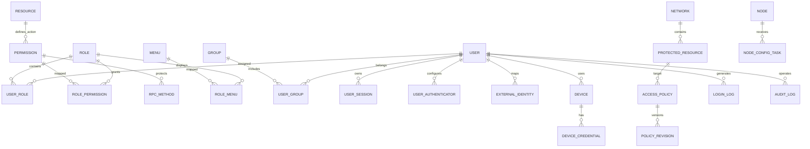

# VeloTrust 零信任平台数据模型设计文档（最终版）

- 文档版本：V1.1
- 文档状态：修订版（RBAC 资源操作权限模型）
- 适用范围：VeloTrust 企业级零信任安全访问平台
- 技术背景：Go；关系型数据库（PostgreSQL 或 MySQL）；GORM / XORM 双 ORM 标签
- 部署模式：企业自托管、单企业部署，不设计多租户隔离字段

---

## 1. 设计目标与边界

本文档定义 VeloTrust 的核心持久化数据模型、实体关系、字段约定、约束、索引和状态一致性要求，作为后续 Go 结构体、数据库迁移、API 和业务服务实现的统一依据。

数据模型覆盖七个业务域：

1. 组织与管理权限
2. 身份认证与会话安全
3. 设备身份与可信状态
4. 网络、节点与受保护资源
5. 访问策略与授权决策
6. 隧道、配置发布与异步任务
7. 审计、登录事件与运维集成

### 1.1 核心设计原则

- **单企业部署**：一个部署实例服务一个企业，不在每张业务表中重复添加 `TenantID`。
- **身份统一**：管理员和普通员工共用 `t_iam_user`，通过角色、权限和策略区分职责。
- **管理授权与网络授权分离**：管理后台 RBAC 只控制管理操作；能否访问网络资源由 ZTNA 策略独立判定。
- **菜单与业务资源分离**：菜单用于导航和页面呈现，管理资源用于描述可管理对象，受保护资源用于描述真实网络访问目标。
- **控制面期望状态与节点实际状态分离**：数据库中的目标配置不等于节点已经应用的配置，必须持久化任务状态、节点回执和实际版本。
- **可审计、可撤销**：登录、会话撤销、策略变更、设备吊销、配置发布等关键事件必须可追踪。
- **敏感信息最小化**：密码、OTP、令牌、私钥和第三方密钥不得以明文写入日志；需要恢复使用的秘密应加密存储。
- **幂等与可恢复**：异步任务具有唯一任务标识、明确状态和可重试语义。
- **ORM 双兼容**：Go 数据对象同时提供 GORM 和 XORM 标签；最终 DDL、索引与约束以所选数据库的迁移脚本为准。

### 1.2 命名约定

| 对象 | 约定 | 示例 |
|---|---|---|
| IAM 表 | `t_iam_` 前缀 | `t_iam_user` |
| ZTNA 表 | `t_ztna_` 前缀 | `t_ztna_device` |
| 系统集成/任务表 | 按所属域归类，优先使用 `t_iam_` 或 `t_ztna_` | `t_iam_integration_sync_task` |
| 主键 | `id`，无业务含义的自增或应用生成 ID | `id BIGINT` |
| 外键字段 | `<实体名>_id` | `user_id`、`resource_id` |
| 时间字段 | `created_at`、`updated_at`、`occurred_at` 等明确表达语义的名称 | `expires_at` |
| 状态字段 | 业务枚举字符串或明确的整数枚举 | `status`、`result` |
| 快照字段 | 以 `_snapshot` 或清晰的名称表示事件发生时的值 | `user_name` |

> 所有表名、字段名统一使用小写下划线命名。Go 结构体字段使用 PascalCase，JSON 字段使用 snake_case；对外 API 若已有既定命名，应以 API 契约为准。

---

## 2. 公共字段与基础模型

### 2.1 业务表公共字段

普通业务实体建议嵌入 `database.BaseModel`：

| 字段 | 数据库类型建议 | 约束 | 说明 |
|---|---|---|---|
| `id` | `BIGINT` / `BIGINT UNSIGNED` | PK | 数据库主键 |
| `created_at` | `TIMESTAMP` / `DATETIME` | NOT NULL | 创建时间，统一存储 UTC 或按项目统一时区策略 |
| `created_by` | `VARCHAR(64)` | NOT NULL DEFAULT `''` | 创建者用户名；由服务端写入，创建后不随更新改变 |
| `updated_at` | `TIMESTAMP` / `DATETIME` | NOT NULL | 最后更新时间 |
| `updated_by` | `VARCHAR(64)` | NOT NULL DEFAULT `''` | 最后更新者用户名，由服务端写入 |
| `version_no` | `BIGINT UNSIGNED` / `BIGINT` | NOT NULL DEFAULT `1` | 乐观锁版本号；仅在更新 SQL 校验旧版本并检查影响行数时才有效 |

推荐 Go 基础模型：

```go
package database

import "time"

type BaseModel struct {
    ID        uint64    `json:"id" gorm:"primaryKey;column:id;autoIncrement" xorm:"'id' pk autoincr"`
    CreatedAt time.Time `json:"created_at" gorm:"column:created_at;not null" xorm:"'created_at' created"`
    CreatedBy string    `json:"created_by" gorm:"column:created_by;size:64;not null;default:''" xorm:"'created_by' varchar(64) notnull default ''"`
    UpdatedAt time.Time `json:"updated_at" gorm:"column:updated_at;not null" xorm:"'updated_at' updated"`
    UpdatedBy string    `json:"updated_by" gorm:"column:updated_by;size:64;not null;default:''" xorm:"'updated_by' varchar(64) notnull default ''"`
    VersionNo uint64    `json:"version_no" gorm:"column:version_no;not null;default:1" xorm:"'version_no' bigint unsigned notnull default 1"`
}
```

### 2.2 不应机械继承 BaseModel 的表

以下类型通常采用专用字段，而不是完整公共字段：

- 只追加、不应被业务更新覆盖的审计事件和登录事件；
- 高写入量的遥测、心跳、连接指标；
- 具有独立生命周期的任务事件、Webhook 事件记录；
- 需要按时间分区或独立归档的历史事件表。

这些表应有明确的 `event_id`、`occurred_at`、`created_at` 等字段，并根据实际查询需要增加创建者快照；不应为了统一而增加无意义的 `updated_at`、`updated_by`。

### 2.3 通用状态规则

- `disabled`：业务对象停止使用，但保留历史关联。
- `revoked`：凭证、会话或授权被主动撤销。
- `deleted_at`（如采用软删除）：仅用于允许恢复的普通业务对象；不能把软删除当成凭证撤销或审计删除机制。
- 事件和审计数据默认追加写入，不提供普通业务更新、删除接口。
- 时间统一使用 UTC 存储并在展示层转换；若项目决定采用数据库本地时区，必须在服务、驱动和迁移中保持一致。

---

## 3. 数据域与核心关系



图中仅表示主要逻辑关系。实际关系表和字段以本文件后续定义为准；部分关系允许为空，以便记录外部用户、系统任务或用户删除后的历史事件。

---

## 4. 组织与管理权限模型

### 4.1 `t_iam_user` — 用户

统一保存本地用户、企业目录同步用户和第三方身份映射后的内部用户。管理员不是单独的用户类型。

| 字段 | 类型建议 | 约束/说明 |
|---|---|---|
| `id` | BIGINT | PK，继承公共字段 |
| `username` | VARCHAR(64) | NOT NULL，唯一；登录名 |
| `display_name` | VARCHAR(128) | NOT NULL DEFAULT ''；显示名称 |
| `email` | VARCHAR(128) | 可空；按产品规则决定是否唯一 |
| `phone_country_code` | VARCHAR(8) | 可空；电话国家/地区区号，例如 `+86`、`+81` |
| `phone_number` | VARCHAR(32) | 可空；不含国家区号的号码部分 |
| `password_salt` | VARCHAR(64) | 本地密码认证用；不返回客户端 |
| `password_hash` | VARCHAR(255) | 本地密码哈希；不存明文密码 |
| `auth_source` | VARCHAR(32) | 主要认证来源提示，如 `local`、`external`、`mixed`；不作为身份映射的唯一依据 |
| `user_status` | VARCHAR(24) | `active`、`disabled`、`locked`、`pending` 等 |
| `must_change_password` | BOOLEAN | 是否要求下次登录修改密码 |
| `last_login_at` | TIMESTAMP | 最近一次成功登录时间，可空 |
| `last_login_ip` | VARCHAR(64) | 最近一次成功登录来源 IP，可空 |
| `remark` | VARCHAR(512) | 管理备注，可空 |
| 公共字段 | — | `created_at`、`created_by`、`updated_at`、`updated_by`、`version_no` |

约束建议：
- `username` 建唯一索引，大小写是否敏感由数据库排序规则和产品规范统一决定。
- 不要仅依据邮箱相同自动合并本地用户和外部身份。
- 禁用用户后，应按策略撤销会话、阻止新认证并触发相关授权重新评估。

### 4.2 `t_iam_user_profile` — 用户扩展资料

只保存低频变化、非认证核心字段，避免把认证状态、凭证和个人资料混在一张表中。

| 字段 | 类型建议 | 约束/说明 |
|---|---|---|
| `id` | BIGINT | PK，继承公共字段 |
| `user_id` | BIGINT | NOT NULL，唯一关联 `t_iam_user.id` |
| `avatar_url` | VARCHAR(512) | 可空 |
| `job_title` | VARCHAR(128) | 可空 |
| `employee_no` | VARCHAR(64) | 可空；是否唯一按企业规则决定 |
| `locale` | VARCHAR(16) | 可空，例如 `zh-CN`、`ja-JP` |
| `timezone` | VARCHAR(64) | 可空，例如 `Asia/Tokyo` |
| `extra_json` | JSON/TEXT | 可空；只存非敏感扩展字段 |
| 公共字段 | — | 标准公共字段 |

### 4.3 `t_iam_group` — 群组

按项目约定使用“群组”而不是“部门”。群组可表达团队、业务小组或访问范围分组。

| 字段 | 类型建议 | 约束/说明 |
|---|---|---|
| `id` | BIGINT | PK，继承公共字段 |
| `parent_id` | BIGINT | 可空；父群组 ID |
| `group_name` | VARCHAR(128) | NOT NULL |
| `group_code` | VARCHAR(64) | NOT NULL；建议唯一 |
| `description` | VARCHAR(512) | 可空 |
| `status` | VARCHAR(24) | `active` / `disabled` |
| `sort_order` | INT | NOT NULL DEFAULT 0 |
| 公共字段 | — | 标准公共字段 |

### 4.4 `t_iam_user_group` — 用户群组关系

| 字段 | 类型建议 | 约束/说明 |
|---|---|---|
| `id` | BIGINT | PK |
| `user_id` | BIGINT | NOT NULL |
| `group_id` | BIGINT | NOT NULL |
| `is_primary` | BOOLEAN | DEFAULT FALSE；是否主群组 |
| `created_at` | TIMESTAMP | NOT NULL |
| `created_by` | VARCHAR(64) | NOT NULL DEFAULT '' |

约束：唯一索引 `(user_id, group_id)`；分别为 `user_id`、`group_id` 建索引。若业务不需要单独维护关系审计，可改用复合主键，但 Go ORM 的关系操作必须统一。

### 4.5 `t_iam_role` — 管理角色

| 字段 | 类型建议 | 约束/说明 |
|---|---|---|
| `id` | BIGINT | PK，继承公共字段 |
| `role_name` | VARCHAR(64) | NOT NULL |
| `role_code` | VARCHAR(64) | NOT NULL，唯一 |
| `description` | VARCHAR(512) | 可空 |
| `is_system` | BOOLEAN | 是否内置角色；内置角色删除需受限 |
| `status` | VARCHAR(24) | `active` / `disabled` |
| 公共字段 | — | 标准公共字段 |

### 4.6 `t_iam_user_role` — 用户角色关系

| 字段 | 类型建议 | 约束/说明 |
|---|---|---|
| `id` | BIGINT | PK |
| `user_id` | BIGINT | NOT NULL |
| `role_id` | BIGINT | NOT NULL |
| `created_at` | TIMESTAMP | NOT NULL |
| `created_by` | VARCHAR(64) | NOT NULL DEFAULT '' |

唯一索引 `(user_id, role_id)`。角色授予与撤销必须写审计日志。

### 4.7 `t_iam_permission` — 资源操作权限定义

权限采用“**资源 + 操作**”的抽象方式，不直接把每个 API/RPC 方法作为角色授权项。权限表达角色可以对某类管理资源执行什么操作；具体 API/RPC 接口再映射到对应权限。

例如：`iam.user.read` 表示读取用户资源，`iam.user.write` 表示对用户资源执行一般写操作。角色获得 `iam.user.read` 后，可访问映射到该权限且通过其他服务端校验的查询接口，而不是逐个授权 `GetUser`、`ListUsers` 等方法。

| 字段 | 类型建议 | 约束/说明 |
|---|---|---|
| `id` | BIGINT | PK，继承公共字段 |
| `permission_name` | VARCHAR(128) | NOT NULL；展示名称，例如“读取用户” |
| `permission_code` | VARCHAR(128) | NOT NULL，唯一；稳定权限编码，例如 `iam.user.read` |
| `resource_id` | BIGINT | NOT NULL；关联 `t_iam_resource.id` |
| `action_code` | VARCHAR(32) | NOT NULL；操作编码，如 `read`、`write`、`execute`、`manage` 或明确的敏感操作编码 |
| `description` | VARCHAR(512) | 可空 |
| `status` | VARCHAR(24) | `active` / `disabled` |
| 公共字段 | — | 标准公共字段 |

约束与语义：
- 建议唯一约束 `(resource_id, action_code)`，同时对 `permission_code` 建唯一约束，避免同一资源重复定义同一种标准操作。
- `permission_code` 是供代码、审计和鉴权使用的稳定标识，不应由展示名称临时拼接生成，也不应依赖菜单路径。
- 基础操作建议包括 `read` 与 `write`；仅在业务确有需要时增加 `execute`、`manage` 或专用操作，例如 `user.reset_password`、`role.grant`、`key.rotate`。敏感操作不得因为角色具有普通 `write` 权限而自动放行。
- 操作编码的实际支持范围由资源定义和业务规则约束，不能允许客户端任意提交未注册的操作编码。
- 若某个资源确实需要细分创建、更新、删除，可定义 `create`、`update`、`delete` 等独立操作；也可以按产品安全要求将它们统一映射到 `write`。同一项目应采用一致且可解释的粒度。
- `disabled` 权限不得形成有效授权；服务端鉴权必须检查权限和关联资源的有效状态。

### 4.8 `t_iam_role_permission` — 角色权限关系

字段：`id`、`role_id`、`permission_id`、`created_at`、`created_by`。唯一索引 `(role_id, permission_id)`。此表只关联角色与抽象后的资源操作权限，不直接关联 API/RPC 方法。

授权判定应以有效用户、有效角色、有效角色权限、有效权限及有效资源为基础。服务端必须在 API/业务服务层执行鉴权，不能只依赖前端按钮隐藏或菜单是否可见。

### 4.9 `t_iam_menu` — 管理菜单

菜单与管理资源分离。菜单只用于控制台导航、路由与页面组织。

| 字段 | 类型建议 | 约束/说明 |
|---|---|---|
| `id` | BIGINT | PK，继承公共字段 |
| `parent_id` | BIGINT | 可空；父菜单 |
| `menu_name` | VARCHAR(128) | NOT NULL |
| `menu_code` | VARCHAR(64) | NOT NULL，建议唯一 |
| `path` | VARCHAR(255) | 前端路由路径，可空 |
| `component` | VARCHAR(255) | 前端页面组件标识，可空 |
| `icon` | VARCHAR(128) | 图标标识，可空 |
| `sort_order` | INT | NOT NULL DEFAULT 0 |
| `menu_type` | VARCHAR(24) | `directory`、`page`、`external` 等 |
| `visible` | BOOLEAN | 是否在导航中显示 |
| `status` | VARCHAR(24) | `active` / `disabled` |
| 公共字段 | — | 标准公共字段 |

### 4.10 `t_iam_role_menu` — 角色菜单关系

字段：`id`、`role_id`、`menu_id`、`created_at`、`created_by`。唯一索引 `(role_id, menu_id)`。菜单可见不代表接口有权限，接口鉴权仍以权限编码为准。

### 4.11 `t_iam_resource` — 可授权管理资源

描述 RBAC 中的管理对象类型，例如用户、角色、设备、访问策略、节点、技术资源、审计日志和系统配置。该表是“资源操作权限”的资源维度，不代表可通过隧道访问的目标服务；后者仍由 `t_ztna_protected_resource` 等 ZTNA 模型描述。

| 字段 | 类型建议 | 约束/说明 |
|---|---|---|
| `id` | BIGINT | PK，继承公共字段 |
| `resource_name` | VARCHAR(128) | NOT NULL；展示名称，例如“用户管理” |
| `resource_code` | VARCHAR(128) | NOT NULL，唯一；稳定编码，例如 `iam.user` |
| `resource_type` | VARCHAR(64) | NOT NULL；资源分类，例如 `user`、`role`、`device`、`policy`、`node`、`audit_log` |
| `description` | VARCHAR(512) | 可空 |
| `status` | VARCHAR(24) | `active` / `disabled` |
| 公共字段 | — | 标准公共字段 |

资源操作集合应由系统定义并校验。例如 `iam.user` 可支持 `read`、`write`，而 `iam.audit_log` 通常只支持 `read`。不要求所有资源支持相同操作。资源编码创建后应保持稳定，避免通过改名改变已有权限语义。

### 4.12 `t_iam_rpc_method` — API/RPC 方法与权限映射

该表登记受 RBAC 保护的后端技术入口，并将每个接口映射到其所需的资源操作权限。一个权限通常对应多个 API/RPC 方法，例如 `iam.user.read` 可以关联 `GetUser`、`ListUsers` 和 `SearchUsers`。角色授权仍然只针对权限，不直接针对方法。

| 字段 | 类型建议 | 约束/说明 |
|---|---|---|
| `id` | BIGINT | PK，继承公共字段 |
| `method_code` | VARCHAR(160) | NOT NULL，唯一；接口稳定标识 |
| `protocol` | VARCHAR(24) | NOT NULL；如 `http`、`grpc`、`rpc` |
| `service_name` | VARCHAR(160) | NOT NULL；服务名或服务归属，例如 `iam.user.UserService` |
| `method_name` | VARCHAR(128) | NOT NULL；方法名称，例如 `GetUser` |
| `http_method` | VARCHAR(12) | HTTP 方法；RPC 接口可空 |
| `path_pattern` | VARCHAR(512) | REST 路由模板；RPC 接口可空 |
| `permission_id` | BIGINT | NOT NULL；关联 `t_iam_permission.id`，表示该接口要求的权限 |
| `description` | VARCHAR(512) | 可空 |
| `status` | VARCHAR(24) | `active` / `disabled` |
| 公共字段 | — | 标准公共字段 |

约束与运行规则：
- REST 接口应以 `protocol + http_method + path_pattern` 识别；RPC 接口应以协议、服务名和方法名识别。唯一约束需按实际路由规范确定，并避免路由模板重叠造成匹配歧义。
- 一个接口默认映射一个主要权限。若业务需要多个前置权限，应在服务层明确实现 AND/OR 语义，或扩展独立的接口权限关联表，不应把多个权限编码塞入一个字符串字段。
- 接口映射的权限必须存在且有效。权限资源停用、权限停用或接口映射停用时，应按默认拒绝策略处理。
- 新增受保护接口必须完成权限映射或显式声明为无需 RBAC 的公开/内部接口；未映射的受保护接口默认拒绝，防止遗漏配置导致越权。
- 该表可由启动时的代码路由元数据同步维护，也可由管理后台维护。若采用代码注解/静态配置作为唯一事实来源，则可不持久化此表；但接口到权限的映射仍必须存在、可测试并可审计。

### 4.13 资源操作权限与 API/RPC 的示例

| 资源编码 | 操作编码 | 权限编码 | API/RPC 示例 |
|---|---|---|---|
| `iam.user` | `read` | `iam.user.read` | `GetUser`、`ListUsers`、`SearchUsers` |
| `iam.user` | `write` | `iam.user.write` | `CreateUser`、`UpdateUser`、`DeleteUser`（仅当采用统一写权限策略时） |
| `iam.role` | `read` | `iam.role.read` | `GetRole`、`ListRoles` |
| `iam.role` | `write` | `iam.role.write` | `CreateRole`、`UpdateRole`、`DeleteRole`（按项目权限粒度配置） |
| `iam.role` | `grant` | `iam.role.grant` | 角色授权变更接口，作为敏感专用操作 |
| `iam.audit_log` | `read` | `iam.audit_log.read` | `QueryAuditLogs`、`GetAuditLog` |

上表为模型示例。实际权限编码应与代码中的常量、路由映射、审计操作编码和管理界面保持一致。若创建、更新、删除需要独立控制，应将其定义为独立操作权限，不应同时声称它们只受统一 `write` 权限控制。

---

## 5. 身份认证、会话与第三方身份

### 5.1 `t_iam_user_session` — 用户会话

| 字段 | 类型建议 | 约束/说明 |
|---|---|---|
| `id` | BIGINT | PK |
| `session_id` | VARCHAR(64) | NOT NULL，唯一；服务端会话标识 |
| `user_id` | BIGINT | NOT NULL |
| `token_hash` | VARCHAR(255) | NOT NULL；只保存令牌摘要，不保存可直接复用的明文令牌 |
| `auth_level` | VARCHAR(32) | 认证强度，如 `password`、`mfa` |
| `mfa_authenticated_at` | TIMESTAMP | 可空 |
| `issued_at` | TIMESTAMP | NOT NULL |
| `expires_at` | TIMESTAMP | NOT NULL |
| `last_seen_at` | TIMESTAMP | 可空 |
| `revoked_at` | TIMESTAMP | 可空 |
| `revocation_reason` | VARCHAR(128) | 可空 |
| `source_ip` | VARCHAR(64) | 可空 |
| `user_agent` | VARCHAR(512) | 可空 |
| `device_id` | BIGINT | 可空 |
| `status` | VARCHAR(24) | `active`、`expired`、`revoked` |
| `created_at` | TIMESTAMP | NOT NULL |

会话撤销必须在服务端可即时生效。若使用自包含 JWT，不能认为只存 JWT 哈希就能即时撤销；应采用短有效期、服务端会话校验、版本号或撤销列表等组合机制。

### 5.2 `t_iam_auth_challenge` — 认证挑战

用于 OTP、MFA、绑定确认或敏感操作二次验证等短时挑战。

字段：`id`、`challenge_id`（唯一）、`user_id`（可空）、`session_id`（可空）、`challenge_type`、`challenge_hash`、`expires_at`、`attempt_count`、`max_attempts`、`consumed_at`（可空）、`status`、`created_at`。

要求：短 TTL、按用户/IP/设备限流、失败次数限制、一次性原子消费、防重放。不要存储明文 OTP。

### 5.3 `t_iam_user_authenticator` — 用户认证器（启用 MFA 时）

字段：`id`、`user_id`、`authenticator_type`（如 `totp`）、`secret_ciphertext`、`encryption_key_version`、`status`、`verified_at`、`last_used_at`、`created_at`、`updated_at`。

约束与安全要求：
- 一个用户可以按产品策略绑定一个或多个认证器；若只允许一个 TOTP，增加 `(user_id, authenticator_type)` 唯一约束。
- TOTP 密钥需加密存储并记录密钥版本；加密密钥不能与数据库放在同一保护域。
- 启用认证器前必须完成验证；密钥不得返回普通查询接口。
- 恢复码如需持久化，应保存单向哈希并记录单次使用状态。

### 5.4 `t_iam_login_log` — 登录与认证事件

该表为追加式事件记录，不继承完整 `BaseModel`。

| 字段 | 类型建议 | 说明 |
|---|---|---|
| `event_id` | VARCHAR(64) / UUID | 主键或唯一事件 ID |
| `user_id` | BIGINT | 可空；未知用户登录失败时允许为空 |
| `user_name` | VARCHAR(128) | 用户名快照 |
| `login_type` | VARCHAR(32) | `local`、`oidc`、`saml`、`directory` 等 |
| `event_type` | VARCHAR(32) | `login`、`logout`、`mfa`、`token_refresh`、`account_locked`、`session_revoked` 等 |
| `result` | VARCHAR(16) | `success` / `failure` |
| `reason_code` | VARCHAR(128) | 稳定原因码，不记录秘密值 |
| `source_ip` | VARCHAR(64) | 来源 IP |
| `user_agent` | VARCHAR(512) | 客户端标识 |
| `device_id` | BIGINT | 可空 |
| `session_id` | VARCHAR(64) | 可空 |
| `mfa_used` | BOOLEAN | 是否使用 MFA |
| `request_id` | VARCHAR(64) | 关联请求链路 |
| `occurred_at` | TIMESTAMP | NOT NULL，事件发生时间 |

索引建议：`(occurred_at)`、`(user_id, occurred_at)`、`(result, occurred_at)`、`request_id`。禁止记录密码、OTP、访问令牌、刷新令牌和私钥。

### 5.5 `t_iam_identity_provider` — 外部身份提供方

保存 OIDC、SAML 或厂商专用集成配置。飞书、钉钉、企业微信等应通过各自适配器实现，不应假定所有平台都直接支持相同的标准协议。

字段建议：

| 字段 | 类型建议 | 说明 |
|---|---|---|
| `id` | BIGINT | PK，继承公共字段 |
| `provider_name` | VARCHAR(128) | 展示名称 |
| `provider_code` | VARCHAR(64) | NOT NULL，唯一 |
| `provider_type` | VARCHAR(32) | `oidc`、`saml`、`feishu`、`dingtalk`、`wecom`、`ldap` 等 |
| `issuer_url` | VARCHAR(512) | 可空 |
| `client_id` | VARCHAR(255) | 可空 |
| `client_secret_ciphertext` | TEXT | 加密后的密钥；不可明文保存 |
| `secret_key_version` | VARCHAR(64) | 加密密钥版本 |
| `authorization_endpoint` | VARCHAR(512) | 可空 |
| `token_endpoint` | VARCHAR(512) | 可空 |
| `userinfo_endpoint` | VARCHAR(512) | 可空 |
| `jwks_uri` | VARCHAR(512) | 可空 |
| `redirect_uri` | VARCHAR(512) | 回调地址 |
| `scopes` | TEXT/JSON | 最小化授权范围 |
| `config_json` | JSON/TEXT | 非秘密的适配器配置 |
| `provisioning_mode` | VARCHAR(32) | `bound_only`、`just_in_time`、`admin_approved` 等 |
| `status` | VARCHAR(24) | `active` / `disabled` |
| 公共字段 | — | 标准公共字段 |

回调地址必须采用精确白名单；OIDC 应验证签名、issuer、audience、expiry、nonce，并在适用时使用 state 与 PKCE。外部身份声明不可直接当作可信的内部权限。

### 5.6 `t_iam_external_identity` — 外部身份映射

| 字段 | 类型建议 | 说明 |
|---|---|---|
| `id` | BIGINT | PK，继承公共字段 |
| `provider_id` | BIGINT | NOT NULL，关联身份提供方 |
| `user_id` | BIGINT | NOT NULL，关联内部用户 |
| `external_user_id` | VARCHAR(255) | NOT NULL；外部系统稳定用户标识 |
| `external_username` | VARCHAR(255) | 可空 |
| `external_email` | VARCHAR(255) | 可空；不作为唯一可信身份键 |
| `external_status` | VARCHAR(32) | 外部账号状态快照 |
| `last_synced_at` | TIMESTAMP | 可空 |
| `attributes_json` | JSON/TEXT | 经筛选的非敏感属性 |
| 公共字段 | — | 标准公共字段 |

唯一约束 `(provider_id, external_user_id)`；按 `user_id` 建索引。除非产品明确允许多外部账号映射同一内部账号，否则需要通过业务规则和管理流程控制映射关系。

### 5.7 `t_iam_external_org` 与 `t_iam_external_identity_org`（按需启用）

用于同步外部组织目录，属于可选模型；若只需要第三方登录而不需要同步群组/组织，可以不建。

- `t_iam_external_org`：`id`、`provider_id`、`external_org_id`、`external_parent_id`、`org_name`、`status`、`attributes_json`、同步时间及公共字段。唯一约束 `(provider_id, external_org_id)`。
- `t_iam_external_identity_org`：`id`、`external_identity_id`、`external_org_id`、`created_at`。唯一约束 `(external_identity_id, external_org_id)`。

外部组织变化默认不应直接自动授予高权限角色。权限映射需由单独的明确规则控制并可审计。

### 5.8 `t_iam_integration_sync_task` — 外部目录同步任务

字段：`id`、`provider_id`、`task_type`、`status`、`cursor_value`、`started_at`、`finished_at`、`next_retry_at`、`retry_count`、`last_error_code`、`last_error_message`（脱敏）、`result_summary_json`、`created_at`、`updated_at`。

要求：幂等、可重试、可续跑、可定期对账；外部账号停用或离职时，根据明确策略禁用内部账号、撤销会话并重新评估授权。

### 5.9 `t_iam_integration_event` — 外部回调/事件去重（推荐）

字段：`id`、`provider_id`、`external_event_id`、`event_type`、`received_at`、`processed_at`、`status`、`payload_hash`、`error_code`。唯一约束 `(provider_id, external_event_id)`。如需保存原始载荷，必须进行敏感字段过滤、加密与保留期控制；默认不保存不必要的完整载荷。

---

## 6. 设备身份与可信状态模型

### 6.1 `t_ztna_device` — 终端设备

| 字段 | 类型建议 | 说明 |
|---|---|---|
| `id` | BIGINT | PK，继承公共字段 |
| `device_name` | VARCHAR(128) | NOT NULL |
| `device_uuid` | VARCHAR(128) | NOT NULL，设备稳定标识，唯一 |
| `device_type` | VARCHAR(32) | `desktop`、`laptop`、`mobile`、`server` 等 |
| `platform` | VARCHAR(64) | 操作系统/平台 |
| `platform_version` | VARCHAR(128) | 可空 |
| `agent_version` | VARCHAR(64) | 客户端/代理版本 |
| `owner_user_id` | BIGINT | 可空；当前主要使用者 |
| `status` | VARCHAR(24) | `pending`、`active`、`disabled`、`quarantined` |
| `trust_status` | VARCHAR(24) | `unknown`、`trusted`、`untrusted`、`review_required` |
| `last_seen_at` | TIMESTAMP | 最近在线时间 |
| `last_seen_ip` | VARCHAR(64) | 最近来源地址 |
| `posture_json` | JSON/TEXT | 经校验的设备合规状态摘要，不应存不必要的隐私数据 |
| `registered_at` | TIMESTAMP | 注册时间 |
| `revoked_at` | TIMESTAMP | 可空 |
| 公共字段 | — | 标准公共字段 |

设备登记不等于可信。设备状态、凭证有效性、合规检查结果和用户身份应分别校验。

### 6.2 `t_ztna_device_credential` — 设备凭证

字段：`id`、`device_id`、`credential_type`、`public_key`、`fingerprint`、`key_version`、`status`、`not_before`、`expires_at`、`revoked_at`、`revocation_reason`、`last_used_at`、`created_at`、`created_by`。

建议约束：
- `(device_id, credential_type, key_version)` 唯一。
- 对 `fingerprint` 建唯一索引（如果该凭证类型的指纹应全局唯一）。
- 私钥优先留在终端安全存储中；服务端只保存公钥或经加密保护且确有必要保存的秘密。
- 吊销凭证应触发会话失效、隧道配置更新和相关策略重新评估。

### 6.3 `t_ztna_device_posture_check` — 设备合规检查记录（建议）

字段：`id`、`device_id`、`check_type`、`result`、`reason_code`、`details_json`（脱敏）、`checked_at`、`valid_until`、`policy_version`。用于记录可信状态判断依据；避免把高频心跳和所有原始遥测都写入此表。

---

## 7. 网络、节点与受保护资源模型

### 7.1 `t_ztna_network` — 企业网络/网络区域

| 字段 | 类型建议 | 说明 |
|---|---|---|
| `id` | BIGINT | PK，继承公共字段 |
| `network_name` | VARCHAR(128) | NOT NULL |
| `network_code` | VARCHAR(64) | NOT NULL，唯一 |
| `network_type` | VARCHAR(32) | `vpc`、`subnet`、`site`、`segment` 等 |
| `cidr` | VARCHAR(64) | 网络网段；可空，按网络类型决定 |
| `region` | VARCHAR(128) | 可空 |
| `environment` | VARCHAR(32) | `prod`、`test`、`dev` 等 |
| `description` | VARCHAR(512) | 可空 |
| `status` | VARCHAR(24) | `active` / `disabled` |
| 公共字段 | — | 标准公共字段 |

创建或更新网段时必须检查 CIDR 合法性、地址池冲突及路由重叠。网络被纳管不意味着其中所有资源都对用户开放。

### 7.2 `t_ztna_node` — 控制面管理的网络节点

用于表达客户端代理、访问网关、中继节点或受控连接器等运行实体。

字段建议：`id`、`node_name`、`node_code`（唯一）、`node_type`、`node_status`、`agent_version`、`control_endpoint`、`public_endpoint`、`private_endpoint`、`public_key`、`network_id`（可空）、`last_heartbeat_at`、`last_config_version`、`actual_config_version`、`capabilities_json`、`health_status`、公共字段。

注意：`last_config_version` 可表示已下发/已知版本，`actual_config_version` 必须以节点应用回执或可靠状态上报为依据，不能仅在发送配置时更新。

### 7.3 `t_ztna_protected_resource` — 受保护资源

该表描述真正需要被 ZTNA 保护的目标，例如 Web 应用、数据库、服务器、服务端口或内网网段。它与 `t_iam_resource` 不同。

| 字段 | 类型建议 | 说明 |
|---|---|---|
| `id` | BIGINT | PK，继承公共字段 |
| `resource_name` | VARCHAR(128) | NOT NULL |
| `resource_code` | VARCHAR(64) | NOT NULL，唯一 |
| `resource_type` | VARCHAR(32) | `web_app`、`server`、`database`、`subnet`、`service` 等 |
| `network_id` | BIGINT | 所属网络，可按场景为空 |
| `host` | VARCHAR(255) | 域名或 IP，可空 |
| `address` | VARCHAR(255) | 目标地址或网段，可空 |
| `port_start` | INT | 可空；端口范围起点 |
| `port_end` | INT | 可空；端口范围终点 |
| `protocol` | VARCHAR(16) | `tcp`、`udp`、`http`、`https` 等 |
| `access_mode` | VARCHAR(32) | `network`、`proxy` 等接入方式 |
| `gateway_node_id` | BIGINT | 可空；指定网关 |
| `category` | VARCHAR(64) | 可空 |
| `tags_json` | JSON/TEXT | 可空；安全标签 |
| `description` | VARCHAR(512) | 可空 |
| `status` | VARCHAR(24) | `active`、`disabled`、`unreachable` 等 |
| 公共字段 | — | 标准公共字段 |

端点字段应根据 `resource_type` 做条件校验；对网段资源校验 CIDR，对端口资源校验 `1–65535` 且起点不大于终点。资源发现、资源纳管、策略授权和实际网络可达性是不同状态。

### 7.4 `t_ztna_node_network` — 节点与网络关系（按需启用）

当节点可能连接多个网络时使用。字段：`id`、`node_id`、`network_id`、`role`、`created_at`。唯一约束 `(node_id, network_id)`。若节点严格只属于一个网络，可直接保留 `network_id` 在节点表而不建关系表。

### 7.5 `t_ztna_node_endpoint` — 节点端点（按需启用）

当一个节点需要维护多个可达端点、地址类型或优先级时使用。字段：`id`、`node_id`、`endpoint_type`、`address`、`port`、`priority`、`last_verified_at`、`status`、`created_at`。不要把客户端报告的未经验证地址直接作为可信的外部端点。

---

## 8. 访问策略与授权模型

### 8.1 `t_ztna_access_policy` — 访问策略主表

策略主表保存稳定标识、管理元数据和当前生效版本指针；详细规则应通过不可变修订版本管理。

| 字段 | 类型建议 | 说明 |
|---|---|---|
| `id` | BIGINT | PK，继承公共字段 |
| `policy_name` | VARCHAR(128) | NOT NULL |
| `policy_code` | VARCHAR(64) | NOT NULL，唯一 |
| `description` | VARCHAR(512) | 可空 |
| `priority` | INT | 数值越小/越大优先需在产品规范中固定 |
| `status` | VARCHAR(24) | `draft`、`active`、`disabled` |
| `current_revision_id` | BIGINT | 当前生效修订，可空 |
| `created_by` / `updated_by` | VARCHAR(64) | 公共字段 |
| 公共字段 | — | 标准公共字段 |

策略优先级、冲突处理、默认拒绝和规则合并方式必须形成统一规范，不能由不同服务各自解释。

### 8.2 `t_ztna_access_policy_revision` — 策略不可变版本

字段：`id`、`policy_id`、`revision_no`、`rules_json`、`compiled_hash`、`change_summary`、`status`、`published_at`、`published_by`、`created_at`、`created_by`。

唯一约束 `(policy_id, revision_no)`。发布后的修订版本不可原地覆盖；策略更新应创建新版本，并保存发布人、发布时间和内容摘要。

### 8.3 `t_ztna_policy_subject` — 策略主体关系

用于把策略关联到用户、群组、角色或设备集合。字段：`id`、`policy_id`、`subject_type`（`user`、`group`、`device` 等）、`subject_id`、`created_at`。唯一约束 `(policy_id, subject_type, subject_id)`。

若策略主体需要精确绑定到不可变修订版本，可将 `policy_id` 替换/补充为 `policy_revision_id`；选定一种模型后应全项目统一。

### 8.4 `t_ztna_policy_resource` — 策略目标资源关系

字段：`id`、`policy_id`、`protected_resource_id`、`created_at`。唯一约束 `(policy_id, protected_resource_id)`。如目标集合完全保存在版本化规则 JSON 中，本关系表可作为查询索引或不启用；不要同时维护两份互相矛盾的权威数据。

### 8.5 `t_ztna_authorization_decision` — 关键授权决策记录（可选）

不建议对每个数据包写一条数据库记录。该表用于记录登录后关键资源访问、临时授权、策略拒绝或安全调查需要保留的决策事件。

字段：`id`、`decision_id`（唯一）、`user_id`、`device_id`、`protected_resource_id`、`policy_id`、`policy_revision_id`、`decision`（`allow` / `deny` / `step_up`）、`reason_code`、`auth_level`、`device_trust_status`、`source_ip`、`request_id`、`decided_at`。

应按风险和审计要求控制记录范围与保留期；高频数据面统计使用指标系统而非逐包写库。

### 8.6 `t_ztna_authorization_grant` — 临时/审批授权（按需启用）

仅当产品提供临时访问、工单审批或限时授权时启用。字段：`id`、`grant_id`、`user_id`、`device_id`（可空）、`protected_resource_id`、`requested_by`、`approved_by`、`reason`、`status`、`valid_from`、`expires_at`、`revoked_at`、`created_at`。授权必须有明确到期时间、撤销状态和审计记录。

---

## 9. 隧道、Peer、配置发布与任务状态

### 9.1 `t_ztna_tunnel` — 逻辑隧道

字段：`id`、`tunnel_code`（唯一）、`tunnel_type`、`status`、`network_id`、`description`、公共字段。逻辑隧道描述管理对象，不直接代表实时连接已建立。

### 9.2 `t_ztna_tunnel_peer` — 隧道 Peer

字段：`id`、`tunnel_id`、`node_id`、`device_id`（可空）、`public_key`、`tunnel_ip`、`allowed_ips`、`endpoint`、`persistent_keepalive`、`status`、`key_version`、`last_handshake_at`、`last_seen_at`、公共字段。

约束建议：`public_key` 按适用范围唯一；隧道地址在同一地址域内唯一；`allowed_ips` 的冲突需要在配置生成时校验，不能仅依赖数据库唯一索引。

### 9.3 `t_ztna_config_revision` — 期望配置版本

字段：`id`、`target_type`、`target_id`、`config_version`、`config_hash`、`config_json` 或 `config_blob_ref`、`created_at`、`created_by`、`reason`。

唯一约束 `(target_type, target_id, config_version)`。配置中若包含秘密材料，应避免直接保存未加密明文；能由安全引用或节点本地生成的私钥不应进入配置快照。

### 9.4 `t_ztna_node_config_task` — 配置分发任务

| 字段 | 类型建议 | 说明 |
|---|---|---|
| `id` | BIGINT | PK |
| `task_id` | VARCHAR(64) | NOT NULL，唯一幂等标识 |
| `node_id` | BIGINT | NOT NULL |
| `target_config_version` | BIGINT | 目标配置版本 |
| `task_type` | VARCHAR(32) | `apply_config`、`revoke`、`rotate_key` 等 |
| `status` | VARCHAR(24) | `pending`、`queued`、`sent`、`received`、`applying`、`applied`、`verified`、`failed`、`cancelled` |
| `retry_count` | INT | NOT NULL DEFAULT 0 |
| `next_retry_at` | TIMESTAMP | 可空 |
| `last_error_code` | VARCHAR(128) | 可空 |
| `last_error_message` | VARCHAR(512) | 脱敏错误摘要 |
| `created_at` | TIMESTAMP | NOT NULL |
| `started_at` | TIMESTAMP | 可空 |
| `finished_at` | TIMESTAMP | 可空 |
| `created_by` | VARCHAR(64) | NOT NULL DEFAULT '' |

状态语义必须明确：`sent` 仅代表发送；`received` 代表节点确认收到；`applied` 代表节点报告已应用；`verified` 代表通过额外校验确认生效。重复任务必须幂等，超时可重试，失败需要保留原因。

### 9.5 `t_ztna_node_config_task_event` — 配置任务事件（推荐）

字段：`id`、`task_id`、`node_id`、`event_type`、`from_status`、`to_status`、`detail_json`（脱敏）、`occurred_at`。追加写入，用于重建任务状态变化过程。

### 9.6 `t_ztna_node_status_report` — 节点状态快照（按需启用）

字段：`id`、`node_id`、`reported_at`、`agent_version`、`actual_config_version`、`wireguard_status`、`health_status`、`connected_peer_count`、`metrics_json`。如果只需要最新状态，可将快照字段放在 `t_ztna_node`；如果需要历史趋势，应按时间分区/归档，避免无限增长。

### 9.7 `t_ztna_relay` — 中继节点（启用中继功能时）

字段：`id`、`node_id`、`relay_code`、`region`、`endpoint`、`capacity`、`current_load`、`status`、`last_health_check_at`、公共字段。若中继本身完全以 `t_ztna_node` 的一种 `node_type` 表达，可不另建此表。

---

## 10. 审计、安全事件与运维

### 10.1 `t_iam_audit_log` — 管理审计日志

该表记录谁在何时对什么对象执行了什么操作以及结果。采用追加式写入，普通业务接口不允许修改或删除历史记录。

| 字段 | 类型建议 | 说明 |
|---|---|---|
| `event_id` | VARCHAR(64) / UUID | 唯一事件 ID |
| `user_id` | BIGINT | 可空；系统任务或用户已删除时可空 |
| `user_name` | VARCHAR(128) | 操作者名称快照 |
| `action` | VARCHAR(128) | 稳定操作编码，如 `policy.publish` |
| `target_type` | VARCHAR(64) | 操作对象类型 |
| `target_id` | VARCHAR(128) | 目标 ID；允许非数值标识 |
| `target_name` | VARCHAR(255) | 目标名称快照 |
| `result` | VARCHAR(16) | `success` / `failure` |
| `reason` | VARCHAR(512) | 可空；失败原因摘要 |
| `source_ip` | VARCHAR(64) | 可空 |
| `request_id` | VARCHAR(64) | 可空；请求链路标识 |
| `changes_json` | JSON/TEXT | 脱敏后的变更摘要，不保存密码、密钥和令牌 |
| `occurred_at` | TIMESTAMP | NOT NULL |

索引建议：`occurred_at`、`(user_id, occurred_at)`、`(result, occurred_at)`、`request_id`、`(target_type, target_id, occurred_at)`。高安全场景可增加哈希链、独立审计存储或不可变备份。

### 10.2 `t_ztna_security_event` — 安全事件（建议）

用于设备不可信、异常登录、凭证吊销失败、节点配置长期未收敛、策略冲突等安全事件。

字段：`id`、`event_id`、`event_type`、`severity`、`status`、`user_id`（可空）、`device_id`（可空）、`node_id`（可空）、`protected_resource_id`（可空）、`reason_code`、`details_json`（脱敏）、`occurred_at`、`acknowledged_at`、`acknowledged_by`、`resolved_at`、`resolved_by`。对 `event_id` 建唯一索引，对 `(status, severity, occurred_at)` 建查询索引。

### 10.3 `t_ztna_address_pool` — 隧道地址池（按需启用）

字段：`id`、`pool_name`、`network_cidr`、`address_family`、`allocation_strategy`、`status`、公共字段。创建时检查 CIDR 合法性、重叠和可分配地址范围。

### 10.4 `t_ztna_address_lease` — 隧道地址分配记录（按需启用）

字段：`id`、`pool_id`、`address`、`owner_type`、`owner_id`、`status`、`allocated_at`、`released_at`。约束：在地址池范围内，活动租约的地址不可重复。释放地址前需确认节点/Peer 已完成撤销或重新配置。

---

## 11. 表清单与启用建议

| 模块 | 表 | 优先级 | 说明 |
|---|---|---|---|
| 用户与组织 | `t_iam_user` | 必须 | 统一内部用户 |
| 用户与组织 | `t_iam_user_profile` | 建议 | 用户扩展资料 |
| 用户与组织 | `t_iam_group`、`t_iam_user_group` | 必须 | 群组与成员关系 |
| 管理 RBAC | `t_iam_role`、`t_iam_user_role` | 必须 | 角色授权 |
| 管理 RBAC | `t_iam_permission`、`t_iam_role_permission` | 必须 | 资源操作权限定义与角色授权 |
| 管理控制台 | `t_iam_menu`、`t_iam_role_menu` | 必须（若有控制台） | 菜单展示授权 |
| 管理资源 | `t_iam_resource` | 必须 | RBAC 可授权资源目录，与受保护资源分离 |
| API/RPC 权限映射 | `t_iam_rpc_method` | 推荐（使用动态映射管理时必须） | 技术接口到资源操作权限的映射；静态代码映射时可不建表 |
| 认证会话 | `t_iam_user_session` | 必须 | 会话生命周期和撤销 |
| 认证挑战 | `t_iam_auth_challenge` | 必须（启用 OTP/MFA/敏感二次验证时） | 防重放的一次性挑战 |
| MFA | `t_iam_user_authenticator` | 按 MFA 能力启用 | TOTP 等认证器 |
| 登录事件 | `t_iam_login_log` | 必须 | 登录与认证追踪 |
| 第三方身份 | `t_iam_identity_provider`、`t_iam_external_identity` | 启用第三方登录时必须 | 外部身份配置和映射 |
| 组织同步 | `t_iam_external_org`、`t_iam_external_identity_org` | 可选 | 外部组织同步 |
| 集成任务 | `t_iam_integration_sync_task`、`t_iam_integration_event` | 推荐 | 可恢复同步与回调去重 |
| 设备 | `t_ztna_device`、`t_ztna_device_credential` | 必须 | 设备与凭证 |
| 设备合规 | `t_ztna_device_posture_check` | 建议 | 合规检查记录 |
| 网络资源 | `t_ztna_network`、`t_ztna_node`、`t_ztna_protected_resource` | 必须 | 网络、节点、访问目标 |
| 节点扩展 | `t_ztna_node_network`、`t_ztna_node_endpoint` | 按模型复杂度启用 | 多网络/多端点 |
| 访问策略 | `t_ztna_access_policy`、`t_ztna_access_policy_revision` | 必须 | 策略及不可变版本 |
| 策略关系 | `t_ztna_policy_subject`、`t_ztna_policy_resource` | 视规则模型决定 | 主体和目标关系索引 |
| 授权记录 | `t_ztna_authorization_decision` | 建议/可选 | 关键授权决策审计 |
| 临时授权 | `t_ztna_authorization_grant` | 按需启用 | 审批与限时授权 |
| 隧道 | `t_ztna_tunnel`、`t_ztna_tunnel_peer` | 必须（采用 WireGuard 时） | 逻辑隧道与 Peer |
| 配置版本 | `t_ztna_config_revision` | 必须 | 期望配置快照 |
| 配置任务 | `t_ztna_node_config_task` | 必须 | 可靠配置下发 |
| 任务事件 | `t_ztna_node_config_task_event` | 推荐 | 状态变化追踪 |
| 节点状态历史 | `t_ztna_node_status_report` | 按监控需求启用 | 历史状态快照 |
| 中继 | `t_ztna_relay` | 启用中继时 | 中继能力与健康 |
| 审计 | `t_iam_audit_log` | 必须 | 管理操作审计 |
| 安全事件 | `t_ztna_security_event` | 建议 | 安全运营闭环 |
| 地址管理 | `t_ztna_address_pool`、`t_ztna_address_lease` | 地址池集中管理时 | 地址分配与冲突控制 |

---

## 12. 实体关系与数据一致性要求

### 12.1 用户与授权

- 用户通过 `t_iam_user_role` 关联角色；角色通过 `t_iam_role_permission` 关联权限。
- 菜单通过 `t_iam_role_menu` 控制导航显示，不替代后端权限验证。
- 角色通过 `t_iam_role_permission` 获得 `t_iam_permission` 定义的资源操作权限；权限由 `resource_id + action_code` 表达。
- `t_iam_rpc_method`（如启用）将 REST API/RPC 方法映射到 `permission_id`。多个方法可以映射到同一权限；角色不直接授权单个方法。
- 鉴权链路应从请求匹配到接口映射，解析所需权限，再检查用户的有效角色是否拥有该权限；任何缺失映射、停用资源、停用权限或无效角色均按明确的拒绝策略处理。
- RBAC 资源操作权限只约束管理控制面 API，不替代 ZTNA 对受保护网络资源的访问策略。
- 群组用于组织成员和策略主体，不自动等同于管理角色。
- 用户禁用、外部身份解绑、设备凭证吊销时，应在同一业务流程中触发会话撤销和相关授权重新评估；跨节点生效通过持久化任务最终收敛。

### 12.2 外部身份同步

- `(provider_id, external_user_id)` 是外部身份映射的核心唯一约束。
- 第三方账号与内部用户的绑定必须经过明确流程，不以邮箱相同作为自动合并的充分条件。
- 同步任务采用幂等写入、游标续跑、有限重试和周期性全量/增量对账。
- 外部账号停用或离职事件应根据配置触发内部用户禁用、会话撤销和访问权限重评估；同步异常不得静默地保留无限期旧权限。

### 12.3 策略发布与配置下发

推荐在一个数据库事务中完成：
1. 保存策略新修订版本；
2. 更新策略当前生效版本指针；
3. 创建需要分发的配置任务或事务性 Outbox 记录；
4. 写入审计事件。

节点收到配置后必须验证版本、签名/来源和参数；应用成功后上报实际版本。后台对账比较期望版本与实际版本，必要时重试或告警。

### 12.4 软删除与外键策略

- 普通目录类对象可采用软删除，但需要定义唯一索引对已删除记录的处理方式。
- 用户、设备、凭证、会话、策略、配置任务和审计数据不应因级联删除而丢失安全追踪信息。
- 对历史事件使用快照字段，避免因关联对象改名或被禁用导致历史记录无法解释。
- 是否使用物理外键应结合迁移、数据量与运维策略决定；即使不创建数据库外键，也必须在业务层保证引用完整性并执行定期校验。

### 12.5 并发与幂等

- 对 `version_no` 的更新应采用 `WHERE id = ? AND version_no = ?`，成功后递增版本，并检查受影响行数。
- 异步任务以 `task_id` 或业务幂等键唯一识别，重试不能重复产生不可逆副作用。
- 事件消费应具备去重标识；第三方回调以提供方和事件 ID 去重。
- 唯一约束和事务用于最终防线，不能只在 Go 代码中先查后写来模拟唯一性。

---

## 13. 索引、约束与数据库兼容性

### 13.1 建议的唯一约束

| 表 | 唯一约束 |
|---|---|
| `t_iam_user` | `username` |
| `t_iam_group` | `group_code` |
| `t_iam_role` | `role_code` |
| `t_iam_permission` | `permission_code`；`(resource_id, action_code)` |
| `t_iam_menu` | `menu_code` |
| `t_iam_user_group` | `(user_id, group_id)` |
| `t_iam_user_role` | `(user_id, role_id)` |
| `t_iam_role_permission` | `(role_id, permission_id)` |
| `t_iam_resource` | `resource_code` |
| `t_iam_rpc_method` | `method_code`；按协议和路由/方法建立适当唯一约束 |
| `t_iam_role_menu` | `(role_id, menu_id)` |
| `t_iam_identity_provider` | `provider_code` |
| `t_iam_external_identity` | `(provider_id, external_user_id)` |
| `t_ztna_device` | `device_uuid` |
| `t_ztna_access_policy` | `policy_code` |
| `t_ztna_access_policy_revision` | `(policy_id, revision_no)` |
| `t_ztna_node` | `node_code` |
| `t_ztna_protected_resource` | `resource_code` |
| `t_ztna_tunnel` | `tunnel_code` |
| `t_ztna_node_config_task` | `task_id` |
| `t_ztna_authorization_decision` | `decision_id` |
| `t_iam_audit_log` / `t_iam_login_log` | `event_id` |

### 13.2 常用查询索引

- 用户：`user_status`、`email`（按查询模式选择）。
- RBAC：`t_iam_permission(resource_id, action_code)`、`t_iam_role_permission(role_id, permission_id)`、`t_iam_rpc_method(permission_id)`；接口路由字段按实际匹配方式建索引。
- 会话：`(user_id, status)`、`expires_at`、`session_id`。
- 设备：`(owner_user_id, status)`、`(trust_status, status)`、`last_seen_at`。
- 受保护资源：`(network_id, status)`、`(resource_type, status)`。
- 策略：`(status, priority)`、`(current_revision_id)`。
- 节点：`(node_status, health_status)`、`last_heartbeat_at`。
- 配置任务：`(status, next_retry_at)`、`(node_id, created_at)`。
- 审计与登录事件：`(occurred_at)`、`(user_id, occurred_at)`、`request_id`。
- 安全事件：`(status, severity, occurred_at)`。

索引需依据真实 SQL 和执行计划复核；避免为每个字段机械创建索引。时间序列数据增长后，应评估分区、归档和保留策略。

### 13.3 PostgreSQL / MySQL 兼容注意事项

- `JSON` 类型、布尔类型、时间类型、自动递增和部分唯一索引在不同数据库之间存在差异。
- MySQL 若需对软删除数据保留唯一约束，应明确使用生成列、复合索引或业务编码策略；不要假设所有数据库都支持相同的部分唯一索引。
- PostgreSQL 可使用 `JSONB`，MySQL 可使用 `JSON`；如需双库兼容，避免在核心业务中依赖数据库特有 JSON 查询能力。
- `VARCHAR` 长度、排序规则、大小写敏感性和索引长度需按目标数据库校验。
- GORM 和 XORM 标签不能替代迁移脚本审核；生产环境应使用显式、可版本化的 schema migration，并在目标数据库上验证。

---

## 14. 数据安全、保留与运维要求

1. **密码**：使用经过审查的密码哈希算法与参数；不保存明文密码，不将密码写入日志。
2. **令牌**：会话表仅保存令牌摘要或不可复用标识；日志中不得输出完整访问令牌、刷新令牌或 Cookie。
3. **密钥**：TOTP 秘密、第三方 Client Secret 等可恢复秘密使用信封加密或等效方案，并支持密钥版本和轮换；数据库备份不能单独解密这些秘密。
4. **私钥**：WireGuard 或设备私钥尽量在设备本地生成并保管；控制面只保存公钥和必要的生命周期元数据。
5. **审计**：审计事件追加写入，限制查询与导出权限；高安全场景可将审计同步到独立存储。
6. **个人信息**：设备姿态、用户属性和外部目录字段按最小必要原则采集，设置明确保留期。
7. **备份恢复**：业务库、配置版本、密钥管理材料和审计数据应制定不同的备份与恢复策略，并定期演练。
8. **数据导出**：导出接口需要管理权限、范围控制、脱敏、审计和必要的二次确认。
9. **状态对账**：定期校验孤儿关系、重复映射、过期会话、长期未完成任务、策略版本和节点实际版本偏差。

---

## 15. Go 数据对象实现约定

### 15.1 ORM 标签

业务实体按项目约定同时提供 GORM 与 XORM 标签。示例：

```go
type User struct {
    database.BaseModel `json:"-"`

    UserName  string `json:"username" gorm:"column:username;size:64;uniqueIndex;not null" xorm:"'username' varchar(64) unique notnull"`
    Email     string `json:"email" gorm:"column:email;size:128" xorm:"'email' varchar(128)"`
    UserStatus string `json:"status" gorm:"column:user_status;size:24;not null" xorm:"'user_status' varchar(24) notnull"`
}

func (User) TableName() string {
    return "t_iam_user"
}
```

这是标签风格示例，不是完整可直接迁移的最终结构体。实际代码应为每个字段定义一致的 JSON、GORM、XORM 映射，并避免把密码哈希、挑战哈希、密钥密文等字段暴露给普通 API 响应。

### 15.2 表名管理

建议每个模型显式定义表名，避免 GORM 和 XORM 的默认命名规则差异造成表名不一致。表名常量可集中管理，但必须保证模型 `TableName()`、XORM `TableName()`/映射配置和迁移脚本一致。

### 15.3 枚举与校验

- 状态值使用常量定义，禁止在业务代码中散落未约束的字符串。
- 数据库字段可使用 `VARCHAR` 保存枚举，利于后续扩展；对安全敏感的状态变更必须经过状态机校验。
- 端口、CIDR、版本号、有效期、外部标识等在服务层校验，并用数据库约束作为最后防线。
- 对 `JSON/TEXT` 配置字段定义 Go 结构体与版本字段；不能将任意不校验的客户端 JSON 直接下发节点执行。

---

## 16. 建议实施顺序与验收标准

### 阶段一：基础身份与管理权限
- 完成用户、用户资料、群组、用户群组关系、角色、用户角色、资源、资源操作权限、角色权限、菜单、角色菜单，以及 API/RPC 到权限的映射机制。
- 验收：唯一约束生效；同一资源操作不重复定义；一个权限可映射多个接口；角色只授权资源操作权限而非逐条授权接口；接口请求会按映射权限执行服务端鉴权；未映射的受保护接口默认拒绝；禁用用户无法建立新会话；菜单隐藏不能绕过后端权限检查；管理员与普通用户共用统一用户模型。

### 阶段二：认证安全与第三方身份
- 完成会话、认证挑战、登录事件、审计日志；按需接入 MFA 与身份提供方/外部身份映射。
- 验收：会话撤销生效；挑战不可重放；第三方身份重复回调不会重复创建映射；外部账号禁用可按策略触发本地禁用和授权重评估。

### 阶段三：设备、网络与资源
- 完成设备、设备凭证、网络、节点、受保护资源。
- 验收：设备吊销能触发配置更新；CIDR/地址冲突能被发现；资源纳管不会自动授予访问权限。

### 阶段四：策略与配置下发
- 完成策略主表、不可变修订、主体/资源关系、隧道 Peer、配置版本和配置任务。
- 验收：策略版本可追溯；任务重试幂等；系统能区分已发送、已接收、已应用和已验证；节点离线时任务可恢复并告警。

### 阶段五：安全运营与可靠性
- 完成安全事件、状态对账、历史归档与备份恢复机制。
- 验收：审计记录可按操作者、目标、时间和请求 ID 查询；关键状态偏差可被发现；恢复演练可验证业务数据和配置的一致性。

---

## 17. 最终设计结论

VeloTrust 的数据模型以统一内部用户为身份核心，以管理 RBAC 控制控制台操作，以独立的 ZTNA 访问策略控制真实网络资源访问。组织、认证、设备、网络、策略、隧道配置、异步任务和审计各自有清晰边界。

实施时必须特别保证以下四点：

1. **管理权限不等于网络访问权**：后台管理员同样需要通过 ZTNA 策略才能访问受保护资源。
2. **菜单不等于接口权限**：菜单仅控制导航展示，后端业务接口必须独立鉴权。
3. **角色授权资源操作，不直接授权接口**：权限由资源和操作构成，API/RPC 方法映射到相应权限；一个权限可覆盖多个接口。
4. **配置下发不等于配置生效**：必须保存任务过程、节点回执和实际配置版本，并通过对账保证最终收敛。
5. **外部身份不等于内部授权**：第三方登录只建立可信身份映射，不应自动授予管理员角色或未经审批的网络访问权。

本文件是数据模型设计基线。进入开发前，应根据最终选定的 PostgreSQL 或 MySQL 版本生成并审核迁移脚本，完成 GORM/XORM 双 ORM 映射测试、唯一约束测试、并发更新测试、会话撤销测试、节点配置重试测试及审计留存测试。
