# VeloTrust IAM 数据库设计

- 文档版本：1.0
- 状态：设计基线
- 数据库：PostgreSQL
- 适用范围：Management IAM 当前初始 Schema
- Schema 来源：[IAM PostgreSQL 初始结构](../postgresql/schema/iam/001_iam.sql)
- 业务依据：[IAM 身份与访问管理模块设计](../../VeloTrust_IAM身份与访问管理模块设计.md)

## 1. 设计范围与约定

本文档描述 IAM 初始 Schema 中的 22 张表。字段、类型、默认值、约束和索引以对应 SQL 为准；业务含义以 IAM 领域定义为准。外部身份提供方、外部身份映射和集成事件表属于可选集成能力，纳入当前结构说明，但不表示部署时必须启用。

### 1.1 公共字段省略规则

为避免逐表重复，字段清单省略常见基础列 `id`、`created_at`、`created_by`、`updated_at`、`updated_by`、`version_no`。每张表的主键、基础列组成和例外在表头的“键与基础列”中明确列出；字段清单仍完整列出业务字段和非标准主键。只有 SQL 中实际存在的基础列才适用于该表。

除特别说明外：

- 实体表的 `id` 为 `BIGINT GENERATED BY DEFAULT AS IDENTITY` 主键。
- 标准审计实体表具有 `created_at TIMESTAMPTZ NOT NULL DEFAULT CURRENT_TIMESTAMP`、`created_by VARCHAR(64) NOT NULL DEFAULT ''`、`updated_at TIMESTAMPTZ NOT NULL DEFAULT CURRENT_TIMESTAMP`、`updated_by VARCHAR(64) NOT NULL DEFAULT ''` 和 `version_no BIGINT NOT NULL DEFAULT 1`。
- 关系表记录创建信息，不保存更新信息；它们通常只有 `created_at`、`created_by`。
- 会话、认证挑战、安全事件等运行记录不机械继承完整审计字段。其时间列、事件主键和状态字段按各自生命周期定义。
- SQL 中声明为可空但未写 `NOT NULL` 的字段均允许 `NULL`；无默认值的字段不隐含应用层默认值。

### 1.2 数据与安全约定

- 时间戳使用 `TIMESTAMPTZ`，应用统一按 UTC 写入和处理。
- 密码明文、原始 Bearer/JWT、TOTP 秘钥明文、IdP 客户端密钥明文不得保存或写入日志。数据库仅保存密码派生结果、令牌摘要或加密后的秘密。
- `created_by`、`updated_by` 是用户名字符串（`VARCHAR(64)`），不是用户数字 ID。日志表中的 `user_id` 与 `user_name` 是事件关联及名称快照，不是基础审计字段。
- 菜单关系仅影响控制台导航呈现，不能代替 API/JRPC 权限检查。ZTNA 网络访问决策也不属于此处的管理 RBAC。
- `t_iam_user_session.device_id`、`t_iam_login_log.device_id` 是指向 ZTNA 设备的逻辑关联；当前 IAM 初始 SQL 没有为其声明外键。

## 2. 表关系 E-R 图

实线表示 IAM SQL 中实际声明的外键关系。虚线表示由业务字段约定的跨域逻辑关联；它们不应被误读为当前 DDL 的外键。

```mermaid
erDiagram
    t_iam_user ||--o| t_iam_user_profile : profile
    t_iam_user ||--o{ t_iam_user_group : member
    t_iam_group ||--o{ t_iam_user_group : includes
    t_iam_group o|--o{ t_iam_group : parent
    t_iam_user ||--o{ t_iam_user_role : assigned
    t_iam_role ||--o{ t_iam_user_role : grants_to_user
    t_iam_resource ||--o{ t_iam_permission : defines
    t_iam_role ||--o{ t_iam_role_permission : grants
    t_iam_permission ||--o{ t_iam_role_permission : assigned
    t_iam_role ||--o{ t_iam_role_menu : displays
    t_iam_menu ||--o{ t_iam_role_menu : assigned
    t_iam_menu o|--o{ t_iam_menu : parent
    t_iam_permission ||--o{ t_iam_rpc_method : protects
    t_iam_user ||--o{ t_iam_user_session : owns
    t_iam_user o|--o{ t_iam_auth_challenge : requests
    t_iam_user_session o|--o{ t_iam_auth_challenge : binds
    t_iam_user ||--o{ t_iam_user_authenticator : configures
    t_iam_user ||--o{ t_iam_webauthn_credential : registers
    t_iam_user o|--o{ t_iam_login_log : generates
    t_iam_user_session o|--o{ t_iam_login_log : records
    t_iam_user o|--o{ t_iam_audit_log : operates
    t_iam_identity_provider ||--o{ t_iam_external_identity : maps
    t_iam_user ||--o{ t_iam_external_identity : linked_to
    t_iam_identity_provider ||--o{ t_iam_integration_event : receives
    t_ztna_device }o..o| t_iam_user_session : logical_device_id
    t_ztna_device }o..o| t_iam_login_log : logical_device_id
```

说明：`t_iam_user_profile.user_id` 唯一，因此一个用户最多一条扩展资料；群组成员、用户角色、角色权限和角色菜单均为多对多关系。用户登录事件和审计事件允许用户被清理或未知，故用户外键采用 `ON DELETE SET NULL` 并保留 `user_name` 快照。设备逻辑关联在 ZTNA schema 中维护。

## 3. 用户与组织表

### 3.1 `t_iam_user` — 用户

统一保存管理员和普通员工的内部用户身份。管理员权限由角色授权决定，不由单独用户类型字段决定。

- **键与基础列：** `id` 主键；标准审计实体基础列。
- **唯一与检查：** `LOWER(username)` 唯一；`LOWER(email)` 在非空时建索引但不要求唯一；Passkey user handle 唯一；认证来源、用户状态受检查约束；密码哈希、盐和版本必须同时为空或同时有值；WebAuthn handle 长 1–64 字节；版本号大于零。
- **索引：** 用户名大小写不敏感唯一索引、状态索引、非空邮箱大小写不敏感索引、最近登录时间索引。

| 字段 | PostgreSQL 类型 | 约束 / 默认值 | 说明 |
|---|---|---|---|
| `username` | `VARCHAR(64)` | 非空；大小写不敏感唯一 | 登录用户名；应用负责规范化，数据库防止大小写差异重复。 |
| `display_name` | `VARCHAR(128)` | 非空，默认 `''` | 控制台显示名称。 |
| `email` | `VARCHAR(128)` | 可空 | 联系邮箱；当前 Schema 不强制唯一。 |
| `phone_country_code` | `VARCHAR(8)` | 可空 | 电话国家或地区区号。 |
| `phone_number` | `VARCHAR(32)` | 可空 | 不含国家或地区区号的电话号码。 |
| `webauthn_user_handle` | `BYTEA` | 可空，唯一；长度 1–64 字节 | 随机、不透明的 WebAuthn 用户 handle；不得直接由数据库用户 ID 推导。 |
| `password_salt` | `VARCHAR(64)` | 可空 | 用户专属密码 KDF 盐值，不作为密码明文保存。 |
| `password_hash` | `VARCHAR(255)` | 可空 | 密码 KDF 输出；不得保存或返回明文密码。 |
| `password_hash_version` | `SMALLINT` | 可空 | 密码 KDF 参数/算法配置版本。 |
| `auth_source` | `VARCHAR(32)` | 非空，默认 `local`；`local` / `external` / `mixed` | 用户可用的认证来源类型。 |
| `user_status` | `VARCHAR(24)` | 非空，默认 `pending`；`active` / `disabled` / `locked` / `pending` | 用户认证及管理状态。 |
| `must_change_password` | `BOOLEAN` | 非空，默认 `FALSE` | 是否要求下次登录时修改密码。 |
| `last_login_at` | `TIMESTAMPTZ` | 可空 | 最近一次成功登录时间。 |
| `last_login_ip` | `VARCHAR(64)` | 可空 | 最近一次成功登录来源地址。 |
| `remark` | `VARCHAR(512)` | 可空 | 管理备注。 |

### 3.2 `t_iam_user_profile` — 用户扩展资料

- **键与基础列：** `id` 主键；标准审计实体基础列。
- **关系与约束：** `user_id` 外键引用用户并唯一，一个用户最多一条资料；`extra_json` 必须为 JSON 对象或空；版本号大于零。

| 字段 | PostgreSQL 类型 | 约束 / 默认值 | 说明 |
|---|---|---|---|
| `user_id` | `BIGINT` | 非空，唯一，外键 | 对应 `t_iam_user.id`。 |
| `avatar_url` | `VARCHAR(512)` | 可空 | 头像地址。 |
| `job_title` | `VARCHAR(128)` | 可空 | 职务或岗位名称。 |
| `employee_no` | `VARCHAR(64)` | 可空 | 企业员工编号；当前不设唯一约束。 |
| `locale` | `VARCHAR(16)` | 可空 | 用户语言/地区偏好，例如 `zh-CN`。 |
| `timezone` | `VARCHAR(64)` | 可空 | 用户时区偏好，例如 `Asia/Shanghai`。 |
| `extra_json` | `JSONB` | 可空；必须为对象 | 非敏感且低频变化的扩展资料。 |

### 3.3 `t_iam_group` — 用户组

- **键与基础列：** `id` 主键；标准审计实体基础列。
- **关系与约束：** `parent_id` 自关联父组；`group_code` 唯一；状态限定为 `active` / `disabled`；版本号大于零。
- **索引：** 父组、状态。

| 字段 | PostgreSQL 类型 | 约束 / 默认值 | 说明 |
|---|---|---|---|
| `parent_id` | `BIGINT` | 可空，自关联外键 | 父用户组；删除父组受子组引用限制。 |
| `group_name` | `VARCHAR(128)` | 非空 | 用户组显示名称。 |
| `group_code` | `VARCHAR(64)` | 非空，唯一 | 稳定的用户组业务编码。 |
| `description` | `VARCHAR(512)` | 可空 | 用户组说明。 |
| `status` | `VARCHAR(24)` | 非空，默认 `active`；`active` / `disabled` | 用户组状态。 |
| `sort_order` | `INTEGER` | 非空，默认 `0` | 展示排序值。 |

### 3.4 `t_iam_user_group` — 用户组成员关系

- **键与基础列：** `id` 主键；仅有创建时间和创建者字段，不含更新字段或版本号。
- **关系与约束：** 用户、用户组均为非空外键；`(user_id, group_id)` 唯一；每个用户最多一条 `is_primary=true` 记录。
- **索引：** `(group_id, user_id)`，以及按 `user_id` 的主组部分唯一索引。

| 字段 | PostgreSQL 类型 | 约束 / 默认值 | 说明 |
|---|---|---|---|
| `user_id` | `BIGINT` | 非空，外键 | 成员用户。 |
| `group_id` | `BIGINT` | 非空，外键 | 所属用户组。 |
| `is_primary` | `BOOLEAN` | 非空，默认 `FALSE` | 是否为用户的主用户组。 |

## 4. 管理 RBAC 与导航表

### 4.1 `t_iam_role` — 角色

- **键与基础列：** `id` 主键；标准审计实体基础列。
- **约束与索引：** `role_code` 唯一；状态为 `active` / `disabled`；版本号大于零；按状态索引。

| 字段 | PostgreSQL 类型 | 约束 / 默认值 | 说明 |
|---|---|---|---|
| `role_name` | `VARCHAR(64)` | 非空 | 角色显示名称。 |
| `role_code` | `VARCHAR(64)` | 非空，唯一 | 稳定角色编码。 |
| `description` | `VARCHAR(512)` | 可空 | 角色用途说明。 |
| `is_system` | `BOOLEAN` | 非空，默认 `FALSE` | 是否为系统内置角色。 |
| `status` | `VARCHAR(24)` | 非空，默认 `active`；`active` / `disabled` | 角色状态。 |

### 4.2 `t_iam_user_role` — 用户角色关系

- **键与基础列：** `id` 主键；仅创建时间和创建者。
- **关系与约束：** 用户和角色均为非空外键；`(user_id, role_id)` 唯一；按 `(role_id, user_id)` 建索引。

| 字段 | PostgreSQL 类型 | 约束 / 默认值 | 说明 |
|---|---|---|---|
| `user_id` | `BIGINT` | 非空，外键 | 被授权用户。 |
| `role_id` | `BIGINT` | 非空，外键 | 分配给用户的角色。 |

### 4.3 `t_iam_resource` — 管理资源

- **键与基础列：** `id` 主键；标准审计实体基础列。
- **约束与索引：** `resource_code` 唯一；状态为 `active` / `disabled`；版本号大于零；按 `(resource_type, status)` 索引。

| 字段 | PostgreSQL 类型 | 约束 / 默认值 | 说明 |
|---|---|---|---|
| `resource_name` | `VARCHAR(128)` | 非空 | 管理资源显示名称。 |
| `resource_code` | `VARCHAR(128)` | 非空，唯一 | 资源稳定编码。 |
| `resource_type` | `VARCHAR(64)` | 非空 | 资源分类，例如用户、角色或网络站点。 |
| `description` | `VARCHAR(512)` | 可空 | 资源说明。 |
| `status` | `VARCHAR(24)` | 非空，默认 `active`；`active` / `disabled` | 资源状态。 |

### 4.4 `t_iam_permission` — 资源操作权限

- **键与基础列：** `id` 主键；标准审计实体基础列。
- **关系与约束：** `resource_id` 外键；权限编码唯一；`(resource_id, action_code)` 唯一；状态为 `active` / `disabled`；版本号大于零。
- **索引：** `(resource_id, status)`。

| 字段 | PostgreSQL 类型 | 约束 / 默认值 | 说明 |
|---|---|---|---|
| `permission_name` | `VARCHAR(128)` | 非空 | 权限显示名称。 |
| `permission_code` | `VARCHAR(128)` | 非空，唯一 | 稳定权限编码，例如 `iam.user.read`。 |
| `resource_id` | `BIGINT` | 非空，外键 | 此操作权限所属的管理资源。 |
| `action_code` | `VARCHAR(32)` | 非空 | 对资源执行的操作，如 `read`、`create`、`update`、`delete`。 |
| `description` | `VARCHAR(512)` | 可空 | 权限用途说明。 |
| `status` | `VARCHAR(24)` | 非空，默认 `active`；`active` / `disabled` | 权限状态。 |

### 4.5 `t_iam_role_permission` — 角色权限关系

- **键与基础列：** `id` 主键；仅创建时间和创建者。
- **关系与约束：** `role_id`、`permission_id` 均为非空外键；二者组合唯一；按 `(permission_id, role_id)` 索引。

| 字段 | PostgreSQL 类型 | 约束 / 默认值 | 说明 |
|---|---|---|---|
| `role_id` | `BIGINT` | 非空，外键 | 获得权限的角色。 |
| `permission_id` | `BIGINT` | 非空，外键 | 授予角色的操作权限。 |

### 4.6 `t_iam_menu` — 管理菜单

- **键与基础列：** `id` 主键；标准审计实体基础列。
- **关系与约束：** `parent_id` 自关联；菜单编码唯一；状态为 `active` / `disabled`；版本号大于零。
- **索引：** `(parent_id, sort_order)`、状态。

| 字段 | PostgreSQL 类型 | 约束 / 默认值 | 说明 |
|---|---|---|---|
| `parent_id` | `BIGINT` | 可空，自关联外键 | 父菜单；空表示顶级菜单。 |
| `menu_name` | `VARCHAR(128)` | 非空 | 菜单显示名称。 |
| `menu_code` | `VARCHAR(64)` | 非空，唯一 | 稳定菜单编码。 |
| `path` | `VARCHAR(255)` | 可空 | 前端路由路径。 |
| `component` | `VARCHAR(255)` | 可空 | 前端组件标识或加载路径。 |
| `icon` | `VARCHAR(128)` | 可空 | 菜单图标标识。 |
| `sort_order` | `INTEGER` | 非空，默认 `0` | 同级菜单排序值。 |
| `menu_type` | `VARCHAR(24)` | 非空 | 菜单类型；具体枚举由应用层契约定义。 |
| `visible` | `BOOLEAN` | 非空，默认 `TRUE` | 是否在导航中显示。 |
| `status` | `VARCHAR(24)` | 非空，默认 `active`；`active` / `disabled` | 菜单状态。 |

### 4.7 `t_iam_role_menu` — 角色菜单关系

- **键与基础列：** `id` 主键；仅创建时间和创建者。
- **关系与约束：** `role_id`、`menu_id` 均为非空外键；二者组合唯一；按 `(menu_id, role_id)` 索引。

| 字段 | PostgreSQL 类型 | 约束 / 默认值 | 说明 |
|---|---|---|---|
| `role_id` | `BIGINT` | 非空，外键 | 被配置菜单权限的角色。 |
| `menu_id` | `BIGINT` | 非空，外键 | 角色可见的菜单项。 |

### 4.8 `t_iam_rpc_method` — RPC/HTTP 方法目录

可用于描述方法与管理权限的关联。IAM 当前授权策略以代码声明为准；不能因为本表缺少一行就推断方法公开。

- **键与基础列：** `id` 主键；标准审计实体基础列。
- **关系与约束：** `permission_id` 外键；方法编码唯一；`(protocol, service_name, method_name)` 唯一；协议限定为 `http`、`jrpc`、`grpc`、`rpc`；HTTP 协议必须填写 HTTP 方法和路径，其它协议必须将二者留空；状态为 `active` / `disabled`；版本号大于零。
- **索引：** HTTP `(http_method, path_pattern)` 部分唯一索引、权限索引、状态索引。

| 字段 | PostgreSQL 类型 | 约束 / 默认值 | 说明 |
|---|---|---|---|
| `method_code` | `VARCHAR(160)` | 非空，唯一 | 方法稳定编码。 |
| `protocol` | `VARCHAR(24)` | 非空；限定枚举 | 方法所属传输协议。 |
| `service_name` | `VARCHAR(160)` | 非空 | 服务名称。 |
| `method_name` | `VARCHAR(128)` | 非空 | 方法名称。 |
| `http_method` | `VARCHAR(12)` | 可空 | HTTP 方法；仅 HTTP 协议填写。 |
| `path_pattern` | `VARCHAR(512)` | 可空 | HTTP 路由模式；仅 HTTP 协议填写。 |
| `permission_id` | `BIGINT` | 非空，外键 | 关联的方法权限。 |
| `description` | `VARCHAR(512)` | 可空 | 方法说明。 |
| `status` | `VARCHAR(24)` | 非空，默认 `active`；`active` / `disabled` | 目录记录状态。 |

## 5. 用户认证与安全状态表

### 5.1 `t_iam_user_session` — 用户会话

保存可撤销会话状态。JWT 令牌只在签发时返回客户端，数据库仅保留摘要。

- **键与基础列：** `id` 主键；另有 `created_at`，无 `created_by`、`updated_at`、`updated_by` 或 `version_no`。
- **唯一与关系：** `session_id`、`token_hash` 唯一；`user_id` 外键；状态为 `active` / `expired` / `revoked`；摘要为 64 位小写十六进制；`expires_at > issued_at`。
- **索引：** `(user_id, status)`、过期时间、活跃会话过期时间部分索引。

| 字段 | PostgreSQL 类型 | 约束 / 默认值 | 说明 |
|---|---|---|---|
| `session_id` | `VARCHAR(64)` | 非空，唯一 | 会话稳定标识，也被认证挑战及登录事件引用。 |
| `user_id` | `BIGINT` | 非空，外键 | 会话所属用户。 |
| `token_hash` | `CHAR(64)` | 非空，唯一；小写十六进制 | Bearer/JWT 随机令牌的 SHA-256 摘要；不得存原始令牌。 |
| `auth_level` | `VARCHAR(32)` | 非空 | 本会话认证强度或认证方式级别。 |
| `mfa_authenticated_at` | `TIMESTAMPTZ` | 可空 | 本会话最近完成 MFA 的时间。 |
| `issued_at` | `TIMESTAMPTZ` | 非空 | 会话/令牌签发时间。 |
| `expires_at` | `TIMESTAMPTZ` | 非空，晚于签发时间 | 会话绝对到期时间。 |
| `last_seen_at` | `TIMESTAMPTZ` | 可空 | 最近一次活动时间。 |
| `revoked_at` | `TIMESTAMPTZ` | 可空 | 会话撤销时间。 |
| `revocation_reason` | `VARCHAR(128)` | 可空 | 会话撤销原因。 |
| `source_ip` | `VARCHAR(64)` | 可空 | 建立会话时的来源 IP。 |
| `user_agent` | `VARCHAR(512)` | 可空 | 建立会话时的客户端标识。 |
| `device_id` | `BIGINT` | 可空；逻辑关联 | 可关联 `t_ztna_device.id`，当前未声明数据库外键。 |
| `status` | `VARCHAR(24)` | 非空，默认 `active`；`active` / `expired` / `revoked` | 会话当前状态。 |

`created_at` 是记录创建时间以及会话绝对年龄起点，不应在令牌轮换时重置。

### 5.2 `t_iam_auth_challenge` — 认证挑战

- **键与基础列：** `id` 主键；另有 `created_at`，无标准审计人及版本字段。
- **唯一与关系：** `challenge_id` 唯一；可选关联用户和会话；摘要必须为 64 位小写十六进制；状态为 `pending` / `consumed` / `expired` / `revoked`；尝试次数范围有效；WebAuthn 注册/认证挑战必须绑定 RP ID 与 Origin。
- **索引：** `(user_id, status)`、待处理挑战到期时间部分索引。

| 字段 | PostgreSQL 类型 | 约束 / 默认值 | 说明 |
|---|---|---|---|
| `challenge_id` | `VARCHAR(64)` | 非空，唯一 | 对外或应用内部使用的挑战标识。 |
| `user_id` | `BIGINT` | 可空，外键 | 已识别用户的挑战；登录前未知用户时可空。 |
| `session_id` | `VARCHAR(64)` | 可空，外键 | 需要绑定已有会话时关联会话。 |
| `challenge_type` | `VARCHAR(32)` | 非空 | 挑战用途，例如 WebAuthn 注册或认证。 |
| `challenge_hash` | `CHAR(64)` | 非空；小写十六进制 | 挑战随机值的摘要，不保存可重放的原值。 |
| `rp_id` | `VARCHAR(255)` | 可空；WebAuthn 时必填 | WebAuthn Relying Party ID。 |
| `origin` | `VARCHAR(512)` | 可空；WebAuthn 时必填 | 发起 WebAuthn 仪式的受信来源。 |
| `expires_at` | `TIMESTAMPTZ` | 非空 | 挑战到期时间。 |
| `attempt_count` | `INTEGER` | 非空，默认 `0` | 已尝试次数。 |
| `max_attempts` | `INTEGER` | 非空，默认 `5` | 允许的最大尝试次数，必须大于零。 |
| `consumed_at` | `TIMESTAMPTZ` | 可空 | 挑战被成功消费的时间。 |
| `status` | `VARCHAR(24)` | 非空，默认 `pending`；限定枚举 | 挑战生命周期状态。 |

### 5.3 `t_iam_user_authenticator` — 用户认证器

当前用于保存 TOTP 等可恢复认证器的加密秘密及防重放状态。凭证密文应由受控密钥加密。

- **键与基础列：** `id` 主键；另有 `created_at`、`updated_at`，无审计人字段和版本号。
- **唯一与关系：** 用户外键；每用户每种认证器类型唯一；状态为 `pending` / `active` / `disabled` / `revoked`；active 状态必须有验证时间。
- **索引：** `(user_id, status)`。

| 字段 | PostgreSQL 类型 | 约束 / 默认值 | 说明 |
|---|---|---|---|
| `user_id` | `BIGINT` | 非空，外键 | 认证器所属用户。 |
| `authenticator_type` | `VARCHAR(32)` | 非空 | 认证器类型，例如 TOTP。 |
| `secret_ciphertext` | `TEXT` | 非空 | 认证器秘密的密文，不得写入明文秘密。 |
| `encryption_key_version` | `VARCHAR(64)` | 非空 | 加密密钥或密钥版本标识，用于轮换解密。 |
| `status` | `VARCHAR(24)` | 非空，默认 `pending`；限定枚举 | 认证器绑定状态。 |
| `verified_at` | `TIMESTAMPTZ` | 可空；active 时必填 | 认证器完成验证的时间。 |
| `last_used_at` | `TIMESTAMPTZ` | 可空 | 最近一次成功使用时间。 |
| `last_used_step` | `BIGINT` | 非空，默认 `0` | TOTP 最后接受的 RFC 6238 时间步；用于阻止验证码重放。 |

### 5.4 `t_iam_webauthn_credential` — Passkey 凭证

只保存 WebAuthn 凭证标识和公钥材料；认证器私钥留在用户的认证器中。

- **键与基础列：** `id` 主键；有 `created_at`，无标准更新审计字段。
- **唯一与关系：** 用户外键；`(rp_id, credential_id)` 唯一；凭证长度、公钥非空、签名计数、AAGUID、传输 JSON、备份标志和撤销状态均受检查约束。
- **索引：** `(user_id, status)`、`(rp_id, status)`。

| 字段 | PostgreSQL 类型 | 约束 / 默认值 | 说明 |
|---|---|---|---|
| `user_id` | `BIGINT` | 非空，外键 | 凭证所属用户。 |
| `rp_id` | `VARCHAR(255)` | 非空 | WebAuthn Relying Party ID。 |
| `credential_id` | `BYTEA` | 非空，长度 1–1023 字节 | 认证器生成的凭证标识；在 RP 范围内唯一。 |
| `public_key_cose` | `BYTEA` | 非空且长度大于零 | COSE 格式公钥；不保存认证器私钥。 |
| `signature_count` | `BIGINT` | 非空，默认 `0`；范围 0–4294967295 | 认证器签名计数器；同步凭证可能不单调，作为风险信号处理。 |
| `aaguid` | `BYTEA` | 可空；存在时 16 字节 | Authenticator Attestation GUID。 |
| `transports` | `JSONB` | 非空，默认 `[]`；必须为数组 | WebAuthn 声明的凭证传输方式。 |
| `backup_eligible` | `BOOLEAN` | 非空，默认 `FALSE` | WebAuthn BE 标志，凭证是否可备份/同步。 |
| `backup_state` | `BOOLEAN` | 非空，默认 `FALSE`；为真时 BE 必须为真 | 最近一次已验证断言的 WebAuthn BS 标志。 |
| `credential_name` | `VARCHAR(128)` | 非空，默认 `''` | 用户可识别的凭证名称。 |
| `status` | `VARCHAR(24)` | 非空，默认 `active`；`active` / `disabled` / `revoked` | 凭证状态。 |
| `last_used_at` | `TIMESTAMPTZ` | 可空 | 最近一次成功使用时间。 |
| `revoked_at` | `TIMESTAMPTZ` | 可空；revoked 时必填 | 凭证撤销时间；非 revoked 状态必须为空。 |
| `revocation_reason` | `VARCHAR(128)` | 可空 | 撤销原因。 |

## 6. 安全事件与运维表

### 6.1 `t_iam_login_log` — 登录事件

追加记录认证事件，用户或会话被删除后仍保留事件快照和历史事实。

- **键与基础列：** `event_id VARCHAR(64)` 是主键；无 `id`、基础审计人字段或更新列。
- **关系与约束：** `user_id`、`session_id` 可空，删除目标时置空；登录方式限定为 `local` / `passkey` / `oidc` / `saml` / `directory`；结果为 `success` / `failure`。
- **索引：** 发生时间、用户与时间、结果与时间、请求 ID、会话 ID。

| 字段 | PostgreSQL 类型 | 约束 / 默认值 | 说明 |
|---|---|---|---|
| `event_id` | `VARCHAR(64)` | 主键 | 登录事件的唯一标识。 |
| `user_id` | `BIGINT` | 可空，删除时置空 | 可识别的内部用户 ID。 |
| `user_name` | `VARCHAR(128)` | 非空，默认 `''` | 事件发生时的用户名快照，便于历史查询。 |
| `login_type` | `VARCHAR(32)` | 非空；限定枚举 | 登录方式。 |
| `event_type` | `VARCHAR(32)` | 非空 | 登录流程事件类型。 |
| `result` | `VARCHAR(16)` | 非空；`success` / `failure` | 事件结果。 |
| `reason_code` | `VARCHAR(128)` | 可空 | 稳定的认证结果原因码，不应存秘密或原始凭证。 |
| `source_ip` | `VARCHAR(64)` | 可空 | 请求来源地址。 |
| `user_agent` | `VARCHAR(512)` | 可空 | 客户端 User-Agent。 |
| `device_id` | `BIGINT` | 可空；逻辑关联 | 可关联 `t_ztna_device.id`，当前未声明外键。 |
| `session_id` | `VARCHAR(64)` | 可空，外键；删除时置空 | 登录成功时关联创建的会话。 |
| `mfa_used` | `BOOLEAN` | 非空，默认 `FALSE` | 本次登录是否使用 MFA。 |
| `request_id` | `VARCHAR(64)` | 可空 | 请求追踪标识。 |
| `occurred_at` | `TIMESTAMPTZ` | 非空，默认当前时间 | 事件发生时间。 |

### 6.2 `t_iam_audit_log` — 管理审计事件

记录 IAM 和管理操作的追加式审计事件，不作为可修改业务对象。

- **键与基础列：** `event_id VARCHAR(64)` 是主键；无 `id`、基础审计人字段或更新列。
- **关系与约束：** 用户可空且删除时置空；结果为 `success` / `failure`；`changes_json` 可空且必须为 JSON 对象。
- **索引：** 发生时间、用户与时间、结果与时间、请求 ID、目标类型/ID/时间。

| 字段 | PostgreSQL 类型 | 约束 / 默认值 | 说明 |
|---|---|---|---|
| `event_id` | `VARCHAR(64)` | 主键 | 审计事件的唯一标识。 |
| `user_id` | `BIGINT` | 可空，删除时置空 | 执行操作的内部用户 ID。 |
| `user_name` | `VARCHAR(128)` | 非空，默认 `''` | 操作者名称快照。 |
| `action` | `VARCHAR(128)` | 非空 | 操作名称或动作编码。 |
| `target_type` | `VARCHAR(64)` | 非空 | 操作目标类型。 |
| `target_id` | `VARCHAR(128)` | 可空 | 目标对象标识快照。 |
| `target_name` | `VARCHAR(255)` | 可空 | 目标对象名称快照。 |
| `result` | `VARCHAR(16)` | 非空；`success` / `failure` | 操作结果。 |
| `reason` | `VARCHAR(512)` | 可空 | 操作结果原因或失败摘要。 |
| `source_ip` | `VARCHAR(64)` | 可空 | 操作者来源地址。 |
| `request_id` | `VARCHAR(64)` | 可空 | 请求追踪标识。 |
| `changes_json` | `JSONB` | 可空；必须为对象 | 经脱敏的变更摘要，不应包含密码、密钥或令牌。 |
| `occurred_at` | `TIMESTAMPTZ` | 非空，默认当前时间 | 审计事件发生时间。 |

### 6.3 `t_iam_auth_throttle` — 认证限速桶

提供跨 Management 实例共享的原子登录失败限速状态。用户名/IP 规范化键应使用 HMAC 摘要，不保存原始用户名或地址。

- **键与基础列：** `id` 主键；仅有 `updated_at`，无创建者、更新者、创建时间或版本号。
- **唯一与约束：** `(dimension, bucket_key_hash, window_started_at)` 唯一；维度限定 `username` / `source_ip`；哈希为 64 位小写十六进制；失败次数非负。
- **索引：** 非空 `blocked_until` 部分索引、窗口起始时间。

| 字段 | PostgreSQL 类型 | 约束 / 默认值 | 说明 |
|---|---|---|---|
| `bucket_key_hash` | `CHAR(64)` | 非空；小写十六进制 | 规范化用户名或来源 IP 的 HMAC 摘要。 |
| `dimension` | `VARCHAR(24)` | 非空；`username` / `source_ip` | 限速维度。 |
| `window_started_at` | `TIMESTAMPTZ` | 非空 | 计数窗口起点。 |
| `failure_count` | `INTEGER` | 非空，默认 `0`，非负 | 当前窗口累计失败次数。 |
| `blocked_until` | `TIMESTAMPTZ` | 可空 | 限制解除时间。 |

## 7. 外部身份集成表

以下表在当前 Schema 中存在，但属于可选的外部身份接入能力。IAM 初始设计未包含外部组织表或集成同步任务表；本文不把它们描述为当前表结构。

### 7.1 `t_iam_identity_provider` — 身份提供方

- **键与基础列：** `id` 主键；标准审计实体基础列。
- **约束与索引：** `provider_code` 唯一；提供方类型、用户开通模式和状态受检查约束；`scopes` 必须是 JSON 数组，`config_json` 必须是对象；版本号大于零；按 `(status, provider_type)` 索引。
- **敏感字段：** `client_secret_ciphertext` 仅存密文；`secret_key_version` 标识解密所需密钥版本。

| 字段 | PostgreSQL 类型 | 约束 / 默认值 | 说明 |
|---|---|---|---|
| `provider_name` | `VARCHAR(128)` | 非空 | 身份提供方显示名称。 |
| `provider_code` | `VARCHAR(64)` | 非空，唯一 | 提供方稳定编码。 |
| `provider_type` | `VARCHAR(32)` | 非空；`oidc` / `saml` / `feishu` / `dingtalk` / `wecom` / `ldap` | 提供方协议或类型。 |
| `issuer_url` | `VARCHAR(512)` | 可空 | OIDC/SAML issuer 地址。 |
| `client_id` | `VARCHAR(255)` | 可空 | 客户端标识。 |
| `client_secret_ciphertext` | `TEXT` | 可空 | 客户端秘密密文，禁止明文保存。 |
| `secret_key_version` | `VARCHAR(64)` | 可空 | 客户端秘密加密密钥版本。 |
| `authorization_endpoint` | `VARCHAR(512)` | 可空 | OAuth/OIDC 授权端点。 |
| `token_endpoint` | `VARCHAR(512)` | 可空 | OAuth/OIDC 令牌端点。 |
| `userinfo_endpoint` | `VARCHAR(512)` | 可空 | OIDC UserInfo 端点。 |
| `jwks_uri` | `VARCHAR(512)` | 可空 | 验证外部令牌签名的 JWKS 地址。 |
| `redirect_uri` | `VARCHAR(512)` | 可空 | 登录回调地址。 |
| `scopes` | `JSONB` | 可空；存在时必须为数组 | 请求的身份/授权 scope 列表。 |
| `config_json` | `JSONB` | 可空；存在时必须为对象 | 提供方扩展配置；不得包含未加密秘密。 |
| `provisioning_mode` | `VARCHAR(32)` | 非空，默认 `bound_only`；限定枚举 | 用户开通策略：仅绑定、即时开通或管理员审批。 |
| `status` | `VARCHAR(24)` | 非空，默认 `disabled`；`active` / `disabled` | 提供方是否启用。 |

### 7.2 `t_iam_external_identity` — 外部身份映射

- **键与基础列：** `id` 主键；标准审计实体基础列。
- **关系与约束：** 提供方和内部用户均为非空外键；`(provider_id, external_user_id)` 唯一；`attributes_json` 可空且必须是对象；版本号大于零。
- **索引：** `user_id`。

| 字段 | PostgreSQL 类型 | 约束 / 默认值 | 说明 |
|---|---|---|---|
| `provider_id` | `BIGINT` | 非空，外键 | 外部身份提供方。 |
| `user_id` | `BIGINT` | 非空，外键 | 映射到的 VeloTrust 内部用户。 |
| `external_user_id` | `VARCHAR(255)` | 非空；与 provider 组合唯一 | 外部系统稳定用户标识；不可仅按邮箱合并用户。 |
| `external_username` | `VARCHAR(255)` | 可空 | 外部用户名快照。 |
| `external_email` | `VARCHAR(255)` | 可空 | 外部邮箱快照。 |
| `external_status` | `VARCHAR(32)` | 可空 | 外部用户状态快照。 |
| `last_synced_at` | `TIMESTAMPTZ` | 可空 | 最近成功同步时间。 |
| `attributes_json` | `JSONB` | 可空；必须为对象 | 经筛选的外部属性；不应复制不需要的敏感声明。 |

### 7.3 `t_iam_integration_event` — 外部集成事件

用于接收和幂等追踪外部身份系统事件。当前 Schema 只保存事件元数据和 payload 摘要，不保存原始 payload。

- **键与基础列：** `id` 主键；有 `received_at`，无标准创建/更新审计人字段或版本号。
- **唯一与约束：** `(provider_id, external_event_id)` 唯一；提供方外键；状态为 `received` / `processing` / `processed` / `failed` / `ignored`；payload 哈希为 64 位小写十六进制。
- **索引：** `(status, received_at)`。

| 字段 | PostgreSQL 类型 | 约束 / 默认值 | 说明 |
|---|---|---|---|
| `provider_id` | `BIGINT` | 非空，外键 | 产生事件的身份提供方。 |
| `external_event_id` | `VARCHAR(255)` | 非空；与 provider 组合唯一 | 外部系统事件标识，用于幂等去重。 |
| `event_type` | `VARCHAR(64)` | 非空 | 外部事件类型。 |
| `received_at` | `TIMESTAMPTZ` | 非空，默认当前时间 | 本系统收到事件的时间。 |
| `processed_at` | `TIMESTAMPTZ` | 可空 | 事件处理完成时间。 |
| `status` | `VARCHAR(24)` | 非空，默认 `received`；限定枚举 | 事件处理状态。 |
| `payload_hash` | `CHAR(64)` | 非空；小写十六进制 | 原始事件负载摘要，用于完整性/重复检测。 |
| `error_code` | `VARCHAR(128)` | 可空 | 处理失败时的稳定错误码。 |

## 8. 约束、索引与生命周期摘要

### 8.1 核心授权路径

1. 用户通过 `t_iam_user_role` 关联一个或多个角色。
2. 角色通过 `t_iam_role_permission` 获得资源操作权限；权限由 `t_iam_permission` 归属于 `t_iam_resource`。
3. RPC 方法目录 `t_iam_rpc_method` 可关联一个权限，但首期运行时方法授权映射以代码声明为准，未匹配方法必须拒绝。
4. 菜单访问关系通过 `t_iam_role_menu` 单独配置，只控制导航显示，不授予后端操作权限。
5. 用户组 `t_iam_user_group` 不自动继承管理角色；网络资源授权由 ZTNA 策略完成。

### 8.2 删除和保留策略

- 用户、角色、资源、权限、菜单和用户组通常停用而非物理删除，以保持历史授权和外键可追溯。
- 会话撤销通过状态、`revoked_at` 和原因表达，不以删除会话代替撤销。
- 登录和管理审计事件采用追加方式；删除用户时将事件 `user_id` 置空并保留 `user_name` 快照。
- 认证限速记录可由有界维护任务清理过期窗口；该表不是审计事实来源。
- 外部集成凭证必须加密并支持密钥轮换；集成事件只保留必要元数据与摘要。

### 8.3 设计边界

- 本文档只描述 `001_iam.sql` 中的 IAM schema。后续迁移如改变字段或约束，应先更新版本化迁移，再同步修订本设计文档。
- `created_by` / `updated_by` 的数据类型依据当前 IAM Schema 为 `VARCHAR(64)`。更改公共 ORM 模型或其他业务域 Schema 不在本文档范围内。
- 当前 IAM Schema 未声明外部组织表、同步任务表，也没有 `t_iam_user_session.device_id`、`t_iam_login_log.device_id` 到 ZTNA 设备的数据库外键。
