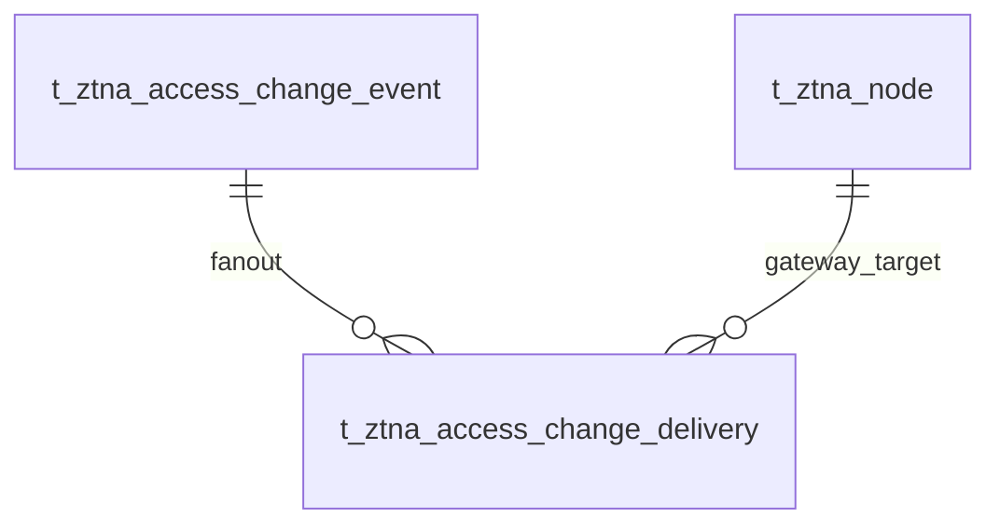

# VeloTrust ZTNA 数据库设计：授权变更与 Gateway 确认

- 数据库：PostgreSQL
- 结构基线：管理端迁移 020
- 业务触发：设备、节点或 IAM 用户启用状态变化
- 目标：保留授权变化，推动在线 Gateway 及时重算 Peer，并记录配置生效确认。

## 1. 表关系

事件表由 Management 在改变用户或节点状态的同一事务内写入。事务提交后通过 PostgreSQL `NOTIFY` 唤醒 HUB；HUB 也会定期扫描未完成事件，避免通知丢失。

## 2. `t_ztna_access_change_event`

每行表示一个用户、设备或节点的授权状态发生变化。

| 字段 | PostgreSQL 类型 | 可空 | 默认值 | 说明 |
|---|---|---:|---|---|
| `id` | `BIGINT` identity | 否 | — | 事件主键。 |
| `subject_type` | `VARCHAR(24)` | 否 | — | `user`、`device` 或 `node`。 |
| `subject_id` | `BIGINT` | 否 | — | 对应领域表的主键；该列不设跨领域多态外键。 |
| `change_type` | `VARCHAR(32)` | 否 | — | `disabled`、`enabled` 或 `authorization_changed`。 |
| `status` | `VARCHAR(16)` | 否 | `pending` | `pending` 表示尚有 Gateway 未确认；全部目标确认或已不再有效时为 `completed`。 |
| `targets_initialized` | `BOOLEAN` | 否 | `FALSE` | HUB 是否已为本事件创建 Gateway 投递目标。 |
| 公共审计字段 | — | 否 | — | `created_at/by`、`updated_at/by`、`version_no`，定义见数据库设计总览。 |

状态通过 CHECK 约束限定；事件以状态、创建时间和主键建立待处理索引，并按主体类型、主体主键和时间建立查询索引。

## 3. `t_ztna_access_change_delivery`

每行记录一个 Gateway 对该事件的当前配置确认。

| 字段 | PostgreSQL 类型 | 可空 | 默认值 | 说明 |
|---|---|---:|---|---|
| `id` | `BIGINT` identity | 否 | — | 投递记录主键。 |
| `event_id` | `BIGINT` | 否 | — | 外键指向事件；事件删除时级联清理。 |
| `gateway_node_id` | `BIGINT` | 否 | — | 外键指向目标 Gateway 节点。 |
| `status` | `VARCHAR(16)` | 否 | `pending` | `pending` 表示等待通知或确认，`acknowledged` 表示 Gateway 已应用当前配置。 |
| `last_notified_at` | `TIMESTAMPTZ` | 是 | — | 最近一次通知该 Gateway 的时间；超时后 HUB 会重试。 |
| `acknowledged_at` | `TIMESTAMPTZ` | 是 | — | Gateway 确认应用当前配置的时间。 |
| `last_error` | `VARCHAR(512)` | 是 | — | 最近一次投递或应用失败说明，供后续诊断使用。 |
| 公共审计字段 | — | 否 | — | `created_at/by`、`updated_at/by`、`version_no`。 |

唯一约束 `(event_id, gateway_node_id)` 保证幂等建目标；状态与 `acknowledged_at` 的一致性由 CHECK 约束保证。待处理目标按 Gateway、状态和最近通知时间建索引。

## 4. 生效与故障行为

- 禁用设备或用户会让 HUB 编译的新 Gateway 配置排除相关 Client Peer；启用时按现有隧道业务配置恢复 Peer。
- Gateway 断开时保留本地缓存配置；事件状态继续为待确认。Gateway 恢复连接后，先认证并获取、应用数据库中的当前配置，再确认事件。
- HUB 只为与受影响节点处于同一活动隧道的 Gateway 创建投递目标，避免无关 Gateway 收到变更。HUB 通过实例本地活动流唤醒在线 Gateway。确认时间目标为尽力 5 秒；未确认的目标持续重试，控制台显示已确认数和目标数。
- Gateway 在应用配置失败时不确认该事件。现有 Gateway 故障处理负责阻断转发；控制台通过 `last_error` 显示最近一次失败原因。
- 事件与 IAM 用户状态或节点状态写入处于同一数据库事务。数据库提交后发生服务重启时，HUB 可从事件表恢复投递。
- 运行时流归属仍是 HUB 实例本地状态；多个实例各自扫描共享 outbox，只唤醒各自持有的流。共享投递行和数据库通知协调最终一致性。

## 5. 迁移与代码边界

- Migration: [`020_access_revocation_delivery.sql`](../../../management/migrations/postgresql/020_access_revocation_delivery.sql)
- Management 写入 outbox 并暴露最新主体事件的确认进度；业务表写入仍通过 `db.Save`。
- HUB 读取和更新投递状态，通过 PostgreSQL `LISTEN/NOTIFY` 与每秒轮询协同；Gateway 只接收 HUB 控制流，不访问 Management。
