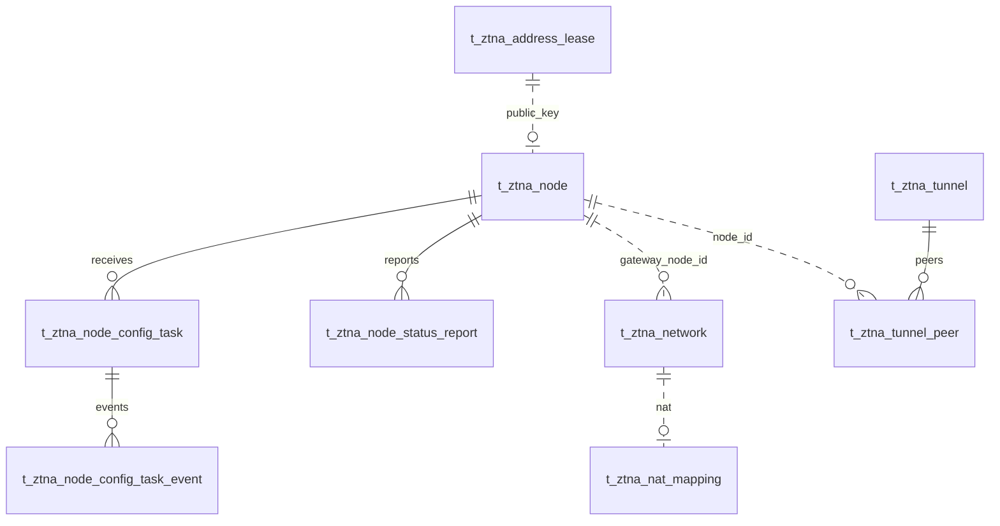

# VeloTrust ZTNA 数据库设计：配置编译、分发任务与节点状态

- 文档版本：2.0
- 数据库：PostgreSQL
- 结构基线：迁移 006–019。
- 总览与公共字段：[ZTNA 数据库设计总览](ztna_data_design.md)
- 业务依据：[数据模型设计文档](../../VeloTrust_数据模型设计文档_最终版.md)

## 1. 模块职责与配置来源

系统不在数据库保存一份可手工编辑的 Gateway 配置 JSON。HUB 根据当前业务记录编译期望状态并计算内容摘要：

- Gateway 隧道地址来自该节点公钥对应的有效 IPAM 租约。
- Peer 来自 Gateway 所属活动隧道中的活动 Peer 记录。
- `routes` 来自 `gateway_node_id` 绑定到该 Gateway 的活动网络站点。
- NAT 来自这些网络站点的启用映射及 Overlay 全局网段。
- 接口名、监听端口、私钥和 HUB 连接参数保留在 Gateway 本机配置。
- 访问策略规则目前没有稳定的机器编译格式，因此 HUB 生成空 ACL 规则集；Gateway 将其解释为默认拒绝。

每次编译的摘要用于检测业务数据变化和判断节点是否收敛。只有分发任务和事件、节点状态快照写入运行状态表，不保存第二份配置内容。

本模块收录 3 张表。实线表示数据库外键；Gateway 配置输入表作为关系上下文列出，但仍由各功能模块负责其结构。

## 2. 数据表设计

标准主键及公共审计字段按总览约定省略。

### 2.1 `t_ztna_node_config_task` — 配置分发任务

记录某个节点需要应用的编译配置摘要及任务状态。任务不保存配置 JSON；节点重连时 HUB 从当前业务表重新编译内容。

| 字段 | PostgreSQL 类型 | 可空 | 默认值 | 说明 |
|---|---|---|---|---|
| `task_id` | `VARCHAR(64)` | 否 | — | 任务唯一标识。 |
| `node_id` | `BIGINT` | 否 | — | 目标节点，外键指向 `t_ztna_node.id`。 |
| `target_config_hash` | `VARCHAR(128)` | 是 | — | 目标编译配置的内容摘要；不是配置版本号。 |
| `task_type` | `VARCHAR(32)` | 否 | — | 任务类型：`apply_config`、`revoke`、`rotate_key`。 |
| `status` | `VARCHAR(24)` | 否 | `'pending'` | `pending`、`queued`、`sent`、`received`、`applying`、`applied`、`verified`、`failed`、`cancelled`。 |
| `retry_count` | `INTEGER` | 否 | `0` | 重试次数。 |
| `next_retry_at` | `TIMESTAMPTZ` | 是 | — | 下一次允许重试的时间。 |
| `last_error_code` | `VARCHAR(128)` | 是 | — | 最近失败的稳定错误代码。 |
| `last_error_message` | `VARCHAR(512)` | 是 | — | 最近失败的脱敏摘要。 |
| `started_at` | `TIMESTAMPTZ` | 是 | — | 首次开始发送时间。 |
| `finished_at` | `TIMESTAMPTZ` | 是 | — | 完成或失败时间。 |

**数据库约束与索引**

- `UNIQUE (task_id, node_id)`，保证任务标识与目标节点对应。
- `node_id` 外键引用 `t_ztna_node.id`，删除限制为 `RESTRICT`。
- `task_type`、`status`、重试次数及开始/结束时间由 CHECK 约束校验。
- `(status, next_retry_at)` 对待发送、排队及失败任务建立部分索引；另有 `(node_id, created_at DESC)` 查询索引。

### 2.2 `t_ztna_node_config_task_event` — 配置任务事件

追加记录任务创建、发送、应用回执与失败状态，供诊断任务生命周期。

| 字段 | PostgreSQL 类型 | 可空 | 默认值 | 说明 |
|---|---|---|---|---|
| `task_id` | `VARCHAR(64)` | 否 | — | 所属任务标识。 |
| `node_id` | `BIGINT` | 否 | — | 目标节点；与 `task_id` 一起引用任务。 |
| `event_type` | `VARCHAR(64)` | 否 | — | 事件类型，如 `task.created`、`task.sent`、`config.applied`、`config.failed`。 |
| `from_status` | `VARCHAR(24)` | 是 | — | 状态变化前的任务状态。 |
| `to_status` | `VARCHAR(24)` | 是 | — | 状态变化后的任务状态。 |
| `detail_json` | `JSONB` | 否 | `'{}'::JSONB` | 脱敏事件详情对象；包含目标摘要，不包含整份配置或私钥。 |
| `occurred_at` | `TIMESTAMPTZ` | 否 | `CURRENT_TIMESTAMP` | 事件发生时间。 |

**数据库约束与索引**

- `(task_id, node_id)` 复合外键引用任务表相同字段，删除限制为 `RESTRICT`。
- `detail_json` 必须是 JSON 对象；状态字段受任务状态枚举 CHECK 约束。
- `(task_id, occurred_at)` 与 `(node_id, occurred_at DESC)` 支持按任务和节点查询时间线。

### 2.3 `t_ztna_node_status_report` — 节点状态快照

保存节点定期上报的实际配置摘要和运行状态。快照用于运维诊断；它不替代当前业务表，也不承载配置内容。

| 字段 | PostgreSQL 类型 | 可空 | 默认值 | 说明 |
|---|---|---|---|---|
| `node_id` | `BIGINT` | 否 | — | 上报节点，外键指向 `t_ztna_node.id`。 |
| `reported_at` | `TIMESTAMPTZ` | 否 | — | 上报时间。 |
| `agent_version` | `VARCHAR(64)` | 是 | — | Agent 版本。 |
| `actual_config_hash` | `VARCHAR(128)` | 是 | — | 节点实际应用的编译配置摘要。 |
| `wireguard_status` | `VARCHAR(24)` | 否 | `'unknown'` | `unknown`、`down`、`starting`、`up`、`error`。 |
| `health_status` | `VARCHAR(24)` | 否 | `'unknown'` | `unknown`、`healthy`、`degraded`、`unhealthy`。 |
| `connected_peer_count` | `INTEGER` | 否 | `0` | 已连接 Peer 数；需同时读取指标中的 `connected_peer_count_known`。 |
| `metrics_json` | `JSONB` | 否 | `'{}'::JSONB` | 运行指标对象。 |

**数据库约束与索引**

- `node_id` 外键引用 `t_ztna_node.id`，删除限制为 `RESTRICT`。
- 状态枚举、非负 Peer 数及 `metrics_json` 对象形状由 CHECK 约束校验。
- `(node_id, reported_at DESC)` 支持查询节点最近状态。

## 3. 配置编译和分发一致性

1. HUB 在同一个 PostgreSQL 查询快照中读取节点、活动租约、Peer、关联网络、NAT 和 Overlay 网段。
2. HUB 对输入执行地址规范化，按稳定顺序序列化配置并计算 SHA-256 摘要。
3. 编译结果摘要变化时，HUB 创建 `apply_config` 任务和 `task.created` 事件；业务数据不复制到配置表。
4. Gateway 收到快照后校验摘要和本机配置边界；应用成功后回执摘要。只有回执与当前重新编译的摘要相同，任务才会置为已应用。
5. 关联站点 CIDR 表示 Gateway 本地转发的目的网段。Agent 检查系统路由必须由物理/静态本地路由覆盖，且不能经过该 Gateway 的 WireGuard 接口，也不能只依赖默认路由。
6. 规则缺失、输入无效、数据库读取失败或状态不一致时不生成放行规则；Gateway fail-closed。

`target_config_hash` 只标识一份由当前业务状态编译出的内容，不代表递增业务版本。状态未知或过期时不能默认放行。配置更新后的目标状态通过重新编译和节点回执收敛。

## 4. 迁移与边界

- 迁移 018 曾将旧配置修订压缩到 `t_ztna_config`，以支持过渡期手工 JSON 发布。
- 迁移 019 删除 `t_ztna_config` 及 `ztna.config.read` / `ztna.config.write` 权限。旧表内容不再是权威数据，业务数据表成为唯一输入源。
- `t_ztna_access_policy.rules_json` 暂无稳定的 Gateway ACL 编译协议；当前下发空规则集并默认拒绝。实现规则编译前，不应把管理策略状态误报为已在数据面强制执行。
- 任务表未记录 HUB 实例租约或归属，多实例 HA 的任务抢占和连接恢复仍需后续设计。
