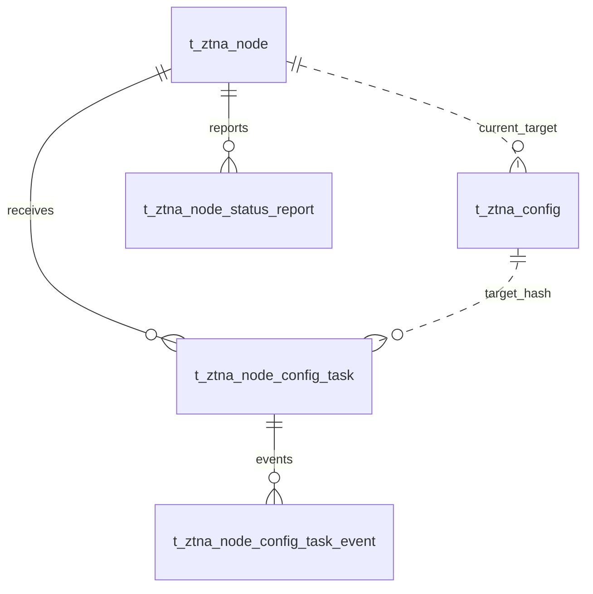

# VeloTrust ZTNA 数据库设计：配置发布与节点状态

- 文档版本：1.0
- 数据库：PostgreSQL
- 结构基线：代码仓库迁移 006–018 的累计结果，包含元数据补齐及网关合并。
- 总览与公共字段：[ZTNA 数据库设计总览](ztna_data_design.md)
- 业务依据：[数据模型设计文档](../../VeloTrust_数据模型设计文档_最终版.md)

## 1. 模块职责与关系

数据库为每个目标保存唯一一条当前期望配置；配置内容更新时覆盖该行。分发任务、任务事件和状态上报记录应用过程，不构成配置历史版本。

本模块收录 4 张表。图中实线表示已声明的外键，虚线表示应用层校验的逻辑关系；跨模块表只作为关系上下文，其字段在所属文档定义。Mermaid 的线型在本文用于区分物理约束与逻辑关系。

## 2. 数据表设计

逐表省略标准主键及公共审计字段，具体定义见总览。业务操作人字段和业务时间字段仍逐一列出；各表均已在迁移 012 补齐公共审计列。

### 2.1 `t_ztna_config` — 当前期望配置

每个目标仅保存一条当前配置快照或安全存储引用。更新覆盖该记录；旧配置内容不保留。

- 初始表来源：[011_ztna_business_core.sql](../../../management/migrations/postgresql/011_ztna_business_core.sql)，迁移 018 将历史修订折叠并重命名为当前配置表。
- 主键：`id BIGINT GENERATED BY DEFAULT AS IDENTITY`。

| 字段 | PostgreSQL 类型 | 可空 | 默认值 | 说明 |
|---|---|---|---|---|
| `target_type` | `VARCHAR(24)` | 否 | — | 目标类型：node、device、tunnel、gateway。 |
| `target_id` | `BIGINT` | 否 | — | 目标实体 ID；根据 target_type 逻辑关联，当前无目标外键。 |
| `config_hash` | `VARCHAR(128)` | 否 | — | 当前配置内容摘要，用于内容校验、幂等应用和收敛判断，不是版本号。 |
| `config_json` | `JSONB` | 是 | — | 内联配置快照；必须和 config_blob_ref 二选一，秘密需加密或使用安全引用。 |
| `config_blob_ref` | `VARCHAR(512)` | 是 | — | 外部配置对象引用；必须和 config_json 二选一。 |
| `reason` | `VARCHAR(512)` | 是 | — | 最近一次更新当前配置的原因。 |

**数据库约束**

| 约束名称 | 定义 |
|---|---|
| `uq_t_ztna_config_target` | `UNIQUE (target_type, target_id)` |
| `ck_t_ztna_config_target` | `CHECK (target_type IN ('node', 'device', 'tunnel', 'gateway'))` |
| `ck_t_ztna_config_payload` | `CHECK ((config_json IS NOT NULL) <> (config_blob_ref IS NOT NULL))` |

主键与 UNIQUE 约束也会形成相应索引。公共 `version_no` 仅用于并发更新保护，不表示业务配置版本。

**业务一致性与生命周期**

`target_id` 是多态引用，没有数据库外键；gateway 目标仍指向统一节点 ID。JSON 和 blob 引用恰有一个非空，DDL 没有限定 JSON 的结构、外部对象存在性或摘要算法；配置服务应统一校验并保护秘密。每次更新替换当前数据库状态，系统不承诺恢复旧配置。

### 2.2 `t_ztna_node_config_task` — 节点配置分发任务

跟踪配置下发、接收、应用、验证和重试，不将消息发送成功当作配置生效。

- 建表来源：[011_ztna_business_core.sql](../../../management/migrations/postgresql/011_ztna_business_core.sql)；字段和约束按后续迁移合并。
- 主键：`id BIGINT GENERATED BY DEFAULT AS IDENTITY`。

| 字段 | PostgreSQL 类型 | 可空 | 默认值 | 说明 |
|---|---|---|---|---|
| `task_id` | `VARCHAR(64)` | 否 | — | 全局唯一任务标识。 |
| `node_id` | `BIGINT` | 否 | — | 目标运行节点，外键指向 t_ztna_node.id。 |
| `target_config_hash` | `VARCHAR(128)` | 是 | — | 本任务要应用的配置内容摘要，用于幂等和识别过期任务；不是配置版本号。 |
| `task_type` | `VARCHAR(32)` | 否 | — | 任务类型：apply_config、revoke、rotate_key。 |
| `status` | `VARCHAR(24)` | 否 | `'pending'` | 状态：pending、queued、sent、received、applying、applied、verified、failed、cancelled。 |
| `retry_count` | `INTEGER` | 否 | `0` | 累计重试次数，非负。 |
| `next_retry_at` | `TIMESTAMPTZ` | 是 | — | 下一次允许重试的时间。 |
| `last_error_code` | `VARCHAR(128)` | 是 | — | 最近错误的稳定代码。 |
| `last_error_message` | `VARCHAR(512)` | 是 | — | 脱敏后的错误摘要。 |
| `started_at` | `TIMESTAMPTZ` | 是 | — | 任务开始执行时间。 |
| `finished_at` | `TIMESTAMPTZ` | 是 | — | 任务结束时间；与 started_at 同时存在时不能早于开始时间。 |

**数据库约束**

| 约束名称 | 定义 |
|---|---|
| `uq_t_ztna_node_config_task_id` | `UNIQUE (task_id)` |
| `uq_t_ztna_node_config_task_node` | `UNIQUE (task_id, node_id)` |
| `fk_t_ztna_node_config_task_node` | `FOREIGN KEY (node_id) REFERENCES public.t_ztna_node (id) ON DELETE RESTRICT` |
| `ck_t_ztna_node_config_task_hash` | `CHECK (target_config_hash IS NULL OR length(btrim(target_config_hash)) > 0)` |
| `ck_t_ztna_node_config_task_type` | `CHECK (task_type IN ('apply_config', 'revoke', 'rotate_key'))` |
| `ck_t_ztna_node_config_task_status` | `CHECK (status IN ('pending', 'queued', 'sent', 'received', 'applying', 'applied', 'verified', 'failed', 'cancelled'))` |
| `ck_t_ztna_node_config_task_retry` | `CHECK (retry_count >= 0)` |
| `ck_t_ztna_node_config_task_times` | `CHECK (finished_at IS NULL OR started_at IS NULL OR finished_at >= started_at)` |

**索引**

| 索引名称 | 索引键与条件 |
|---|---|
| `ix_t_ztna_node_config_task_retry` | `(status, next_retry_at) WHERE status IN ('pending', 'queued', 'failed')` |
| `ix_t_ztna_node_config_task_node_created` | `(node_id, created_at DESC)` |

说明：主键与 UNIQUE 约束也会形成相应唯一索引，上表只列额外显式创建的索引。

**业务一致性与生命周期**

sent/received/applied/verified 分别表示发送、接收、应用和验证，不能相互替代。apply_config 任务必须携带目标节点当前配置的 hash；执行前再次比较数据库当前 hash，已过期的任务取消并重新排队。重试应幂等并受任务状态、退避及旧回执保护；配置任务表尚无 HUB 实例归属/租约列，不应宣称仅凭该表已实现多实例协调。

### 2.3 `t_ztna_node_config_task_event` — 配置任务事件

追加记录任务状态迁移、节点回执和失败详情。

- 建表来源：[011_ztna_business_core.sql](../../../management/migrations/postgresql/011_ztna_business_core.sql)；字段和约束按后续迁移合并。
- 主键：`id BIGINT GENERATED BY DEFAULT AS IDENTITY`。

| 字段 | PostgreSQL 类型 | 可空 | 默认值 | 说明 |
|---|---|---|---|---|
| `task_id` | `VARCHAR(64)` | 否 | — | 所属任务标识；与 node_id 共同形成任务复合外键。 |
| `node_id` | `BIGINT` | 否 | — | 任务目标节点 ID；通过任务复合外键验证归属。 |
| `event_type` | `VARCHAR(64)` | 否 | — | 任务事件类型。 |
| `from_status` | `VARCHAR(24)` | 是 | — | 可选迁移前状态，枚举与任务状态一致。 |
| `to_status` | `VARCHAR(24)` | 是 | — | 可选迁移后状态，枚举与任务状态一致。 |
| `detail_json` | `JSONB` | 否 | `'{}'::JSONB` | 事件详情 JSON 对象，应脱敏。 |
| `occurred_at` | `TIMESTAMPTZ` | 否 | `CURRENT_TIMESTAMP` | 事件发生时间。 |

**数据库约束**

| 约束名称 | 定义 |
|---|---|
| `fk_t_ztna_node_config_task_event_task` | `FOREIGN KEY (task_id, node_id) REFERENCES public.t_ztna_node_config_task (task_id, node_id) ON DELETE RESTRICT` |
| `ck_t_ztna_node_config_task_event_detail` | `CHECK (jsonb_typeof(detail_json) = 'object')` |
| `ck_t_ztna_node_config_task_event_from_status` | `CHECK ( from_status IS NULL OR from_status IN ('pending', 'queued', 'sent', 'received', 'applying', 'applied', 'verified', 'failed', 'cancelled') )` |
| `ck_t_ztna_node_config_task_event_to_status` | `CHECK ( to_status IS NULL OR to_status IN ('pending', 'queued', 'sent', 'received', 'applying', 'applied', 'verified', 'failed', 'cancelled') )` |

**索引**

| 索引名称 | 索引键与条件 |
|---|---|
| `ix_t_ztna_node_config_task_event_task_time` | `(task_id, occurred_at)` |
| `ix_t_ztna_node_config_task_event_node_time` | `(node_id, occurred_at DESC)` |

说明：主键与 UNIQUE 约束也会形成相应唯一索引，上表只列额外显式创建的索引。

**业务一致性与生命周期**

复合外键确保事件的 node_id 属于该任务。from_status/to_status 的 CHECK 只验证枚举，不限制合法状态迁移方向；事件应由已验证的任务处理流程追加。

### 2.4 `t_ztna_node_status_report` — 节点状态快照

保存节点上报的实际配置和运行快照，供配置收敛与运维查询使用。

- 建表来源：[011_ztna_business_core.sql](../../../management/migrations/postgresql/011_ztna_business_core.sql)；字段和约束按后续迁移合并。
- 主键：`id BIGINT GENERATED BY DEFAULT AS IDENTITY`。

| 字段 | PostgreSQL 类型 | 可空 | 默认值 | 说明 |
|---|---|---|---|---|
| `node_id` | `BIGINT` | 否 | — | 上报节点，外键指向 t_ztna_node.id。 |
| `reported_at` | `TIMESTAMPTZ` | 否 | — | 状态快照的上报时间。 |
| `agent_version` | `VARCHAR(64)` | 是 | — | 本次上报的软件版本。 |
| `actual_config_hash` | `VARCHAR(128)` | 是 | — | 节点报告已应用配置的内容摘要；可与当前配置 hash 比较判断是否收敛。 |
| `wireguard_status` | `VARCHAR(24)` | 否 | `'unknown'` | WireGuard 运行状态：unknown、down、starting、up、error。 |
| `health_status` | `VARCHAR(24)` | 否 | `'unknown'` | 健康状态：unknown、healthy、degraded、unhealthy。 |
| `connected_peer_count` | `INTEGER` | 否 | `0` | 本次连接 Peer 数量，非负。 |
| `metrics_json` | `JSONB` | 否 | `'{}'::JSONB` | 运行指标 JSON 对象；高频指标可另用监控系统。 |

**数据库约束**

| 约束名称 | 定义 |
|---|---|
| `fk_t_ztna_node_status_report_node` | `FOREIGN KEY (node_id) REFERENCES public.t_ztna_node (id) ON DELETE RESTRICT` |
| `ck_t_ztna_node_status_report_wireguard` | `CHECK (wireguard_status IN ('unknown', 'down', 'starting', 'up', 'error'))` |
| `ck_t_ztna_node_status_report_health` | `CHECK (health_status IN ('unknown', 'healthy', 'degraded', 'unhealthy'))` |
| `ck_t_ztna_node_status_report_peers` | `CHECK (connected_peer_count >= 0)` |
| `ck_t_ztna_node_status_report_metrics` | `CHECK (jsonb_typeof(metrics_json) = 'object')` |

**索引**

| 索引名称 | 索引键与条件 |
|---|---|
| `ix_t_ztna_node_status_report_node_time` | `(node_id, reported_at DESC)` |

说明：主键与 UNIQUE 约束也会形成相应唯一索引，上表只列额外显式创建的索引。

**业务一致性与生命周期**

上报时间不是数据库接收时间；接受 actual_config_hash 前应验证节点身份，并拒绝乱序的状态上报。状态报告可保留运行观测历史，但不会保存历史配置内容。上报表的创建审计列由迁移 012 补齐，不意味着状态快照应被普通修改接口覆盖。

## 3. 使用与维护约定

- 写入由对应领域服务经 Repository 与事务接口完成；使用项目 `db.Save` 持久化业务模型，由服务显式传递 `internal/context` 中的操作者用户名。
- 公共 `version_no` 用于并发修改检查；它不是配置历史版本。当前配置行是期望状态的唯一权威来源，Agent 以 config_hash 回报实际应用状态。
- 本文描述仓库迁移结构与业务要求，不代表所有服务、页面或分发链路已实现；数据库 CHECK 未覆盖的业务条件须在服务事务中明确验证。
- 涉及身份或授权的状态未知、过期或无法验证时默认拒绝访问；状态变更及撤销应留存审计，数据面应用结果由节点回执确认。
