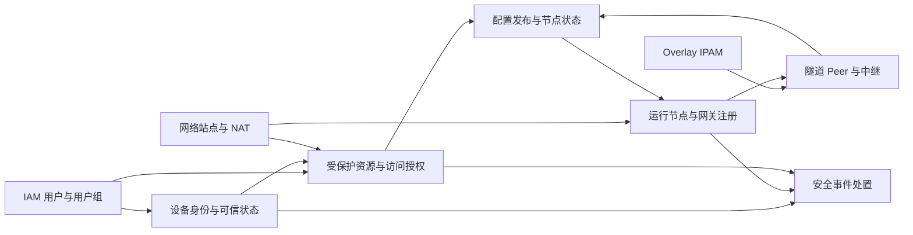

# VeloTrust ZTNA 数据库设计总览

- 文档版本：1.0
- 数据库：PostgreSQL
- 文档范围：设备、节点、网络站点、Overlay IPAM、访问策略、隧道、配置分发、授权变更投递和安全事件。
- 结构与审计语义基线：仓库中迁移 006–024 的累计结果；不是对运行数据库已迁移状态的断言。
- 业务依据：[VeloTrust 数据模型设计文档](../../VeloTrust_数据模型设计文档_最终版.md)

## 1. 模块划分与文档入口

当前有效业务表共 **26 张**，按九个功能模块编写。每张表只在所属模块详细定义；跨模块 E-R 关系保留外键目标名称，便于追踪。公共字段集中说明，逐表文档列出业务字段、数据类型、可空性、默认值、约束、索引和生命周期要求。

| 功能模块 | 表数 | 设计文档 |
|---|---|---|
| 设备身份与可信状态 | 3 | [设备身份与可信状态](ztna_device_data_design.md) |
| 运行节点与网关注册 | 2 | [运行节点与网关注册](ztna_node_data_design.md) |
| 网络站点与 NAT | 2 | [网络站点与 NAT](ztna_network_data_design.md) |
| Overlay IPAM 地址管理 | 3 | [Overlay IPAM 地址管理](ztna_ipam_data_design.md) |
| 受保护资源与访问授权 | 6 | [受保护资源与访问授权](ztna_policy_data_design.md) |
| 隧道 Peer 与中继 | 3 | [隧道 Peer 与中继](ztna_tunnel_data_design.md) |
| 配置发布与节点状态 | 4 | [配置发布与节点状态](ztna_config_data_design.md) |
| 授权变更与 Gateway 确认 | 2 | [授权变更与 Gateway 确认](ztna_access_change_data_design.md) |
| 安全事件处置 | 1 | [安全事件处置](ztna_security_data_design.md) |

IAM 用户、角色、用户组和管理审计表见 [IAM 数据库设计](iam_data_design.md)。ZTNA 的安全处置人和审批人可以引用 IAM 用户；管理 RBAC 与网络访问授权分别维护。

## 2. 模块间数据流

图表示业务协作方向，不表示每条连线都存在外键。模块文档中的 E-R 图和约束表给出物理关系与逻辑关联。

## 3. 公共字段

除 Overlay 单例主键外，27 张表均使用自增 `id BIGINT` 主键。迁移 012 对 ZTNA 业务表、关系表和事件表补齐了统一保存所需审计元数据；迁移 015 将早期网关凭证及 IPAM 的数字审计操作人转换为用户名。以下公共字段在逐表字段表中省略：

| 字段 | PostgreSQL 类型 | 约束 / 默认值 | 说明 |
|---|---|---|---|
| `id` | `BIGINT` | `GENERATED BY DEFAULT AS IDENTITY PRIMARY KEY` | 无业务含义的记录主键；Overlay 单例例外。 |
| `created_at` | `TIMESTAMPTZ` | 非空，默认 `CURRENT_TIMESTAMP` | 记录创建时间。 |
| `created_by` | `VARCHAR(64)` | 非空，默认 `''` | 创建操作主体，由服务上下文提供；可以是员工用户名，或带类型前缀的机器主体。 |
| `updated_at` | `TIMESTAMPTZ` | 非空，默认 `CURRENT_TIMESTAMP` | 最近更新时间。 |
| `updated_by` | `VARCHAR(64)` | 非空，默认 `''` | 最近更新操作主体；可以是员工用户名，或带类型前缀的机器主体。 |
| `version_no` | `BIGINT` | 非空，默认 `1` | 公共模型并发版本；具体是否有正数 CHECK 见各表约束。 |

说明：

- `t_ztna_overlay_network.id` 是 `SMALLINT PRIMARY KEY DEFAULT 1`，并有 `id=1` 的单例检查。
- 仅 `t_ztna_network` 当前含 `is_del BOOLEAN NOT NULL DEFAULT FALSE`；它在网络站点字段表中保留说明。
- 人工操作使用员工用户名；已认证的 Client Agent、Gateway 和 HUB 后台操作分别使用 `client:<node_code>`、`gateway:<node_code>`、`hub:<instance_id>`。设备显示名称和数据库数字主键不作为审计主体。
- 主体字符串最长 64 字符；过长的节点代码或 HUB 实例标识使用带原类型前缀的稳定 SHA-256 摘要，避免写入时截断或失败。
- 审计列的数据库默认时间不会自动触发更新时间，操作主体也不会由数据库自动推导；服务需调用模型生命周期方法，并通过 Repository 保存。
- `requested_by`、`approved_by`、`acknowledged_by`、`resolved_by` 是具体业务操作人的 BIGINT 外键；`published_by` 是发布人用户名。这些字段不能因后缀为 `_by` 就一律改成公共字段。
- 事件表具有公共更新元数据，是为适配现有保存基础设施；姿态检查、决策和任务事件等事实记录在业务语义上仍应追加保留。

## 4. 全量表归属

| 数据表 | 功能模块 | 用途 |
|---|---|---|
| `t_ztna_device` | [设备身份与可信状态](ztna_device_data_design.md) | 终端设备 |
| `t_ztna_device_credential` | [设备身份与可信状态](ztna_device_data_design.md) | 设备凭证 |
| `t_ztna_device_posture_check` | [设备身份与可信状态](ztna_device_data_design.md) | 设备合规检查 |
| `t_ztna_access_change_event` | [授权变更与 Gateway 确认](ztna_access_change_data_design.md) | 用户、设备或节点授权状态变化事件 |
| `t_ztna_access_change_delivery` | [授权变更与 Gateway 确认](ztna_access_change_data_design.md) | Gateway 当前配置应用确认 |
| `t_ztna_node` | [运行节点与网关注册](ztna_node_data_design.md) | 运行节点 |
| `t_gateway_registration_token` | [运行节点与网关注册](ztna_node_data_design.md) | 网关一次性注册凭证 |
| `t_ztna_network` | [网络站点与 NAT](ztna_network_data_design.md) | 网络与网络站点 |
| `t_ztna_nat_mapping` | [网络站点与 NAT](ztna_network_data_design.md) | 网络 NAT 映射 |
| `t_ztna_overlay_network` | [Overlay IPAM 地址管理](ztna_ipam_data_design.md) | Overlay 全局地址范围 |
| `t_ztna_address_pool` | [Overlay IPAM 地址管理](ztna_ipam_data_design.md) | Overlay 地址池 |
| `t_ztna_address_lease` | [Overlay IPAM 地址管理](ztna_ipam_data_design.md) | Overlay 地址租约 |
| `t_ztna_address_pool.client_group_id` | [Overlay IPAM 地址管理](ztna_ipam_data_design.md) | 员工组关联动态 Client 地址池；仅用于分配 Overlay IP，不授予 Gateway 访问权限 |
| `t_ztna_protected_resource` | [受保护资源与访问授权](ztna_policy_data_design.md) | 受保护资源 |
| `t_ztna_access_policy` | [受保护资源与访问授权](ztna_policy_data_design.md) | 访问策略 |
| `t_ztna_policy_subject` | [受保护资源与访问授权](ztna_policy_data_design.md) | 策略主体关系 |
| `t_ztna_policy_resource` | [受保护资源与访问授权](ztna_policy_data_design.md) | 策略目标关系 |
| `t_ztna_authorization_decision` | [受保护资源与访问授权](ztna_policy_data_design.md) | 授权决策记录 |
| `t_ztna_authorization_grant` | [受保护资源与访问授权](ztna_policy_data_design.md) | 临时访问授权 |
| `t_ztna_tunnel` | [隧道 Peer 与中继](ztna_tunnel_data_design.md) | 逻辑隧道 |
| `t_ztna_tunnel_peer` | [隧道 Peer 与中继](ztna_tunnel_data_design.md) | 隧道 Peer |
| `t_ztna_relay` | [隧道 Peer 与中继](ztna_tunnel_data_design.md) | 中继节点扩展 |
| `t_ztna_node_config_task` | [配置发布与节点状态](ztna_config_data_design.md) | 节点配置分发任务 |
| `t_ztna_node_config_task_event` | [配置发布与节点状态](ztna_config_data_design.md) | 配置任务事件 |
| `t_ztna_node_status_report` | [配置发布与节点状态](ztna_config_data_design.md) | 节点状态快照 |
| `t_ztna_security_event` | [安全事件处置](ztna_security_data_design.md) | 安全事件 |

## 5. 迁移基线与兼容说明

| 迁移 | 对本文结构的影响 |
|---|---|
| [006](../../../management/migrations/postgresql/006_gateway_enrollment.sql) | 初始网关及一次性注册凭证；仅凭证表在合并后保留。 |
| [008](../../../management/migrations/postgresql/008_ipam_network_catalog.sql) | 路由业务网络目录及旧网关网络关系。 |
| [009](../../../management/migrations/postgresql/009_ipam_overlay_pools_leases_nat.sql) | 地址池、租约、NAT 映射。 |
| [010](../../../management/migrations/postgresql/010_ipam_overlay_network.sql) | Overlay 全局地址范围。 |
| [011](../../../management/migrations/postgresql/011_ztna_business_core.sql) | 设备、节点、资源策略、授权、隧道、配置和安全事件核心表。 |
| [012](../../../management/migrations/postgresql/012_model_save_metadata.sql) | 统一保存模型的公共审计列。 |
| [013](../../../management/migrations/postgresql/013_physical_sites.sql) | 网络站点复用网络表，增加默认网关和逻辑删除字段。 |
| [014](../../../management/migrations/postgresql/014_network_site_labels.sql) | 管理菜单和权限显示为网络站点，未新增业务表。 |
| [015](../../../management/migrations/postgresql/015_unify_gateway_nodes_and_audit_actors.sql) | 网关身份与网络关系合入通用节点，迁移外键与审计用户名。 |
| [016](../../../management/migrations/postgresql/016_network_gateway_ownership.sql) | 统一网络网关归属，重命名 gateway_node_id，删除节点网络关系表并增加反向查询索引。 |
| [017](../../../management/migrations/postgresql/017_remove_node_endpoint.sql) | 删除未被业务使用且与节点主表端点字段重复的候选端点表。 |
| [018](../../../management/migrations/postgresql/018_current_policy_and_config_state.sql) | 将策略规则移入策略当前行，并将旧配置修订折叠为过渡期当前配置表。 |
| [019](../../../management/migrations/postgresql/019_compile_gateway_config_from_business_data.sql) | 删除过渡期 `t_ztna_config` 和手工配置权限；HUB 改为从当前网络、Peer、IPAM 与 NAT 数据编译 Gateway 配置。 |
| [020](../../../management/migrations/postgresql/020_access_revocation_delivery.sql) | 设备与 Client Agent 节点建立可空一对一关联；新增授权变更 outbox 和 Gateway 确认状态。 |
| [021](../../../management/migrations/postgresql/021_client_hub_enrollment.sql) | 为员工登录和 HUB 侧 Client Agent 注册增加数据结构。 |
| [022](../../../management/migrations/postgresql/022_iam_account_type.sql) | 区分管理账号与员工账号，为 ZTNA 终端身份关联提供用户分类。 |
| [023](../../../management/migrations/postgresql/023_iam_employee_users_menu.sql) | 为员工账号管理提供菜单权限种子数据。 |
| [024](../../../management/migrations/postgresql/024_ztna_audit_principals.sql) | 将历史上由 HUB 创建的 Client 节点、设备和凭证记录回填为对应员工用户名；不覆盖后续更新审计主体。 |
| [025](../../../management/migrations/postgresql/025_ztna_client_group_assignment.sql) | 增加员工用户组到 Client 逻辑隧道及动态地址池的自动分配映射。 |
| [026](../../../management/migrations/postgresql/026_iam_group_management_permissions.sql) | 为平台管理员补齐员工安全用户组和成员管理权限。 |
| [027](../../../management/migrations/postgresql/027_ztna_address_pool_client_group.sql) | 将员工组关联迁移至地址池，移除 Client 用户组到隧道的独立映射表。 |

- `t_gateway_node`、`t_gateway_node_network` 已由迁移 015 删除，不列为当前有效表；网关身份使用 `t_ztna_node`；网络归属随后由迁移 016 统一至网络表。
- 注册凭证保留 `t_gateway_registration_token` 表名，目标列由 `gateway_row_id` 改为 `node_id`，引用统一节点。
- 迁移 016 将 `t_ztna_network.gateway_row_id` 重命名为 `gateway_node_id`，迁移唯一且一致的网关绑定后删除 `t_ztna_node_network`。每个网络最多一个网关，同一网关可拥有多个网络。
- 迁移 017 删除 `t_ztna_node_endpoint`；当前端点值保存在 `t_ztna_node` 的 `control_endpoint`、`public_endpoint` 和 `private_endpoint` 字段中。
- 迁移 018 将策略当前规则保存在 `t_ztna_access_policy.rules_json`，并短暂引入 `t_ztna_config` 作为兼容配置源；迁移 019 删除该表。Gateway 配置现由 HUB 从业务表编译，任务和节点报告通过 `config_hash` 比对实际收敛状态。
- 旧迁移中的数字 created_by/updated_by 不是最终字段类型；015 把有值的 IAM 用户 ID 映射为用户名，无法映射的非零审计人会中止迁移。
- schema 目录的单份建表文件是对应历史阶段的快照；恢复最终结构时必须应用后续迁移，不能仅执行初始快照。

## 6. 关系、约束和业务一致性

- E-R 图中的实线表示 DDL 外键，虚线表示应用层约定。多态主体、配置目标、CIDR 包含关系以及以名称/标签存储的归属不自动具备数据库参照完整性。
- 策略规则和网络、隧道等业务数据以数据库当前记录为准，不维护业务修订历史；HUB 编译后的 `config_hash` 仅用于内容比对和幂等应用。密钥轮换状态仍按密钥生命周期管理，公共 `version_no` 只用于并发写入保护。
- HUB 从已关联网络生成 Gateway 本地转发目的网段；该网段必须有物理或静态路由，不能由 Agent 错误地添加为 WireGuard 出口路由。Gateway 配置应用成功仍需用任务回执及状态校准收敛。
- 真实业务网段允许多站点重叠；访问同址站点需要明确的影子网段映射。Overlay 地址池必须与全局范围相容并校验冲突，不能通过 NAT 台账替代 Overlay 地址租约。
- JSON CHECK 多数只检查对象/数组形状；地址、公钥、策略语义、状态迁移及跨记录一致性需要服务层验证。
- 准入、信任、审批或策略状态无法验证时默认拒绝；凭证消费、地址分配和状态更新使用事务与并发条件保护。
- 用户、设备或节点禁用状态与授权变更事件在同一事务提交；HUB 使用数据库通知加周期扫描推动在线 Gateway 刷新配置，离线 Gateway 重连后应用当前配置。

## 7. 当前未纳入独立表的能力

- DNS 域名分流已有技术方案，但当前迁移没有独立 DNS zone、域名规则、上游服务器或解析日志表。本文不虚构其持久化结构。
- 当前迁移没有专门的 HUB 实例、会话归属或分布式租约表；配置任务和状态快照只能作为运行协作的一部分，不能据此认定高可用协调已经完成。
- 表结构覆盖的能力范围不等于服务、JRPC 接口、页面和数据面联动的实现状态；本文用于数据库设计与后续实现核对。

## 8. 网关归属升级注意事项

迁移 016 在同一事务中锁定网络表与旧关系表，检查后回填唯一网关，并保留已有一致绑定。网络关联多个网关、两处归属冲突、存在非网关/非 route_gateway 关系或 CIDR 快照与网络 CIDR 不同时会报出冲突记录并回滚。请先核对并修正冲突后重试，迁移不会任意选择网关或静默删除无法表达的关系。迁移成功后，Management 与 Web 同时使用 `gateway_node_id`，旧请求字段不再作为输入契约。
