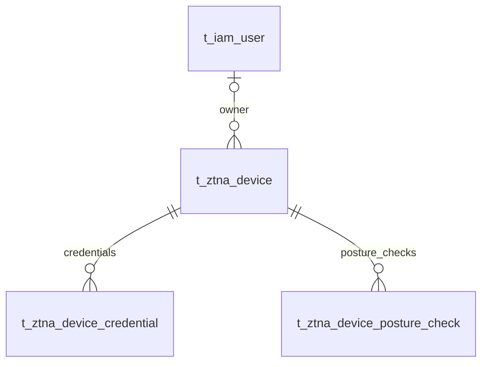

# VeloTrust ZTNA 数据库设计：设备身份与可信状态

- 文档版本：1.0
- 数据库：PostgreSQL
- 结构基线：代码仓库迁移 006–018 的累计结果，包含元数据补齐及网关合并。
- 总览与公共字段：[ZTNA 数据库设计总览](ztna_data_design.md)
- 业务依据：[数据模型设计文档](../../VeloTrust_数据模型设计文档_最终版.md)

## 1. 模块职责与关系

设备凭证和姿态结果是授权输入，节点运行信息见节点模块。

本模块收录 3 张表。图中实线表示已声明的外键，虚线表示应用层校验的逻辑关系；跨模块表只作为关系上下文，其字段在所属文档定义。Mermaid 的线型在本文用于区分物理约束与逻辑关系。

## 2. 数据表设计

逐表省略标准主键及公共审计字段，具体定义见总览。业务操作人字段和业务时间字段仍逐一列出；各表均已在迁移 012 补齐公共审计列。

### 2.1 `t_ztna_device` — 终端设备

保存终端身份、所有者和信任状态。设备完成注册与设备可信是不同的状态。

- 建表来源：[011_ztna_business_core.sql](../../../management/migrations/postgresql/011_ztna_business_core.sql)；字段和约束按后续迁移合并。
- 主键：`id BIGINT GENERATED BY DEFAULT AS IDENTITY`。

| 字段 | PostgreSQL 类型 | 可空 | 默认值 | 说明 |
|---|---|---|---|---|
| `device_name` | `VARCHAR(128)` | 否 | — | 设备显示名称。 |
| `device_uuid` | `VARCHAR(128)` | 否 | — | 设备稳定标识，跨重新连接识别同一设备。 |
| `device_type` | `VARCHAR(32)` | 否 | — | 设备类别，由设备准入业务解释。 |
| `platform` | `VARCHAR(64)` | 否 | — | 操作系统或运行平台。 |
| `platform_version` | `VARCHAR(128)` | 是 | — | 操作系统版本。 |
| `agent_version` | `VARCHAR(64)` | 是 | — | Agent 软件版本。 |
| `owner_user_id` | `BIGINT` | 是 | — | 设备所属用户，外键指向 t_iam_user.id；允许尚未分配所有者。 |
| `status` | `VARCHAR(24)` | 否 | `'pending'` | 设备生命周期：pending、active、disabled、quarantined、revoked。 |
| `trust_status` | `VARCHAR(24)` | 否 | `'unknown'` | 信任状态：unknown、trusted、untrusted、review_required。 |
| `last_seen_at` | `TIMESTAMPTZ` | 是 | — | 最近一次可信上报或活动时间。 |
| `last_seen_ip` | `INET` | 是 | — | 最近观察到的 IPv4/IPv6 地址。 |
| `posture_json` | `JSONB` | 是 | — | 设备姿态汇总，必须是 JSON 对象。 |
| `registered_at` | `TIMESTAMPTZ` | 是 | — | 设备完成注册时间。 |
| `revoked_at` | `TIMESTAMPTZ` | 是 | — | 设备被吊销时间，与 revoked 状态保持一致。 |

**数据库约束**

| 约束名称 | 定义 |
|---|---|
| `uq_t_ztna_device_uuid` | `UNIQUE (device_uuid)` |
| `fk_t_ztna_device_owner` | `FOREIGN KEY (owner_user_id) REFERENCES public.t_iam_user (id) ON DELETE RESTRICT` |
| `ck_t_ztna_device_status` | `CHECK (status IN ('pending', 'active', 'disabled', 'quarantined', 'revoked'))` |
| `ck_t_ztna_device_trust` | `CHECK (trust_status IN ('unknown', 'trusted', 'untrusted', 'review_required'))` |
| `ck_t_ztna_device_posture_json` | `CHECK (posture_json IS NULL OR jsonb_typeof(posture_json) = 'object')` |
| `ck_t_ztna_device_revoked` | `CHECK ((status = 'revoked') = (revoked_at IS NOT NULL))` |
| `ck_t_ztna_device_version` | `CHECK (version_no > 0)` |

**索引**

| 索引名称 | 索引键与条件 |
|---|---|
| `ix_t_ztna_device_owner_status` | `(owner_user_id, status)` |
| `ix_t_ztna_device_trust_status` | `(trust_status, status)` |
| `ix_t_ztna_device_last_seen` | `(last_seen_at DESC)` |

说明：主键与 UNIQUE 约束也会形成相应唯一索引，上表只列额外显式创建的索引。

**业务一致性与生命周期**

注册只表明设备已纳管；`trust_status=unknown`、状态被禁用/隔离/吊销、姿态结果过期时，授权业务应拒绝或要求重新验证。当前表没有到运行节点的显式 `node_id` 外键，文档不假设设备与节点存在数据库一对一映射。

### 2.2 `t_ztna_device_credential` — 设备凭证

保存设备公钥、指纹、密钥版本和有效期，支持凭证轮换与吊销。

- 建表来源：[011_ztna_business_core.sql](../../../management/migrations/postgresql/011_ztna_business_core.sql)；字段和约束按后续迁移合并。
- 主键：`id BIGINT GENERATED BY DEFAULT AS IDENTITY`。

| 字段 | PostgreSQL 类型 | 可空 | 默认值 | 说明 |
|---|---|---|---|---|
| `device_id` | `BIGINT` | 否 | — | 所属设备，外键指向 t_ztna_device.id。 |
| `credential_type` | `VARCHAR(32)` | 否 | — | 设备凭证类型。 |
| `public_key` | `VARCHAR(512)` | 否 | — | 公开验证材料；不保存设备私钥。 |
| `fingerprint` | `VARCHAR(128)` | 否 | — | 凭证指纹，全表唯一，用于定位和核验。 |
| `key_version` | `INTEGER` | 否 | `1` | 同设备同类型凭证的版本号，必须大于零。 |
| `status` | `VARCHAR(16)` | 否 | `'active'` | 凭证状态：active、revoked、expired。 |
| `not_before` | `TIMESTAMPTZ` | 否 | `CURRENT_TIMESTAMP` | 凭证起始生效时间。 |
| `expires_at` | `TIMESTAMPTZ` | 是 | — | 可选到期时间，存在时必须晚于 not_before。 |
| `revoked_at` | `TIMESTAMPTZ` | 是 | — | 吊销时间，与 revoked 状态保持一致。 |
| `revocation_reason` | `VARCHAR(512)` | 是 | — | 凭证吊销原因。 |
| `last_used_at` | `TIMESTAMPTZ` | 是 | — | 最近成功使用凭证的时间。 |

**数据库约束**

| 约束名称 | 定义 |
|---|---|
| `uq_t_ztna_device_credential_version` | `UNIQUE (device_id, credential_type, key_version)` |
| `fk_t_ztna_device_credential_device` | `FOREIGN KEY (device_id) REFERENCES public.t_ztna_device (id) ON DELETE RESTRICT` |
| `ck_t_ztna_device_credential_status` | `CHECK (status IN ('active', 'revoked', 'expired'))` |
| `ck_t_ztna_device_credential_version` | `CHECK (key_version > 0)` |
| `ck_t_ztna_device_credential_expiry` | `CHECK (expires_at IS NULL OR expires_at > not_before)` |
| `ck_t_ztna_device_credential_revoked` | `CHECK ((status = 'revoked') = (revoked_at IS NOT NULL))` |

**索引**

| 索引名称 | 索引键与条件 |
|---|---|
| `uq_t_ztna_device_credential_fingerprint` | `UNIQUE (fingerprint)` |
| `ix_t_ztna_device_credential_device_status` | `(device_id, status, expires_at)` |

说明：主键与 UNIQUE 约束也会形成相应唯一索引，上表只列额外显式创建的索引。

**业务一致性与生命周期**

轮换应新增密钥版本并按生效窗口切换。指纹唯一并不限制同一设备存在多个 active 版本；允许的并行有效窗口由凭证服务约束。

### 2.3 `t_ztna_device_posture_check` — 设备合规检查

保存一次设备合规检查的结果和有效窗口，供信任评估与安全调查使用。

- 建表来源：[011_ztna_business_core.sql](../../../management/migrations/postgresql/011_ztna_business_core.sql)；字段和约束按后续迁移合并。
- 主键：`id BIGINT GENERATED BY DEFAULT AS IDENTITY`。

| 字段 | PostgreSQL 类型 | 可空 | 默认值 | 说明 |
|---|---|---|---|---|
| `device_id` | `BIGINT` | 否 | — | 被检查设备，外键指向 t_ztna_device.id。 |
| `check_type` | `VARCHAR(64)` | 否 | — | 检查项类型，例如系统版本或安全软件检查。 |
| `result` | `VARCHAR(16)` | 否 | — | 检查结果：pass、fail、warn、error。 |
| `reason_code` | `VARCHAR(128)` | 是 | — | 稳定的结果原因码。 |
| `details_json` | `JSONB` | 否 | `'{}'::JSONB` | 检查详情 JSON 对象，不应包含设备秘密。 |
| `checked_at` | `TIMESTAMPTZ` | 否 | — | 检查发生时间。 |
| `valid_until` | `TIMESTAMPTZ` | 是 | — | 检查结果有效期限，存在时晚于 checked_at。 |
| `policy_version` | `BIGINT` | 是 | — | 本次设备姿态检查采用的检查规则集标识，存在时为正数；不是访问策略版本，当前无外键。 |

**数据库约束**

| 约束名称 | 定义 |
|---|---|
| `fk_t_ztna_device_posture_device` | `FOREIGN KEY (device_id) REFERENCES public.t_ztna_device (id) ON DELETE RESTRICT` |
| `ck_t_ztna_device_posture_result` | `CHECK (result IN ('pass', 'fail', 'warn', 'error'))` |
| `ck_t_ztna_device_posture_details` | `CHECK (jsonb_typeof(details_json) = 'object')` |
| `ck_t_ztna_device_posture_validity` | `CHECK (valid_until IS NULL OR valid_until > checked_at)` |
| `ck_t_ztna_device_posture_policy_version` | `CHECK (policy_version IS NULL OR policy_version > 0)` |

**索引**

| 索引名称 | 索引键与条件 |
|---|---|
| `ix_t_ztna_device_posture_device_checked` | `(device_id, checked_at DESC)` |
| `ix_t_ztna_device_posture_result_validity` | `(result, valid_until)` |

说明：主键与 UNIQUE 约束也会形成相应唯一索引，上表只列额外显式创建的索引。

**业务一致性与生命周期**

一次检查为一条事实记录。`policy_version` 标识设备姿态检查规则集，与 `t_ztna_access_policy` 无关；查询可信状态时应同时检查有效期和所需检查项。

## 3. 使用与维护约定

- 写入由对应领域服务经 Repository 与事务接口完成；使用项目 `db.Save` 持久化业务模型，由服务显式传递 `internal/context` 中的操作者用户名。
- 公共 `version_no` 用于并发修改检查；它不是策略或配置历史版本。设备姿态规则集标识和 Peer 密钥轮换状态具有各自业务含义。
- 本文描述仓库迁移结构与业务要求，不代表所有服务、页面或分发链路已实现；数据库 CHECK 未覆盖的业务条件须在服务事务中明确验证。
- 涉及身份或授权的状态未知、过期或无法验证时默认拒绝访问；状态变更及撤销应留存审计，数据面应用结果由节点回执确认。
