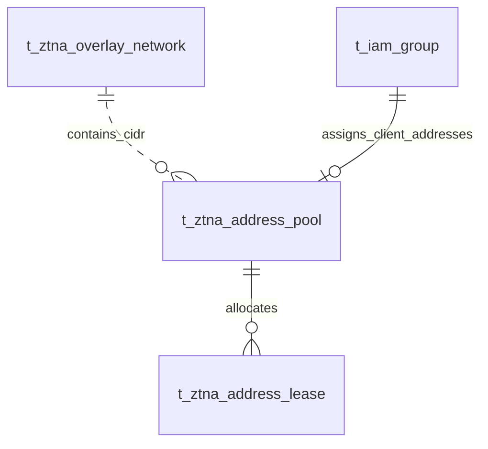

# VeloTrust ZTNA 数据库设计：Overlay IPAM 地址管理

- 文档版本：1.1
- 数据库：PostgreSQL
- 结构与审计语义基线：代码仓库迁移 006–027 的累计结果，包含元数据补齐、节点合并、审计主体规范和 Client 地址池员工组关联。
- 总览与公共字段：[ZTNA 数据库设计总览](ztna_data_design.md)
- 业务依据：[数据模型设计文档](../../VeloTrust_数据模型设计文档_最终版.md)

## 1. 模块职责与关系

全局范围、地址池和租约形成地址分配层次；全局范围到池是应用校验的 CIDR 包含关系，没有数据库外键。动态 User-Device 地址池可直接关联一个员工组，HUB 根据设备所有者的员工组分配 Overlay IP。该关联只负责地址分配；Client 可访问的 Gateway 由访问策略决定。

本模块收录 3 张表。图中实线表示已声明的外键，虚线表示应用层校验的逻辑关系；跨模块表只作为关系上下文，其字段在所属文档定义。Mermaid 的线型在本文用于区分物理约束与逻辑关系。

## 2. 数据表设计

逐表省略标准主键及公共审计字段，具体定义见总览。业务操作人字段和业务时间字段仍逐一列出；各表均已在迁移 012 补齐公共审计列。

### 2.1 `t_ztna_overlay_network` — Overlay 全局地址范围

保存单企业部署的唯一 Overlay IPv4 地址空间，地址池从该范围划分。

- 建表来源：[010_ipam_overlay_network.sql](../../../management/migrations/postgresql/010_ipam_overlay_network.sql)；字段和约束按后续迁移合并。
- 主键：`id SMALLINT DEFAULT 1`，由单例 CHECK 固定为 `1`。

| 字段 | PostgreSQL 类型 | 可空 | 默认值 | 说明 |
|---|---|---|---|---|
| `id` | `SMALLINT` | 否 | `1` | 固定单例主键，SMALLINT，默认且必须等于 1；不是自增 BIGINT。 |
| `network_cidr` | `CIDR` | 否 | — | 10.0.0.0/8 内的 IPv4 前缀，掩码长度为 /8–/16。 |

**数据库约束**

| 约束名称 | 定义 |
|---|---|
| `ck_t_ztna_overlay_network_singleton` | `CHECK (id = 1)` |
| `ck_t_ztna_overlay_network_private_a` | `CHECK ( family(network_cidr) = 4 AND network_cidr <<= '10.0.0.0/8'::cidr AND masklen(network_cidr) BETWEEN 8 AND 16 )` |
| `ck_t_ztna_overlay_network_version` | `CHECK (version_no > 0)` |

本表由主键索引支持单例查询，未额外声明其他索引。

**业务一致性与生命周期**

全局地址范围初始化后不可修改的规则由当前 Repository 在事务中检查，DDL 只保证单例与地址范围，没有不可变触发器。它与业务站点 LAN 网段属于不同地址用途。

### 2.2 `t_ztna_address_pool` — Overlay 地址池

保存可分配的 WireGuard Overlay 地址池及分配策略。

- 建表来源：[009_ipam_overlay_pools_leases_nat.sql](../../../management/migrations/postgresql/009_ipam_overlay_pools_leases_nat.sql)；字段和约束按后续迁移合并。
- 主键：`id BIGINT GENERATED BY DEFAULT AS IDENTITY`。

| 字段 | PostgreSQL 类型 | 可空 | 默认值 | 说明 |
|---|---|---|---|---|
| `pool_name` | `VARCHAR(128)` | 否 | — | 地址池名称，全表唯一。 |
| `network_cidr` | `CIDR` | 否 | — | 池网段；数据库禁止默认路由，范围与重叠校验由地址管理业务负责。 |
| `pool_type` | `VARCHAR(32)` | 否 | — | 用途：Gateway、User-Device、Service-VIP；大小写以 DDL 枚举为准。 |
| `allocation_mode` | `VARCHAR(16)` | 否 | — | 分配模式：static、dynamic。 |
| `idp_group` | `VARCHAR(128)` | 是 | — | 身份组绑定标签；字符串元数据，当前无 IAM 用户组外键。 |
| `client_group_id` | `BIGINT` | 是 | — | 员工 IAM 用户组；仅动态 `User-Device` 池可设置。多个地址池可以关联同一员工组；HUB 据此自动分配 Client Overlay IP，不授予 Gateway 访问权限。 |
| `gateway_binding` | `VARCHAR(128)` | 是 | — | 网关绑定标签；字符串元数据，当前无节点外键。 |
| `color` | `CHAR(7)` | 否 | `'#10b981'` | 界面颜色，格式为 #RRGGBB。 |
| `description` | `VARCHAR(512)` | 是 | — | 地址池用途说明。 |
| `status` | `VARCHAR(16)` | 否 | `'active'` | 地址池状态：active、disabled。 |

**数据库约束**

| 约束名称 | 定义 |
|---|---|
| `uq_t_ztna_address_pool_name` | `UNIQUE (pool_name)` |
| `ck_t_ztna_address_pool_type` | `CHECK (pool_type IN ('Gateway', 'User-Device', 'Service-VIP'))` |
| `ck_t_ztna_address_pool_allocation` | `CHECK (allocation_mode IN ('static', 'dynamic'))` |
| `ck_t_ztna_address_pool_color` | `CHECK (color ~ '^#[0-9A-Fa-f]{6}$')` |
| `ck_t_ztna_address_pool_status` | `CHECK (status IN ('active', 'disabled'))` |
| `fk_t_ztna_address_pool_client_group` | 外键到 `t_iam_group.id`，删除策略为 RESTRICT。 |
| `ck_t_ztna_address_pool_client_group` | `client_group_id` 非空时，池类型必须为 `User-Device` 且分配模式为 `dynamic`。 |
| `ck_t_ztna_address_pool_not_default` | `CHECK (network_cidr <> '0.0.0.0/0'::cidr AND network_cidr <> '::/0'::cidr)` |
| `ck_t_ztna_address_pool_version` | `CHECK (version_no > 0)` |

**索引**

| 索引名称 | 索引键与条件 |
|---|---|
| `ix_t_ztna_address_pool_status` | `(status, pool_name)` |
| `ix_t_ztna_address_pool_cidr` | `(network_cidr)` |

说明：主键与 UNIQUE 约束也会形成相应唯一索引，上表只列额外显式创建的索引。

**业务一致性与生命周期**

当前应用要求 IPv4 /16–/30，地址池必须位于已初始化的全局范围内并校验重叠；这些包含关系和重叠规则没有外键或排斥约束。`idp_group`、`gateway_binding` 是标签，不能当成已验证的主体或节点关系。`client_group_id` 是经过 IAM 外键校验的真实关系。已分配地址时修改池范围需要保护现有租约。

### 2.3 `t_ztna_address_lease` — Overlay 地址租约

保存 IP 地址分配及释放历史。只有 active/reserved 租约占用地址、目标名称和公钥唯一名额。

- 建表来源：[009_ipam_overlay_pools_leases_nat.sql](../../../management/migrations/postgresql/009_ipam_overlay_pools_leases_nat.sql)；字段和约束按后续迁移合并。
- 主键：`id BIGINT GENERATED BY DEFAULT AS IDENTITY`。

| 字段 | PostgreSQL 类型 | 可空 | 默认值 | 说明 |
|---|---|---|---|---|
| `pool_id` | `BIGINT` | 否 | — | 所属地址池，外键指向 t_ztna_address_pool.id。 |
| `address` | `INET` | 否 | — | 分配给目标的隧道地址，使用 INET 类型。 |
| `node_type` | `VARCHAR(16)` | 否 | — | 分配对象类别：Gateway、Peer、Server；不是 t_ztna_node.node_type 的同一枚举。 |
| `target_name` | `VARCHAR(128)` | 否 | — | 分配目标名称快照；当前没有对应 node_id/device_id 外键。 |
| `endpoint` | `VARCHAR(255)` | 是 | — | 目标连接端点快照。 |
| `allocation_mode` | `VARCHAR(64)` | 否 | — | 分配来源或模式标签，当前无枚举 CHECK。 |
| `idp_group` | `VARCHAR(128)` | 是 | — | 身份组绑定标签；当前无用户组外键。 |
| `wireguard_pubkey` | `VARCHAR(64)` | 是 | — | WireGuard 公钥，非空时长度为 44；完整编码有效性仍需应用验证。 |
| `status` | `VARCHAR(16)` | 否 | `'active'` | 租约状态：active、reserved、released。 |
| `allocated_at` | `TIMESTAMPTZ` | 否 | `CURRENT_TIMESTAMP` | 租约分配时间。 |
| `released_at` | `TIMESTAMPTZ` | 是 | — | 租约释放时间，与 released 状态保持一致。 |

**数据库约束**

| 约束名称 | 定义 |
|---|---|
| `ck_t_ztna_address_lease_node_type` | `CHECK (node_type IN ('Gateway', 'Peer', 'Server'))` |
| `ck_t_ztna_address_lease_status` | `CHECK (status IN ('active', 'reserved', 'released'))` |
| `ck_t_ztna_address_lease_pubkey` | `CHECK (wireguard_pubkey IS NULL OR length(wireguard_pubkey) = 44)` |
| `ck_t_ztna_address_lease_release` | `CHECK ((status = 'released') = (released_at IS NOT NULL))` |
| `fk_t_ztna_address_lease_pool` | `FOREIGN KEY (pool_id) REFERENCES public.t_ztna_address_pool (id) ON DELETE RESTRICT` |

**索引**

| 索引名称 | 索引键与条件 |
|---|---|
| `uq_t_ztna_address_lease_active_address` | `UNIQUE (address) WHERE status IN ('active', 'reserved')` |
| `uq_t_ztna_address_lease_active_target` | `UNIQUE (pool_id, target_name) WHERE status IN ('active', 'reserved')` |
| `uq_t_ztna_address_lease_active_pubkey` | `UNIQUE (wireguard_pubkey) WHERE status IN ('active', 'reserved') AND wireguard_pubkey IS NOT NULL` |
| `ix_t_ztna_address_lease_pool_status` | `(pool_id, status, allocated_at DESC)` |

说明：主键与 UNIQUE 约束也会形成相应唯一索引，上表只列额外显式创建的索引。

**业务一致性与生命周期**

active/reserved 地址全表唯一，释放后保留历史但不继续占用地址。池内目标名称和非空公钥也受活跃租约部分唯一索引保护。分配事务需验证池启用、地址属于池、不是网络/广播地址；`INET` 本身不保证主机掩码或池包含关系。

## 3. 使用与维护约定

- 写入由对应领域服务经 Repository 与事务接口完成；使用项目 `db.Save` 持久化业务模型，由服务显式传递 `internal/context` 中的操作者用户名。
- 公共 `version_no` 用于并发修改检查；它不是策略或配置历史版本。密钥轮换状态按 Peer 密钥生命周期单独管理。
- HUB 只匹配设备所有者直接所属的 active IAM 用户组和关联的 active 动态 `User-Device` 地址池；池行锁保证并发分配串行化，再从池内空闲地址中随机选择一个。有效租约会幂等复用。
- 自动分配只写入 IP 租约，不创建 WireGuard Peer，也不选择 Gateway。Gateway 集合由访问策略决定，配置未就绪时 HUB 保持不下发状态。
- 本文描述仓库迁移结构与业务要求，不代表所有服务、页面或分发链路已实现；数据库 CHECK 未覆盖的业务条件须在服务事务中明确验证。
- 涉及身份或授权的状态未知、过期或无法验证时默认拒绝访问；状态变更及撤销应留存审计，数据面应用结果由节点回执确认。
