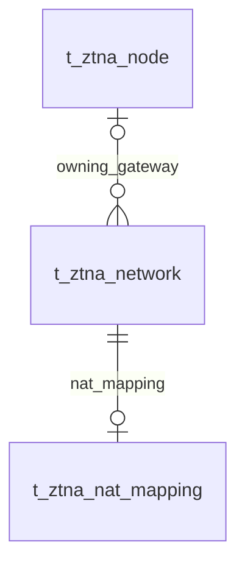

# VeloTrust ZTNA 数据库设计：网络站点与 NAT

- 文档版本：1.0
- 数据库：PostgreSQL
- 结构基线：代码仓库迁移 006–018 的累计结果，包含元数据补齐及网关合并。
- 总览与公共字段：[ZTNA 数据库设计总览](ztna_data_design.md)
- 业务依据：[数据模型设计文档](../../VeloTrust_数据模型设计文档_最终版.md)

## 1. 模块职责与关系

网络站点与网络共用一张表；NAT 映射由站点业务管理，IPAM 维护 Overlay 地址分配。

本模块收录 2 张表。图中实线表示已声明的外键，虚线表示应用层校验的逻辑关系；跨模块表只作为关系上下文，其字段在所属文档定义。Mermaid 的线型在本文用于区分物理约束与逻辑关系。

## 2. 数据表设计

逐表省略标准主键及公共审计字段，具体定义见总览。业务操作人字段和业务时间字段仍逐一列出；各表均已在迁移 012 补齐公共审计列。

### 2.1 `t_ztna_network` — 网络与网络站点

统一保存路由业务网络。network_type=site 的一行同时代表网络站点及其本地网段，站点 ID 与网络 ID 相同。

- 建表来源：[008_ipam_network_catalog.sql](../../../management/migrations/postgresql/008_ipam_network_catalog.sql)；字段和约束按后续迁移合并。
- 主键：`id BIGINT GENERATED BY DEFAULT AS IDENTITY`。

| 字段 | PostgreSQL 类型 | 可空 | 默认值 | 说明 |
|---|---|---|---|---|
| `network_name` | `VARCHAR(128)` | 否 | — | 网络站点或路由网络名称。 |
| `network_code` | `VARCHAR(64)` | 否 | — | 稳定业务编码，唯一；匹配小写字母、数字及点、下划线、短横线规则。 |
| `network_type` | `VARCHAR(32)` | 否 | — | 网络类型：vpc、subnet、site、segment；site 为网络站点。 |
| `cidr` | `CIDR` | 否 | — | 真实业务网段，使用 CIDR 类型，不允许 IPv4/IPv6 默认路由。 |
| `region` | `VARCHAR(128)` | 是 | — | 区域或地域标签。 |
| `environment` | `VARCHAR(32)` | 是 | — | 环境标签，例如 prod、test、dev；当前无枚举 CHECK。 |
| `description` | `VARCHAR(512)` | 是 | — | 网络或站点说明。 |
| `status` | `VARCHAR(24)` | 否 | `'active'` | 网络状态：active、disabled。 |
| `gateway_node_id` | `BIGINT` | 是 | — | 所属网关的统一节点 ID，外键指向 t_ztna_node.id；每个网络最多绑定一个网关，一个网关可管理多个网络。 |
| `is_del` | `BOOLEAN` | 否 | `FALSE` | 逻辑删除标记，仅在支持逻辑删除的网络记录上使用。 |

**数据库约束**

| 约束名称 | 定义 |
|---|---|
| `uq_t_ztna_network_code` | `UNIQUE (network_code)` |
| `ck_t_ztna_network_code` | `CHECK (network_code ~ '^[a-z0-9][a-z0-9._-]{1,63}$')` |
| `ck_t_ztna_network_type` | `CHECK (network_type IN ('vpc', 'subnet', 'site', 'segment'))` |
| `ck_t_ztna_network_not_default` | `CHECK (cidr <> '0.0.0.0/0'::cidr AND cidr <> '::/0'::cidr)` |
| `ck_t_ztna_network_status` | `CHECK (status IN ('active', 'disabled'))` |
| `ck_t_ztna_network_version` | `CHECK (version_no > 0)` |
| `fk_t_ztna_network_gateway` | `FOREIGN KEY (gateway_node_id) REFERENCES public.t_ztna_node (id) ON DELETE RESTRICT` |

**索引**

| 索引名称 | 索引键与条件 |
|---|---|
| `ix_t_ztna_network_status_type` | `(status, network_type, network_name)` |
| `ix_t_ztna_network_cidr` | `(cidr)` |
| `ix_t_ztna_network_gateway_node` | `(gateway_node_id) WHERE gateway_node_id IS NOT NULL` |
| `ix_t_ztna_network_sites` | `(network_name, id) WHERE network_type='site' AND is_del=FALSE` |

说明：主键与 UNIQUE 约束也会形成相应唯一索引，上表只列额外显式创建的索引。

**业务一致性与生命周期**

网络站点使用 `network_type=site`，站点管理读取时过滤 `is_del=false`；网关归属只保存到 gateway_node_id，允许网段直接取该网络的 cidr。`gateway_node_id` 外键未限制 node_type，业务需验证其确为可用网关。绑定网关后，站点业务限制删除、停用或修改 CIDR；应先保存解除绑定，再执行这些操作。只有启用的站点允许绑定网关；注册时对站点行加锁并拒绝覆盖已有绑定。唯一编码索引包含逻辑删除记录，不会自动释放编码。

### 2.2 `t_ztna_nat_mapping` — 网络 NAT 映射

保存站点真实网段与虚拟影子网段的映射台账，由网络站点业务管理。配置台账不代表 Gateway 已经应用规则。

- 建表来源：[009_ipam_overlay_pools_leases_nat.sql](../../../management/migrations/postgresql/009_ipam_overlay_pools_leases_nat.sql)；字段和约束按后续迁移合并。
- 主键：`id BIGINT GENERATED BY DEFAULT AS IDENTITY`。

| 字段 | PostgreSQL 类型 | 可空 | 默认值 | 说明 |
|---|---|---|---|---|
| `network_id` | `BIGINT` | 否 | — | 所属网络站点，外键指向 t_ztna_network.id；每个网络最多一条映射。 |
| `network_name` | `VARCHAR(128)` | 否 | — | 网络名称快照，更新时需要与网络对象协调。 |
| `real_cidr` | `CIDR` | 否 | — | 真实业务网段。 |
| `virtual_cidr` | `CIDR` | 是 | — | 虚拟影子网段；SNAT_Masquerade 可空，其余类型必须填写。 |
| `nat_type` | `VARCHAR(32)` | 否 | — | NAT 类型：1:1_Bidirectional、SNAT_Masquerade、DNAT_VirtualIP。 |
| `enabled` | `BOOLEAN` | 否 | `TRUE` | 映射是否启用；启用状态不能代替下发任务的应用确认。 |
| `description` | `VARCHAR(512)` | 是 | — | NAT 业务说明。 |

**数据库约束**

| 约束名称 | 定义 |
|---|---|
| `uq_t_ztna_nat_mapping_network` | `UNIQUE (network_id)` |
| `ck_t_ztna_nat_mapping_type` | `CHECK (nat_type IN ('1:1_Bidirectional', 'SNAT_Masquerade', 'DNAT_VirtualIP'))` |
| `ck_t_ztna_nat_mapping_virtual_required` | `CHECK (nat_type = 'SNAT_Masquerade' OR virtual_cidr IS NOT NULL)` |
| `ck_t_ztna_nat_mapping_version` | `CHECK (version_no > 0)` |
| `fk_t_ztna_nat_mapping_network` | `FOREIGN KEY (network_id) REFERENCES public.t_ztna_network (id) ON DELETE RESTRICT` |

**索引**

| 索引名称 | 索引键与条件 |
|---|---|
| `ix_t_ztna_nat_mapping_enabled` | `(enabled, network_id)` |
| `ix_t_ztna_nat_mapping_virtual` | `(virtual_cidr)` |

说明：主键与 UNIQUE 约束也会形成相应唯一索引，上表只列额外显式创建的索引。

**业务一致性与生命周期**

真实网段可以在不同站点重叠，远端通过虚拟影子网段区分。网段语法由 CIDR 类型保障，但 1:1 映射前缀长度相同、影子网段冲突及真实网段与站点匹配均需业务校验。DNAT 负责目标地址转换，出站 SNAT 负责回程；规则最终生效以 Gateway 配置回执为准。

## 3. 使用与维护约定

- 写入由对应领域服务经 Repository 与事务接口完成；使用项目 `db.Save` 持久化业务模型，由服务显式传递 `internal/context` 中的操作者用户名。
- 公共 `version_no` 用于并发修改检查；它不是策略或配置历史版本。密钥轮换状态按 Peer 密钥生命周期单独管理。
- 本文描述仓库迁移结构与业务要求，不代表所有服务、页面或分发链路已实现；数据库 CHECK 未覆盖的业务条件须在服务事务中明确验证。
- 涉及身份或授权的状态未知、过期或无法验证时默认拒绝访问；状态变更及撤销应留存审计，数据面应用结果由节点回执确认。
