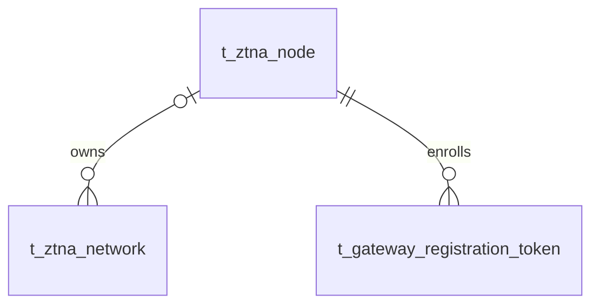

# VeloTrust ZTNA 数据库设计：运行节点与网关注册

- 文档版本：1.0
- 数据库：PostgreSQL
- 结构基线：代码仓库迁移 006–018 的累计结果，包含元数据补齐及网关合并。
- 总览与公共字段：[ZTNA 数据库设计总览](ztna_data_design.md)
- 业务依据：[数据模型设计文档](../../VeloTrust_数据模型设计文档_最终版.md)

## 1. 模块职责与关系

统一节点目录承载所有运行节点，站点网关归属统一保存在网络表。注册时只能选择启用、未删除且尚未绑定网关的站点；绑定与凭证签发在同一事务完成。

本模块收录 2 张表。节点主表保存当前控制、公网和私网端点值；候选端点表尚无业务使用，已由迁移 017 删除。图中实线表示已声明的外键，跨模块表只作为关系上下文，其字段在所属文档定义。

## 2. 数据表设计

逐表省略标准主键及公共审计字段，具体定义见总览。业务操作人字段和业务时间字段仍逐一列出；各表均已在迁移 012 补齐公共审计列。

### 2.1 `t_ztna_node` — 运行节点

统一保存 Client Agent、Gateway、Relay 和 Connector 的运行身份、端点摘要和配置状态。网关以 node_type=gateway 表示。

- 建表来源：[011_ztna_business_core.sql](../../../management/migrations/postgresql/011_ztna_business_core.sql)；字段和约束按后续迁移合并。
- 主键：`id BIGINT GENERATED BY DEFAULT AS IDENTITY`。

| 字段 | PostgreSQL 类型 | 可空 | 默认值 | 说明 |
|---|---|---|---|---|
| `node_name` | `VARCHAR(128)` | 否 | — | 节点显示名称；gateway 节点名称具有部分唯一索引。 |
| `node_code` | `VARCHAR(64)` | 否 | — | 节点稳定业务编码，全表唯一。 |
| `node_type` | `VARCHAR(32)` | 否 | — | 节点类型：client_agent、gateway、relay、connector。 |
| `node_status` | `VARCHAR(24)` | 否 | `'pending'` | 节点生命周期：pending、active、disabled、quarantined、revoked。 |
| `agent_version` | `VARCHAR(64)` | 是 | — | 节点软件版本。 |
| `control_endpoint` | `VARCHAR(255)` | 是 | — | 节点控制通道端点摘要。 |
| `public_endpoint` | `VARCHAR(255)` | 是 | — | 公网端点摘要。 |
| `private_endpoint` | `VARCHAR(255)` | 是 | — | 私网端点摘要。 |
| `public_key` | `VARCHAR(64)` | 是 | — | 节点公开密钥，非空时唯一；不保存私钥。 |
| `last_heartbeat_at` | `TIMESTAMPTZ` | 是 | — | 最近一次有效心跳时间。 |
| `last_config_hash` | `VARCHAR(128)` | 是 | — | 最近向节点下发的配置内容摘要。 |
| `actual_config_hash` | `VARCHAR(128)` | 是 | — | 节点回执或可信状态上报确认的已应用配置摘要；未知时为空。 |
| `capabilities_json` | `JSONB` | 否 | `'{}'::JSONB` | 节点能力 JSON 对象。 |
| `health_status` | `VARCHAR(24)` | 否 | `'unknown'` | 健康状态：unknown、healthy、degraded、unhealthy。 |
| `gateway_type` | `VARCHAR(64)` | 是 | — | 网关子类型；非网关节点必须为空。 |
| `gateway_network_name` | `VARCHAR(128)` | 是 | — | 网关注册时保留的网络标签，不是网络关系主键；非网关节点必须为空。 |
| `require_approval` | `BOOLEAN` | 否 | `FALSE` | 网关注册是否要求审批；DDL 未将此布尔字段限制为仅网关可用。 |
| `registered_at` | `TIMESTAMPTZ` | 是 | — | 网关完成注册的时间；非网关节点必须为空。 |

**数据库约束**

| 约束名称 | 定义 |
|---|---|
| `uq_t_ztna_node_code` | `UNIQUE (node_code)` |
| `ck_t_ztna_node_type` | `CHECK (node_type IN ('client_agent', 'gateway', 'relay', 'connector'))` |
| `ck_t_ztna_node_status` | `CHECK (node_status IN ('pending', 'active', 'disabled', 'quarantined', 'revoked'))` |
| `ck_t_ztna_node_health` | `CHECK (health_status IN ('unknown', 'healthy', 'degraded', 'unhealthy'))` |
| `ck_t_ztna_node_capabilities` | `CHECK (jsonb_typeof(capabilities_json) = 'object')` |
| `ck_t_ztna_node_version` | `CHECK (version_no > 0)` |
| `ck_t_ztna_node_gateway_type_scope` | `CHECK (gateway_type IS NULL OR node_type = 'gateway')` |
| `ck_t_ztna_node_gateway_network_scope` | `CHECK (gateway_network_name IS NULL OR node_type = 'gateway')` |
| `ck_t_ztna_node_registered_at_scope` | `CHECK (registered_at IS NULL OR node_type = 'gateway')` |

**索引**

| 索引名称 | 索引键与条件 |
|---|---|
| `uq_t_ztna_node_public_key` | `UNIQUE (public_key) WHERE public_key IS NOT NULL` |
| `ix_t_ztna_node_status_health` | `(node_status, health_status)` |
| `ix_t_ztna_node_heartbeat` | `(last_heartbeat_at DESC)` |
| `uq_t_ztna_gateway_node_name` | `UNIQUE (node_name) WHERE node_type = 'gateway'` |

说明：主键与 UNIQUE 约束也会形成相应唯一索引，上表只列额外显式创建的索引。

**业务一致性与生命周期**

网关身份已由迁移 015 并入本表，不再创建 `t_gateway_node`。DDL 对三个可空网关扩展字段限制了节点类型，但没有限制 `require_approval`；业务仍应只在网关准入中使用它。每个网络最多绑定一个网关，归属由 `t_ztna_network.gateway_node_id` 维护；反向查询即可获取同一网关的多个站点和允许网段，本表没有 `network_id`。

### 2.2 `t_gateway_registration_token` — 网关一次性注册凭证

保存一次性网关注册凭证的摘要和使用状态；保留历史表名，但引用统一节点目录。

- 建表来源：[006_gateway_enrollment.sql](../../../management/migrations/postgresql/006_gateway_enrollment.sql)；字段和约束按后续迁移合并。
- 主键：`id BIGINT GENERATED BY DEFAULT AS IDENTITY`。

| 字段 | PostgreSQL 类型 | 可空 | 默认值 | 说明 |
|---|---|---|---|---|
| `node_id` | `BIGINT` | 否 | — | 目标网关节点，外键指向 t_ztna_node.id；由迁移 015 将 gateway_row_id 重命名而来。 |
| `token_hash` | `CHAR(64)` | 否 | — | 注册凭证 SHA-256 小写十六进制摘要，全表唯一；不保存明文。 |
| `status` | `VARCHAR(16)` | 否 | `'pending'` | 凭证状态：pending、used、expired、revoked。 |
| `max_uses` | `SMALLINT` | 否 | `1` | 最大使用次数，数据库固定为 1。 |
| `used_count` | `SMALLINT` | 否 | `0` | 已使用次数，范围 0–max_uses。 |
| `expires_at` | `TIMESTAMPTZ` | 否 | — | 凭证绝对到期时间。 |
| `notes` | `VARCHAR(512)` | 是 | — | 签发备注，不应包含凭证明文。 |
| `used_at` | `TIMESTAMPTZ` | 是 | — | 凭证成功使用时间。 |
| `used_ip` | `INET` | 是 | — | 使用凭证时的来源 IPv4/IPv6 地址。 |
| `revoked_at` | `TIMESTAMPTZ` | 是 | — | 凭证撤销时间。 |
| `revocation_reason` | `VARCHAR(512)` | 是 | — | 撤销原因。 |

**数据库约束**

| 约束名称 | 定义 |
|---|---|
| `uq_t_gateway_registration_token_hash` | `UNIQUE (token_hash)` |
| `ck_t_gateway_registration_hash` | `CHECK (token_hash ~ '^[0-9a-f]{64}$')` |
| `ck_t_gateway_registration_status` | `CHECK (status IN ('pending', 'used', 'expired', 'revoked'))` |
| `ck_t_gateway_registration_uses` | `CHECK (max_uses = 1 AND used_count BETWEEN 0 AND max_uses)` |
| `fk_t_gateway_registration_node` | `FOREIGN KEY (node_id) REFERENCES public.t_ztna_node (id) ON DELETE RESTRICT` |

**索引**

| 索引名称 | 索引键与条件 |
|---|---|
| `uq_t_gateway_registration_pending_gateway` | `UNIQUE (node_id) WHERE status = 'pending'` |
| `ix_t_gateway_registration_status_expiry` | `(status, expires_at)` |
| `ix_t_gateway_registration_gateway_created` | `(node_id, created_at DESC)` |

说明：主键与 UNIQUE 约束也会形成相应唯一索引，上表只列额外显式创建的索引。

**业务一致性与生命周期**

每节点最多一张 pending 凭证，凭证只能使用一次。消费应在同一事务核对状态、有效期、节点类型及剩余次数，再更新使用信息；不要仅依赖 max_uses CHECK 防止并发重放。过期 pending 记录需更新状态后再签发新 pending 凭证。

## 3. 使用与维护约定

- 写入由对应领域服务经 Repository 与事务接口完成；使用项目 `db.Save` 持久化业务模型，由服务显式传递 `internal/context` 中的操作者用户名。
- 公共 `version_no` 用于并发修改检查；它不是策略或配置历史版本。密钥轮换状态按 Peer 密钥生命周期单独管理。
- 本文描述仓库迁移结构与业务要求，不代表所有服务、页面或分发链路已实现；数据库 CHECK 未覆盖的业务条件须在服务事务中明确验证。
- 涉及身份或授权的状态未知、过期或无法验证时默认拒绝访问；状态变更及撤销应留存审计，数据面应用结果由节点回执确认。
