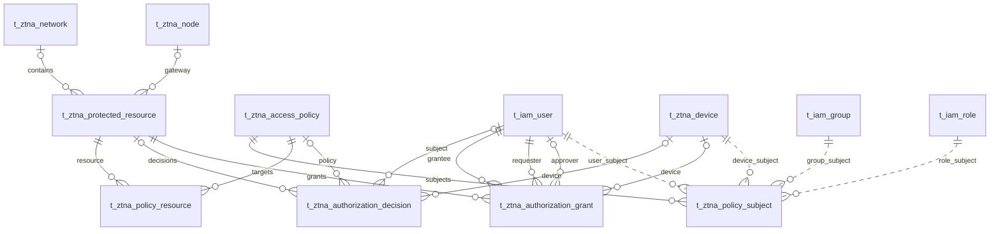

# VeloTrust ZTNA 数据库设计：受保护资源与访问授权

- 文档版本：1.0
- 数据库：PostgreSQL
- 结构基线：代码仓库迁移 006–018 的累计结果，包含元数据补齐及网关合并。
- 总览与公共字段：[ZTNA 数据库设计总览](ztna_data_design.md)
- 业务依据：[数据模型设计文档](../../VeloTrust_数据模型设计文档_最终版.md)

## 1. 模块职责与关系

访问策略行保存当前生效规则；主体关系、资源关系和授权决策分别按各自生命周期维护。主体多态引用由业务校验，图中四种 subject 虚线仅在对应 subject_type 时成立。

本模块收录 6 张表。图中实线表示已声明的外键，虚线表示应用层校验的逻辑关系；跨模块表只作为关系上下文，其字段在所属文档定义。

## 2. 数据表设计

逐表省略标准主键及公共审计字段，具体定义见总览。业务操作人字段和业务时间字段仍逐一列出；各表均已在迁移 012 补齐公共审计列。

### 2.1 `t_ztna_protected_resource` — 受保护资源

描述实际需要访问的应用、主机、数据库、网段或服务。

- 建表来源：[011_ztna_business_core.sql](../../../management/migrations/postgresql/011_ztna_business_core.sql)；字段和约束按后续迁移合并。
- 主键：`id BIGINT GENERATED BY DEFAULT AS IDENTITY`。

| 字段 | PostgreSQL 类型 | 可空 | 默认值 | 说明 |
|---|---|---|---|---|
| `resource_name` | `VARCHAR(128)` | 否 | — | 受保护资源显示名称。 |
| `resource_code` | `VARCHAR(64)` | 否 | — | 稳定业务编码，全表唯一。 |
| `resource_type` | `VARCHAR(32)` | 否 | — | 资源类型：web_app、server、database、subnet、service。 |
| `network_id` | `BIGINT` | 是 | — | 所属网络或站点，外键指向 t_ztna_network.id。 |
| `host` | `VARCHAR(255)` | 是 | — | 目标域名或主机地址文本；至少 host/address 之一非空。 |
| `address` | `VARCHAR(255)` | 是 | — | 目标地址或 CIDR 文本；按资源类型校验。 |
| `port_start` | `INTEGER` | 是 | — | 端口范围起点；与 port_end 同时为空或形成合法范围。 |
| `port_end` | `INTEGER` | 是 | — | 端口范围终点；不小于 port_start 且不大于 65535。 |
| `protocol` | `VARCHAR(16)` | 是 | — | 可选协议：tcp、udp、http、https。 |
| `access_mode` | `VARCHAR(32)` | 否 | `'network'` | 接入模式：network、proxy。 |
| `gateway_node_id` | `BIGINT` | 是 | — | 指定的入口网关，外键指向 t_ztna_node.id。 |
| `category` | `VARCHAR(64)` | 是 | — | 资源分类标签。 |
| `tags_json` | `JSONB` | 否 | `'[]'::JSONB` | 安全标签，当前允许 JSON 数组或对象。 |
| `description` | `VARCHAR(512)` | 是 | — | 资源说明。 |
| `status` | `VARCHAR(24)` | 否 | `'active'` | 资源状态：active、disabled、unreachable。 |

**数据库约束**

| 约束名称 | 定义 |
|---|---|
| `uq_t_ztna_protected_resource_code` | `UNIQUE (resource_code)` |
| `ck_t_ztna_protected_resource_protocol` | `CHECK (protocol IS NULL OR protocol IN ('tcp', 'udp', 'http', 'https'))` |
| `ck_t_ztna_protected_resource_status` | `CHECK (status IN ('active', 'disabled', 'unreachable'))` |
| `ck_t_ztna_protected_resource_version` | `CHECK (version_no > 0)` |

**索引**

| 索引名称 | 索引键与条件 |
|---|---|
| `ix_t_ztna_protected_resource_network_status` | `(network_id, status)` |
| `ix_t_ztna_protected_resource_type_status` | `(resource_type, status)` |
| `ix_t_ztna_protected_resource_gateway` | `(gateway_node_id, status)` |

说明：主键与 UNIQUE 约束也会形成相应唯一索引，上表只列额外显式创建的索引。

**业务一致性与生命周期**

管理 RBAC 的 `t_iam_resource` 和本表属于不同资源域。DDL 检查至少一个端点非空、端口范围、协议和标签结构；域名/IP/CIDR 语法、网关节点类型、资源与站点归属仍由业务验证。

### 2.2 `t_ztna_access_policy` — 访问策略

保存策略身份、管理字段和唯一权威的当前规则。更新直接覆盖当前数据库记录，不保留策略修订历史。

- 建表来源：[011_ztna_business_core.sql](../../../management/migrations/postgresql/011_ztna_business_core.sql)；字段和约束按后续迁移合并。
- 主键：`id BIGINT GENERATED BY DEFAULT AS IDENTITY`。

| 字段 | PostgreSQL 类型 | 可空 | 默认值 | 说明 |
|---|---|---|---|---|
| `policy_name` | `VARCHAR(128)` | 否 | — | 策略显示名称。 |
| `policy_code` | `VARCHAR(64)` | 否 | — | 策略稳定编码，全表唯一。 |
| `description` | `VARCHAR(512)` | 是 | — | 策略说明。 |
| `priority` | `INTEGER` | 否 | `100` | 非负优先级；数值方向与冲突处理应由统一策略引擎约定。 |
| `status` | `VARCHAR(24)` | 否 | `'draft'` | 策略状态：draft、active、disabled。 |
| `rules_json` | `JSONB` | 否 | `'[]'::JSONB` | 当前策略规则，允许 JSON 数组或对象；策略更新时原位替换。 |
| `compiled_hash` | `VARCHAR(128)` | 是 | — | 当前规则规范化或编译结果的内容摘要，不是修订号。 |

**数据库约束**

| 约束名称 | 定义 |
|---|---|
| `uq_t_ztna_access_policy_code` | `UNIQUE (policy_code)` |
| `ck_t_ztna_access_policy_status` | `CHECK (status IN ('draft', 'active', 'disabled'))` |
| `ck_t_ztna_access_policy_priority` | `CHECK (priority >= 0)` |
| `ck_t_ztna_access_policy_rules` | `CHECK (jsonb_typeof(rules_json) IN ('array', 'object'))` |
| `ck_t_ztna_access_policy_version_no` | `CHECK (version_no > 0)`，只约束公共并发标记 |

**索引**

| 索引名称 | 索引键与条件 |
|---|---|
| `ix_t_ztna_access_policy_status_priority` | `(status, priority, id)` |

说明：主键与 UNIQUE 约束也会形成相应唯一索引，上表只列额外显式创建的索引。

**业务一致性与生命周期**

策略状态、规则 JSON 和主体/资源关系应在同一事务中更新。`version_no` 是公共模型的乐观并发标记，不保存策略历史；优先级方向与冲突裁决由统一策略引擎约定。

### 2.3 `t_ztna_policy_subject` — 策略主体关系

关联策略与用户、用户组、角色或设备，用于候选策略查找。

- 建表来源：[011_ztna_business_core.sql](../../../management/migrations/postgresql/011_ztna_business_core.sql)；字段和约束按后续迁移合并。
- 主键：`id BIGINT GENERATED BY DEFAULT AS IDENTITY`。

| 字段 | PostgreSQL 类型 | 可空 | 默认值 | 说明 |
|---|---|---|---|---|
| `policy_id` | `BIGINT` | 否 | — | 所属策略，外键指向 t_ztna_access_policy.id。 |
| `subject_type` | `VARCHAR(16)` | 否 | — | 主体类型：user、group、role、device。 |
| `subject_id` | `BIGINT` | 否 | — | 主体正整数 ID；根据 subject_type 逻辑关联对应实体，当前没有多态数据库外键。 |

**数据库约束**

| 约束名称 | 定义 |
|---|---|
| `uq_t_ztna_policy_subject` | `UNIQUE (policy_id, subject_type, subject_id)` |
| `fk_t_ztna_policy_subject_policy` | `FOREIGN KEY (policy_id) REFERENCES public.t_ztna_access_policy (id) ON DELETE RESTRICT` |
| `ck_t_ztna_policy_subject_type` | `CHECK (subject_type IN ('user', 'group', 'role', 'device'))` |
| `ck_t_ztna_policy_subject_id` | `CHECK (subject_id > 0)` |

**索引**

| 索引名称 | 索引键与条件 |
|---|---|
| `ix_t_ztna_policy_subject_lookup` | `(subject_type, subject_id, policy_id)` |

说明：主键与 UNIQUE 约束也会形成相应唯一索引，上表只列额外显式创建的索引。

**业务一致性与生命周期**

`subject_id` 根据类型指向 IAM 用户/用户组/角色或 ZTNA 设备，数据库仅检查正数。主体存在性、启用状态和删除关联由服务处理。当前关系绑定 policy_id，并与策略当前规则一起构成当前授权状态；服务在同一事务中更新，不能维护两份不一致的主体集合。

### 2.4 `t_ztna_policy_resource` — 策略目标关系

关联策略与受保护资源，支持按资源查找候选策略。

- 建表来源：[011_ztna_business_core.sql](../../../management/migrations/postgresql/011_ztna_business_core.sql)；字段和约束按后续迁移合并。
- 主键：`id BIGINT GENERATED BY DEFAULT AS IDENTITY`。

| 字段 | PostgreSQL 类型 | 可空 | 默认值 | 说明 |
|---|---|---|---|---|
| `policy_id` | `BIGINT` | 否 | — | 所属策略，外键指向 t_ztna_access_policy.id。 |
| `protected_resource_id` | `BIGINT` | 否 | — | 目标资源，外键指向 t_ztna_protected_resource.id。 |

**数据库约束**

| 约束名称 | 定义 |
|---|---|
| `uq_t_ztna_policy_resource` | `UNIQUE (policy_id, protected_resource_id)` |
| `fk_t_ztna_policy_resource_policy` | `FOREIGN KEY (policy_id) REFERENCES public.t_ztna_access_policy (id) ON DELETE RESTRICT` |
| `fk_t_ztna_policy_resource_resource` | `FOREIGN KEY (protected_resource_id) REFERENCES public.t_ztna_protected_resource (id) ON DELETE RESTRICT` |

**索引**

| 索引名称 | 索引键与条件 |
|---|---|
| `ix_t_ztna_policy_resource_resource` | `(protected_resource_id, policy_id)` |

说明：主键与 UNIQUE 约束也会形成相应唯一索引，上表只列额外显式创建的索引。

**业务一致性与生命周期**

当前关系绑定 policy_id，作为当前目标集合索引。服务在更新策略规则和目标关系时使用同一事务，避免产生相互冲突的授权依据。

### 2.5 `t_ztna_authorization_decision` — 授权决策记录

保存关键访问的决策结果和策略标识；不用于逐包日志，也不追踪策略历史修订。

- 建表来源：[011_ztna_business_core.sql](../../../management/migrations/postgresql/011_ztna_business_core.sql)；字段和约束按后续迁移合并。
- 主键：`id BIGINT GENERATED BY DEFAULT AS IDENTITY`。

| 字段 | PostgreSQL 类型 | 可空 | 默认值 | 说明 |
|---|---|---|---|---|
| `decision_id` | `VARCHAR(64)` | 否 | — | 决策业务标识，全表唯一。 |
| `user_id` | `BIGINT` | 是 | — | 决策关联用户，外键指向 t_iam_user.id。 |
| `device_id` | `BIGINT` | 是 | — | 决策关联设备，外键指向 t_ztna_device.id。 |
| `protected_resource_id` | `BIGINT` | 是 | — | 决策目标资源，外键指向 t_ztna_protected_resource.id。 |
| `policy_id` | `BIGINT` | 是 | — | 参与决策的当前策略，外键指向 t_ztna_access_policy.id。 |
| `decision` | `VARCHAR(16)` | 否 | — | 决策结果：allow、deny、step_up。 |
| `reason_code` | `VARCHAR(128)` | 否 | — | 稳定的决策原因码。 |
| `auth_level` | `VARCHAR(32)` | 是 | — | 做出决策时的认证强度快照。 |
| `device_trust_status` | `VARCHAR(24)` | 是 | — | 设备信任状态快照：unknown、trusted、untrusted、review_required。 |
| `source_ip` | `INET` | 是 | — | 访问来源 IPv4/IPv6 地址。 |
| `request_id` | `VARCHAR(64)` | 是 | — | 关联请求追踪标识。 |
| `decided_at` | `TIMESTAMPTZ` | 否 | `CURRENT_TIMESTAMP` | 决策发生时间。 |

**数据库约束**

| 约束名称 | 定义 |
|---|---|
| `uq_t_ztna_authorization_decision_id` | `UNIQUE (decision_id)` |
| `fk_t_ztna_authorization_decision_user` | `FOREIGN KEY (user_id) REFERENCES public.t_iam_user (id) ON DELETE RESTRICT` |
| `fk_t_ztna_authorization_decision_device` | `FOREIGN KEY (device_id) REFERENCES public.t_ztna_device (id) ON DELETE RESTRICT` |
| `fk_t_ztna_authorization_decision_resource` | `FOREIGN KEY (protected_resource_id) REFERENCES public.t_ztna_protected_resource (id) ON DELETE RESTRICT` |
| `fk_t_ztna_authorization_decision_policy` | `FOREIGN KEY (policy_id) REFERENCES public.t_ztna_access_policy (id) ON DELETE RESTRICT` |
| `ck_t_ztna_authorization_decision_result` | `CHECK (decision IN ('allow', 'deny', 'step_up'))` |
| `ck_t_ztna_authorization_decision_trust` | `CHECK ( device_trust_status IS NULL OR device_trust_status IN ('unknown', 'trusted', 'untrusted', 'review_required') )` |

**索引**

| 索引名称 | 索引键与条件 |
|---|---|
| `ix_t_ztna_authorization_decision_user_time` | `(user_id, decided_at DESC)` |
| `ix_t_ztna_authorization_decision_resource_time` | `(protected_resource_id, decided_at DESC)` |
| `ix_t_ztna_authorization_decision_result_time` | `(decision, decided_at DESC)` |
| `ix_t_ztna_authorization_decision_request` | `(request_id) WHERE request_id IS NOT NULL` |

说明：主键与 UNIQUE 约束也会形成相应唯一索引，上表只列额外显式创建的索引。

**业务一致性与生命周期**

allow/deny/step_up 是结果快照，不直接生成永久通行凭证。审计记录保留策略 ID 和决策原因，不声称能还原已被后续编辑覆盖的规则内容。未知或无法核验当前策略时按默认拒绝处理。

### 2.6 `t_ztna_authorization_grant` — 临时访问授权

保存访问申请、审批及限时授权的独立生命周期。

- 建表来源：[011_ztna_business_core.sql](../../../management/migrations/postgresql/011_ztna_business_core.sql)；字段和约束按后续迁移合并。
- 主键：`id BIGINT GENERATED BY DEFAULT AS IDENTITY`。

| 字段 | PostgreSQL 类型 | 可空 | 默认值 | 说明 |
|---|---|---|---|---|
| `grant_id` | `VARCHAR(64)` | 否 | — | 授权申请业务标识，全表唯一。 |
| `user_id` | `BIGINT` | 否 | — | 被授权用户，外键指向 t_iam_user.id。 |
| `device_id` | `BIGINT` | 是 | — | 可选限定设备，外键指向 t_ztna_device.id。 |
| `protected_resource_id` | `BIGINT` | 否 | — | 授权目标资源，外键指向 t_ztna_protected_resource.id。 |
| `requested_by` | `BIGINT` | 否 | — | 申请操作人的用户 ID，外键指向 t_iam_user.id；不是基础审计字段。 |
| `approved_by` | `BIGINT` | 是 | — | 审批操作人的用户 ID，外键指向 t_iam_user.id。 |
| `reason` | `VARCHAR(1024)` | 否 | — | 申请/授权业务理由。 |
| `status` | `VARCHAR(24)` | 否 | `'requested'` | 状态：requested、approved、rejected、revoked、expired。 |
| `valid_from` | `TIMESTAMPTZ` | 是 | — | 授权生效时间，和 expires_at 成对填写。 |
| `expires_at` | `TIMESTAMPTZ` | 是 | — | 授权到期时间，存在时晚于 valid_from；approved 时必填。 |
| `revoked_at` | `TIMESTAMPTZ` | 是 | — | 授权撤销时间，与 revoked 状态保持一致。 |

**数据库约束**

| 约束名称 | 定义 |
|---|---|
| `uq_t_ztna_authorization_grant_id` | `UNIQUE (grant_id)` |
| `fk_t_ztna_authorization_grant_user` | `FOREIGN KEY (user_id) REFERENCES public.t_iam_user (id) ON DELETE RESTRICT` |
| `fk_t_ztna_authorization_grant_device` | `FOREIGN KEY (device_id) REFERENCES public.t_ztna_device (id) ON DELETE RESTRICT` |
| `fk_t_ztna_authorization_grant_resource` | `FOREIGN KEY (protected_resource_id) REFERENCES public.t_ztna_protected_resource (id) ON DELETE RESTRICT` |
| `fk_t_ztna_authorization_grant_requester` | `FOREIGN KEY (requested_by) REFERENCES public.t_iam_user (id) ON DELETE RESTRICT` |
| `fk_t_ztna_authorization_grant_approver` | `FOREIGN KEY (approved_by) REFERENCES public.t_iam_user (id) ON DELETE RESTRICT` |
| `ck_t_ztna_authorization_grant_status` | `CHECK (status IN ('requested', 'approved', 'rejected', 'revoked', 'expired'))` |
| `ck_t_ztna_authorization_grant_window` | `CHECK ( (valid_from IS NULL AND expires_at IS NULL) OR (valid_from IS NOT NULL AND expires_at IS NOT NULL AND expires_at > valid_from) )` |
| `ck_t_ztna_authorization_grant_approval` | `CHECK (status <> 'approved' OR (approved_by IS NOT NULL AND valid_from IS NOT NULL AND expires_at IS NOT NULL))` |
| `ck_t_ztna_authorization_grant_revoked` | `CHECK ((status = 'revoked') = (revoked_at IS NOT NULL))` |

**索引**

| 索引名称 | 索引键与条件 |
|---|---|
| `ix_t_ztna_authorization_grant_user_status` | `(user_id, status, expires_at)` |
| `ix_t_ztna_authorization_grant_resource_status` | `(protected_resource_id, status, expires_at)` |

说明：主键与 UNIQUE 约束也会形成相应唯一索引，上表只列额外显式创建的索引。

**业务一致性与生命周期**

`requested_by`、`approved_by` 是业务操作人 ID，应保留 BIGINT 外键；基础 created_by/updated_by 是用户名字符串。approved 需有审批人及完整有效期；生效判断还必须比较当前时间、状态和资源/设备条件。

## 3. 使用与维护约定

- 写入由对应领域服务经 Repository 与事务接口完成；使用项目 `db.Save` 持久化业务模型，由服务显式传递 `internal/context` 中的操作者用户名。
- 公共 `version_no` 用于并发修改检查；它不是策略或配置历史版本。策略和配置内容以当前数据库行作为唯一权威状态。
- 本文描述仓库迁移结构与业务要求，不代表所有服务、页面或分发链路已实现；数据库 CHECK 未覆盖的业务条件须在服务事务中明确验证。
- 涉及身份或授权的状态未知、过期或无法验证时默认拒绝访问；状态变更及撤销应留存审计，数据面应用结果由节点回执确认。
