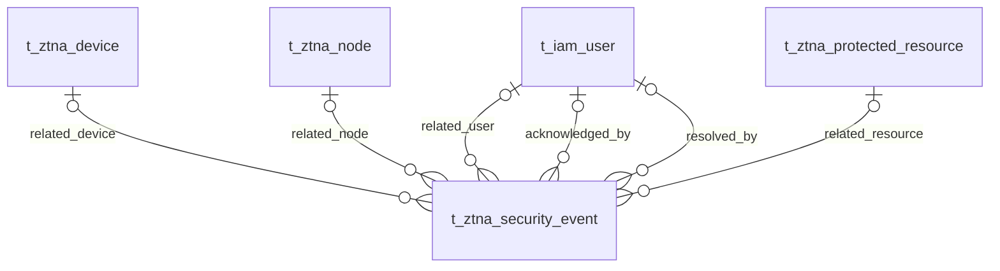

# VeloTrust ZTNA 数据库设计：安全事件处置

- 文档版本：1.0
- 数据库：PostgreSQL
- 结构与审计语义基线：代码仓库迁移 006–024 的累计结果，包含元数据补齐、节点合并和审计主体规范。
- 总览与公共字段：[ZTNA 数据库设计总览](ztna_data_design.md)
- 业务依据：[数据模型设计文档](../../VeloTrust_数据模型设计文档_最终版.md)

## 1. 模块职责与关系

本模块记录网络安全事件及处置状态；控制台操作审计和用户登录事件属于 IAM 文档。

本模块收录 1 张表。图中实线表示已声明的外键，虚线表示应用层校验的逻辑关系；跨模块表只作为关系上下文，其字段在所属文档定义。Mermaid 的线型在本文用于区分物理约束与逻辑关系。

## 2. 数据表设计

逐表省略标准主键及公共审计字段，具体定义见总览。业务操作人字段和业务时间字段仍逐一列出；各表均已在迁移 012 补齐公共审计列。

### 2.1 `t_ztna_security_event` — 安全事件

保存与用户、设备、节点和资源有关的安全告警，并跟踪确认和解决状态。

- 建表来源：[011_ztna_business_core.sql](../../../management/migrations/postgresql/011_ztna_business_core.sql)；字段和约束按后续迁移合并。
- 主键：`id BIGINT GENERATED BY DEFAULT AS IDENTITY`。

| 字段 | PostgreSQL 类型 | 可空 | 默认值 | 说明 |
|---|---|---|---|---|
| `event_id` | `VARCHAR(64)` | 否 | — | 安全事件业务标识，全表唯一。 |
| `event_type` | `VARCHAR(64)` | 否 | — | 安全事件分类。 |
| `severity` | `VARCHAR(16)` | 否 | — | 严重级别：info、low、medium、high、critical。 |
| `status` | `VARCHAR(24)` | 否 | `'open'` | 处置状态：open、acknowledged、resolved、suppressed。 |
| `user_id` | `BIGINT` | 是 | — | 事件涉及用户，外键指向 t_iam_user.id。 |
| `device_id` | `BIGINT` | 是 | — | 事件涉及设备，外键指向 t_ztna_device.id。 |
| `node_id` | `BIGINT` | 是 | — | 事件涉及运行节点，外键指向 t_ztna_node.id。 |
| `protected_resource_id` | `BIGINT` | 是 | — | 事件涉及资源，外键指向 t_ztna_protected_resource.id。 |
| `reason_code` | `VARCHAR(128)` | 否 | — | 稳定的事件原因码。 |
| `details_json` | `JSONB` | 否 | `'{}'::JSONB` | 脱敏事件详情 JSON 对象。 |
| `occurred_at` | `TIMESTAMPTZ` | 否 | `CURRENT_TIMESTAMP` | 安全事件实际发生时间。 |
| `acknowledged_at` | `TIMESTAMPTZ` | 是 | — | 人工确认时间，必须与 acknowledged_by 同时为空或非空。 |
| `acknowledged_by` | `BIGINT` | 是 | — | 确认操作人的用户 ID，外键指向 t_iam_user.id；不是 created_by。 |
| `resolved_at` | `TIMESTAMPTZ` | 是 | — | 解决时间，必须与 resolved_by 同时为空或非空。 |
| `resolved_by` | `BIGINT` | 是 | — | 解决操作人的用户 ID，外键指向 t_iam_user.id；不是 updated_by。 |

**数据库约束**

| 约束名称 | 定义 |
|---|---|
| `uq_t_ztna_security_event_id` | `UNIQUE (event_id)` |
| `fk_t_ztna_security_event_user` | `FOREIGN KEY (user_id) REFERENCES public.t_iam_user (id) ON DELETE RESTRICT` |
| `fk_t_ztna_security_event_device` | `FOREIGN KEY (device_id) REFERENCES public.t_ztna_device (id) ON DELETE RESTRICT` |
| `fk_t_ztna_security_event_node` | `FOREIGN KEY (node_id) REFERENCES public.t_ztna_node (id) ON DELETE RESTRICT` |
| `fk_t_ztna_security_event_resource` | `FOREIGN KEY (protected_resource_id) REFERENCES public.t_ztna_protected_resource (id) ON DELETE RESTRICT` |
| `fk_t_ztna_security_event_ack_user` | `FOREIGN KEY (acknowledged_by) REFERENCES public.t_iam_user (id) ON DELETE RESTRICT` |
| `fk_t_ztna_security_event_resolve_user` | `FOREIGN KEY (resolved_by) REFERENCES public.t_iam_user (id) ON DELETE RESTRICT` |
| `ck_t_ztna_security_event_severity` | `CHECK (severity IN ('info', 'low', 'medium', 'high', 'critical'))` |
| `ck_t_ztna_security_event_status` | `CHECK (status IN ('open', 'acknowledged', 'resolved', 'suppressed'))` |
| `ck_t_ztna_security_event_details` | `CHECK (jsonb_typeof(details_json) = 'object')` |
| `ck_t_ztna_security_event_ack` | `CHECK ((acknowledged_by IS NULL) = (acknowledged_at IS NULL))` |
| `ck_t_ztna_security_event_resolution` | `CHECK ((resolved_by IS NULL) = (resolved_at IS NULL))` |
| `ck_t_ztna_security_event_ack_status` | `CHECK (status <> 'acknowledged' OR acknowledged_at IS NOT NULL)` |
| `ck_t_ztna_security_event_resolved_status` | `CHECK (status <> 'resolved' OR resolved_at IS NOT NULL)` |

**索引**

| 索引名称 | 索引键与条件 |
|---|---|
| `ix_t_ztna_security_event_status_severity_time` | `(status, severity, occurred_at DESC)` |
| `ix_t_ztna_security_event_user_time` | `(user_id, occurred_at DESC) WHERE user_id IS NOT NULL` |
| `ix_t_ztna_security_event_device_time` | `(device_id, occurred_at DESC) WHERE device_id IS NOT NULL` |

说明：主键与 UNIQUE 约束也会形成相应唯一索引，上表只列额外显式创建的索引。

**业务一致性与生命周期**

acknowledged_by/resolved_by 是业务处置人的 BIGINT 用户外键，与公共 created_by/updated_by 的 VARCHAR(64) 审计语义不同。确认和解决动作需要事务更新及 IAM 审计；状态枚举没有自动保证合法迁移，细粒度状态规则由业务层处理。

## 3. 使用与维护约定

- 写入由对应领域服务经 Repository 与事务接口完成；使用项目 `db.Save` 持久化业务模型，由服务显式传递 `internal/context` 中的操作者用户名。
- 公共 `version_no` 用于并发修改检查；它不是策略或配置历史版本。密钥版本仍单独表示密钥轮换状态。
- 本文描述仓库迁移结构与业务要求，不代表所有服务、页面或分发链路已实现；数据库 CHECK 未覆盖的业务条件须在服务事务中明确验证。
- 涉及身份或授权的状态未知、过期或无法验证时默认拒绝访问；状态变更及撤销应留存审计，数据面应用结果由节点回执确认。
