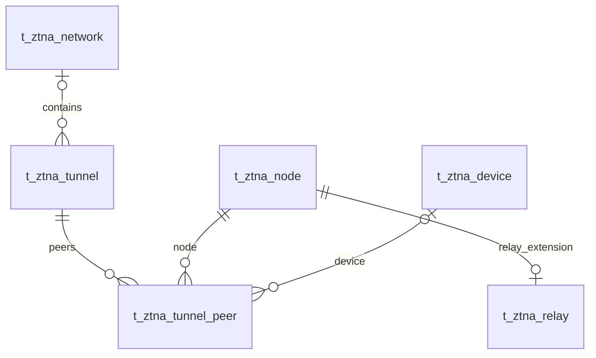

# VeloTrust ZTNA 数据库设计：隧道 Peer 与中继

- 文档版本：1.0
- 数据库：PostgreSQL
- 结构基线：代码仓库迁移 006–018 的累计结果，包含元数据补齐及网关合并。
- 总览与公共字段：[ZTNA 数据库设计总览](ztna_data_design.md)
- 业务依据：[数据模型设计文档](../../VeloTrust_数据模型设计文档_最终版.md)

## 1. 模块职责与关系

逻辑拓扑与 Peer 期望配置由控制面维护，WireGuard 执行加密隧道，实际连通性通过运行状态确认。

本模块收录 3 张表。图中实线表示已声明的外键，虚线表示应用层校验的逻辑关系；跨模块表只作为关系上下文，其字段在所属文档定义。Mermaid 的线型在本文用于区分物理约束与逻辑关系。

## 2. 数据表设计

逐表省略标准主键及公共审计字段，具体定义见总览。业务操作人字段和业务时间字段仍逐一列出；各表均已在迁移 012 补齐公共审计列。

### 2.1 `t_ztna_tunnel` — 逻辑隧道

保存逻辑组网对象；active 状态并不代表实时 WireGuard 握手成功。

- 建表来源：[011_ztna_business_core.sql](../../../management/migrations/postgresql/011_ztna_business_core.sql)；字段和约束按后续迁移合并。
- 主键：`id BIGINT GENERATED BY DEFAULT AS IDENTITY`。

| 字段 | PostgreSQL 类型 | 可空 | 默认值 | 说明 |
|---|---|---|---|---|
| `tunnel_code` | `VARCHAR(64)` | 否 | — | 逻辑隧道业务编码，全表唯一。 |
| `tunnel_type` | `VARCHAR(32)` | 否 | — | 组网类型：wireguard、hub_spoke、site_to_site。 |
| `status` | `VARCHAR(24)` | 否 | `'draft'` | 管理状态：draft、active、disabled。 |
| `network_id` | `BIGINT` | 是 | — | 可选所属网络，外键指向 t_ztna_network.id。 |
| `description` | `VARCHAR(512)` | 是 | — | 隧道用途说明。 |

**数据库约束**

| 约束名称 | 定义 |
|---|---|
| `uq_t_ztna_tunnel_code` | `UNIQUE (tunnel_code)` |
| `fk_t_ztna_tunnel_network` | `FOREIGN KEY (network_id) REFERENCES public.t_ztna_network (id) ON DELETE RESTRICT` |
| `ck_t_ztna_tunnel_type` | `CHECK (tunnel_type IN ('wireguard', 'hub_spoke', 'site_to_site'))` |
| `ck_t_ztna_tunnel_status` | `CHECK (status IN ('draft', 'active', 'disabled'))` |
| `ck_t_ztna_tunnel_version` | `CHECK (version_no > 0)` |

**索引**

| 索引名称 | 索引键与条件 |
|---|---|
| `ix_t_ztna_tunnel_network_status` | `(network_id, status)` |

说明：主键与 UNIQUE 约束也会形成相应唯一索引，上表只列额外显式创建的索引。

**业务一致性与生命周期**

本表描述逻辑拓扑，不能替代节点握手、当前配置摘要和健康状态。多站点路径及中央 Gateway 中继转发的期望路由由配置生成流程编排。

### 2.2 `t_ztna_tunnel_peer` — 隧道 Peer

保存逻辑隧道内 Peer 的期望公钥、地址与网络配置，以及最近观察状态。

- 建表来源：[011_ztna_business_core.sql](../../../management/migrations/postgresql/011_ztna_business_core.sql)；字段和约束按后续迁移合并。
- 主键：`id BIGINT GENERATED BY DEFAULT AS IDENTITY`。

| 字段 | PostgreSQL 类型 | 可空 | 默认值 | 说明 |
|---|---|---|---|---|
| `tunnel_id` | `BIGINT` | 否 | — | 所属逻辑隧道，外键指向 t_ztna_tunnel.id。 |
| `node_id` | `BIGINT` | 否 | — | Peer 对应的运行节点，外键指向 t_ztna_node.id。 |
| `device_id` | `BIGINT` | 是 | — | 可选关联终端设备，外键指向 t_ztna_device.id。 |
| `public_key` | `VARCHAR(64)` | 否 | — | WireGuard 公钥，当前全表唯一；不保存私钥。 |
| `tunnel_ip` | `CIDR` | 否 | — | Peer 的隧道地址前缀，在同一隧道内唯一。 |
| `allowed_ips` | `JSONB` | 否 | `'[]'::JSONB` | WireGuard AllowedIPs JSON 数组；应由已授权网络配置生成。 |
| `endpoint` | `VARCHAR(255)` | 是 | — | Peer 连接目标端点。 |
| `persistent_keepalive` | `INTEGER` | 否 | `0` | 保活秒数，0 表示禁用，数据库范围 0–65535。 |
| `status` | `VARCHAR(24)` | 否 | `'pending'` | Peer 状态：pending、active、disabled、revoked。 |
| `key_version` | `INTEGER` | 否 | `1` | Peer 密钥版本，必须大于零。 |
| `last_handshake_at` | `TIMESTAMPTZ` | 是 | — | 最近观察到的成功握手时间。 |
| `last_seen_at` | `TIMESTAMPTZ` | 是 | — | 最近活动时间。 |

**数据库约束**

| 约束名称 | 定义 |
|---|---|
| `fk_t_ztna_tunnel_peer_tunnel` | `FOREIGN KEY (tunnel_id) REFERENCES public.t_ztna_tunnel (id) ON DELETE RESTRICT` |
| `fk_t_ztna_tunnel_peer_node` | `FOREIGN KEY (node_id) REFERENCES public.t_ztna_node (id) ON DELETE RESTRICT` |
| `fk_t_ztna_tunnel_peer_device` | `FOREIGN KEY (device_id) REFERENCES public.t_ztna_device (id) ON DELETE RESTRICT` |
| `ck_t_ztna_tunnel_peer_allowed_ips` | `CHECK (jsonb_typeof(allowed_ips) = 'array')` |
| `ck_t_ztna_tunnel_peer_keepalive` | `CHECK (persistent_keepalive BETWEEN 0 AND 65535)` |
| `ck_t_ztna_tunnel_peer_status` | `CHECK (status IN ('pending', 'active', 'disabled', 'revoked'))` |
| `ck_t_ztna_tunnel_peer_key_version` | `CHECK (key_version > 0)` |
| `ck_t_ztna_tunnel_peer_version` | `CHECK (version_no > 0)` |

**索引**

| 索引名称 | 索引键与条件 |
|---|---|
| `uq_t_ztna_tunnel_peer_public_key` | `UNIQUE (public_key)` |
| `uq_t_ztna_tunnel_peer_tunnel_ip` | `UNIQUE (tunnel_id, tunnel_ip)` |
| `ix_t_ztna_tunnel_peer_node_status` | `(node_id, status)` |
| `ix_t_ztna_tunnel_peer_device` | `(device_id) WHERE device_id IS NOT NULL` |

说明：主键与 UNIQUE 约束也会形成相应唯一索引，上表只列额外显式创建的索引。

**业务一致性与生命周期**

当前公钥全表唯一，同一个公钥不能同时插入多条隧道 Peer；需要此能力时应另行迁移唯一约束。`allowed_ips` 的 JSON CHECK 只保证数组，不保证条目是合法 CIDR 或已授权前缀；公钥编码、隧道主机前缀和地址冲突也需要服务校验。

### 2.3 `t_ztna_relay` — 中继节点扩展

补充 relay 类型节点的服务地址、区域和容量元数据。

- 建表来源：[011_ztna_business_core.sql](../../../management/migrations/postgresql/011_ztna_business_core.sql)；字段和约束按后续迁移合并。
- 主键：`id BIGINT GENERATED BY DEFAULT AS IDENTITY`。

| 字段 | PostgreSQL 类型 | 可空 | 默认值 | 说明 |
|---|---|---|---|---|
| `node_id` | `BIGINT` | 否 | — | 对应运行节点，外键指向 t_ztna_node.id，唯一。 |
| `relay_code` | `VARCHAR(64)` | 否 | — | 中继服务编码，全表唯一。 |
| `region` | `VARCHAR(128)` | 是 | — | 中继所在区域。 |
| `endpoint` | `VARCHAR(255)` | 否 | — | 中继对外服务端点。 |
| `capacity` | `INTEGER` | 否 | `0` | 配置容量，非负；计量单位由中继业务统一定义。 |
| `current_load` | `INTEGER` | 否 | `0` | 最近负载快照，非负。 |
| `status` | `VARCHAR(24)` | 否 | `'disabled'` | 中继状态：active、disabled、unhealthy。 |
| `last_health_check_at` | `TIMESTAMPTZ` | 是 | — | 最近健康检查时间。 |

**数据库约束**

| 约束名称 | 定义 |
|---|---|
| `uq_t_ztna_relay_node` | `UNIQUE (node_id)` |
| `uq_t_ztna_relay_code` | `UNIQUE (relay_code)` |
| `fk_t_ztna_relay_node` | `FOREIGN KEY (node_id) REFERENCES public.t_ztna_node (id) ON DELETE RESTRICT` |
| `ck_t_ztna_relay_capacity` | `CHECK (capacity >= 0 AND current_load >= 0)` |
| `ck_t_ztna_relay_status` | `CHECK (status IN ('active', 'disabled', 'unhealthy'))` |
| `ck_t_ztna_relay_version` | `CHECK (version_no > 0)` |

**索引**

| 索引名称 | 索引键与条件 |
|---|---|
| `ix_t_ztna_relay_region_status` | `(region, status)` |

说明：主键与 UNIQUE 约束也会形成相应唯一索引，上表只列额外显式创建的索引。

**业务一致性与生命周期**

node_id 唯一，所以每节点最多一条中继扩展。外键未限制 node_type，服务须检查 relay 类型。DDL 只检查容量和负载非负，不保证 current_load ≤ capacity。

## 3. 使用与维护约定

- 写入由对应领域服务经 Repository 与事务接口完成；使用项目 `db.Save` 持久化业务模型，由服务显式传递 `internal/context` 中的操作者用户名。
- 公共 `version_no` 用于并发修改检查；它不是策略或配置历史版本。Peer 的 `key_version` 仍单独表示密钥轮换状态。
- 本文描述仓库迁移结构与业务要求，不代表所有服务、页面或分发链路已实现；数据库 CHECK 未覆盖的业务条件须在服务事务中明确验证。
- 涉及身份或授权的状态未知、过期或无法验证时默认拒绝访问；状态变更及撤销应留存审计，数据面应用结果由节点回执确认。
